# 点菜下单模块

<cite>
**本文引用的文件**   
- [README.md](file://README.md)
- [order_page.dart](file://lib/pages/order/order_page.dart)
- [order_models.dart](file://lib/pages/order/order_models.dart)
- [cart_panel_sheet.dart](file://lib/pages/order/widgets/cart_panel_sheet.dart)
- [promotion_manager.dart](file://lib/pages/order/promotion_manager.dart)
- [nth_discount_manager.dart](file://lib/pages/order/nth_discount_manager.dart)
- [set_meal_sheet.dart](file://lib/pages/order/widgets/set_meal_sheet.dart)
- [spec_cook_sheet.dart](file://lib/components/spec_cook_sheet.dart)
- [temporary_dish_sheet.dart](file://lib/components/temporary_dish_sheet.dart)
- [pay_scan_page.dart](file://lib/pages/order/pay_scan_page.dart)
- [settle_page.dart](file://lib/pages/order/settle_page.dart)
- [order_repository.dart](file://lib/pages/order/order_repository.dart)
- [cart_calc_service.dart](file://lib/util/cart_calc_service.dart)
- [amount_calc_utils.dart](file://lib/util/amount_calc_utils.dart)
- [promotion_helper.dart](file://lib/util/promotion_helper.dart)
- [promotion_service.dart](file://lib/util/promotion_service.dart)
</cite>

## 目录
1. [引言](#引言)
2. [项目结构](#项目结构)
3. [核心组件](#核心组件)
4. [架构总览](#架构总览)
5. [详细组件分析](#详细组件分析)
6. [依赖关系分析](#依赖关系分析)
7. [性能与体验优化](#性能与体验优化)
8. [故障排查指南](#故障排查指南)
9. [结论](#结论)
10. [附录：业务代码示例路径](#附录业务代码示例路径)

## 引言
本模块面向聚客美滋滋应用的“点菜下单”主流程，覆盖从分类侧边栏导航、商品列表滚动联动、规格做法套餐选择、临时菜录入、扫码支付到促销计算、购物车增删改查、库存校验、价格计算、结账收银及桌台并发控制等完整链路。文档以现有源码为依据，给出数据模型、状态流转、算法逻辑与集成点的结构化说明，帮助读者理解“如何点菜、如何计价、如何促销、如何落单”。

## 项目结构
订单相关能力主要分布在以下位置：
- 页面层：点菜页、订单详情、确认页、结账页、扫码支付页。
- 弹窗与底部抽屉：规格做法、套餐选择、购物车面板、临时菜录入。
- 领域模型：商品、分类、购物车条目、套餐明细、促销实体。
- 服务与工具：购物车计算、金额计算、促销服务、促销助手、桌台并发保护。

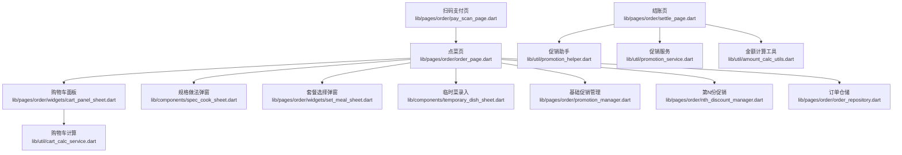

**图表来源**
- [order_page.dart:1-120](file://lib/pages/order/order_page.dart#L1-L120)
- [cart_panel_sheet.dart:1-120](file://lib/pages/order/widgets/cart_panel_sheet.dart#L1-L120)
- [spec_cook_sheet.dart:1-120](file://lib/components/spec_cook_sheet.dart#L1-L120)
- [set_meal_sheet.dart:1-120](file://lib/pages/order/widgets/set_meal_sheet.dart#L1-L120)
- [temporary_dish_sheet.dart:1-120](file://lib/components/temporary_dish_sheet.dart#L1-L120)
- [promotion_manager.dart:1-120](file://lib/pages/order/promotion_manager.dart#L1-L120)
- [nth_discount_manager.dart:1-120](file://lib/pages/order/nth_discount_manager.dart#L1-L120)
- [order_repository.dart:1-120](file://lib/pages/order/order_repository.dart#L1-L120)
- [cart_calc_service.dart:1-120](file://lib/util/cart_calc_service.dart#L1-L120)
- [settle_page.dart:1-120](file://lib/pages/order/settle_page.dart#L1-L120)
- [promotion_helper.dart:1-120](file://lib/util/promotion_helper.dart#L1-L120)
- [promotion_service.dart:1-120](file://lib/util/promotion_service.dart#L1-L120)
- [amount_calc_utils.dart:1-120](file://lib/util/amount_calc_utils.dart#L1-L120)
- [pay_scan_page.dart:1-120](file://lib/pages/order/pay_scan_page.dart#L1-L120)

**章节来源**
- [README.md:1-50](file://README.md#L1-L50)

## 核心组件
- 点菜页：负责分类导航、商品分组展示、滚动联动、权限检查、自动锁台、实时快照、必点菜规则、购物车操作入口。
- 购物车面板：展示购物车条目、数量加减、清空确认、点击菜品名称弹出操作菜单。
- 规格做法弹窗：统一处理“加购模式”和“修改模式”，支持规格默认选中、做法推荐回显、整份/数量加价。
- 套餐选择弹窗：多组N选M/按数量/按项选择、库存与沽清校验、默认选中恢复、价格实时计算。
- 临时菜录入：分类/单位/档口/快捷备注加载，支持保存资料、做法描述、厨打方案选择。
- 促销引擎：基础促销（分类折扣/菜品折扣/特价菜）+ 第N份促销 + 云端买赠/满赠/满减/满折。
- 购物车计算：售价/会员价/原价、赠送/改价/称重、折扣累加、低消计入、整单折扣。
- 金额工具：精确四则运算、抹零策略、低消差、服务费计算。
- 扫码支付页：摄像头扫描付款码、连续扫描、相册识别。
- 结账页：支付方式、促销活动应用、会员信息、低消与服务费、锁台校验、暂结开关。

**章节来源**
- [order_page.dart:1-180](file://lib/pages/order/order_page.dart#L1-L180)
- [cart_panel_sheet.dart:1-180](file://lib/pages/order/widgets/cart_panel_sheet.dart#L1-L180)
- [spec_cook_sheet.dart:1-180](file://lib/components/spec_cook_sheet.dart#L1-L180)
- [set_meal_sheet.dart:1-180](file://lib/pages/order/widgets/set_meal_sheet.dart#L1-L180)
- [temporary_dish_sheet.dart:1-180](file://lib/components/temporary_dish_sheet.dart#L1-L180)
- [promotion_manager.dart:1-180](file://lib/pages/order/promotion_manager.dart#L1-L180)
- [nth_discount_manager.dart:1-180](file://lib/pages/order/nth_discount_manager.dart#L1-L180)
- [cart_calc_service.dart:1-180](file://lib/util/cart_calc_service.dart#L1-L180)
- [amount_calc_utils.dart:1-180](file://lib/util/amount_calc_utils.dart#L1-L180)
- [pay_scan_page.dart:1-180](file://lib/pages/order/pay_scan_page.dart#L1-L180)
- [settle_page.dart:1-180](file://lib/pages/order/settle_page.dart#L1-L180)

## 架构总览
点菜下单模块采用“页面 + 弹窗/抽屉 + 仓储/服务 + 工具类”的分层组织方式：
- 页面层承载用户交互与业务流程编排。
- 弹窗/抽屉封装复杂选择与编辑场景。
- 仓储层提供商品分类、商品、档口等数据源访问。
- 服务层封装促销计算、购物车计算、金额计算。
- 工具层提供通用数值计算、权限、设备能力、本地缓存等。

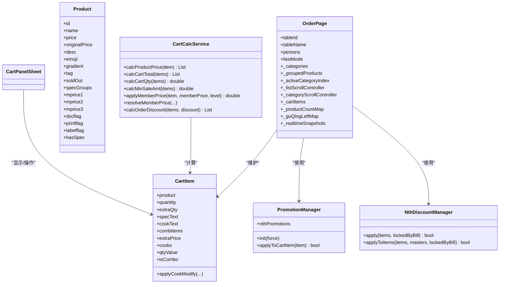

**图表来源**
- [order_page.dart:1-180](file://lib/pages/order/order_page.dart#L1-L180)
- [order_models.dart:1-180](file://lib/pages/order/order_models.dart#L1-L180)
- [cart_calc_service.dart:1-180](file://lib/util/cart_calc_service.dart#L1-L180)
- [promotion_manager.dart:1-180](file://lib/pages/order/promotion_manager.dart#L1-L180)
- [nth_discount_manager.dart:1-180](file://lib/pages/order/nth_discount_manager.dart#L1-L180)
- [cart_panel_sheet.dart:1-120](file://lib/pages/order/widgets/cart_panel_sheet.dart#L1-L120)

## 详细组件分析

### 分类侧边栏导航与滚动联动
点菜页维护分类列表、按分类分组的商品、当前高亮分类下标、右侧列表滚动控制器与左侧分类滚动控制器，并通过节流策略避免双向联动死循环。实现要点：
- 初始化时订阅列表滚动事件，根据各分类区块起始偏移量计算当前高亮分类。
- 点击左侧分类时程序化滚动至对应区块，同时设置程序化滚动标志防止重复触发。
- 为每个分类维护购物车数量角标映射，基于商品ID到分类ID的反查Map提升统计效率。
- 对实时商品状态（停用/改价）进行按分类缓存，2秒内复用以减少抖动。

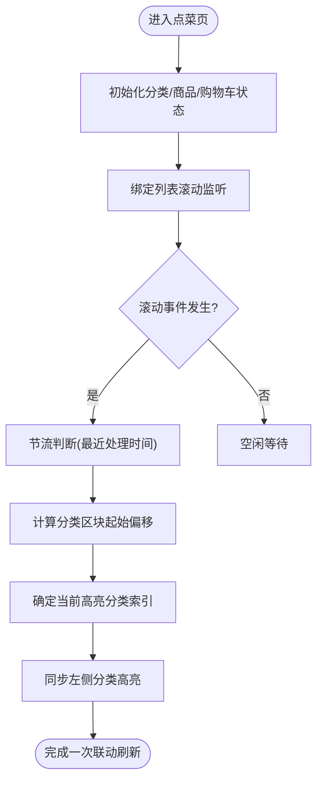

**图表来源**
- [order_page.dart:1-180](file://lib/pages/order/order_page.dart#L1-L180)

**章节来源**
- [order_page.dart:1-260](file://lib/pages/order/order_page.dart#L1-L260)

### 购物车增删改查与状态管理
购物车在点菜页中通过可变列表维护，并配套多个辅助映射表用于O(1)查询与分类角标统计。购物车面板提供数量加减、清空确认、点击菜品名称弹出操作菜单等能力。关键设计：
- 购物车条目包含商品对象、整数数量、小数数量、规格/做法文本、套餐子行、做法加价与做法明细。
- 购物车面板禁止直接操作“第N份促销拆分行”的数量，避免破坏促销拆分语义。
- 购物车合计金额通过遍历求和；实际单价由商品对象与做法修改后的价格共同决定。
- 购物车条目支持“做法修改后同步价格”的方法，剥离旧数量加价再叠加新值。

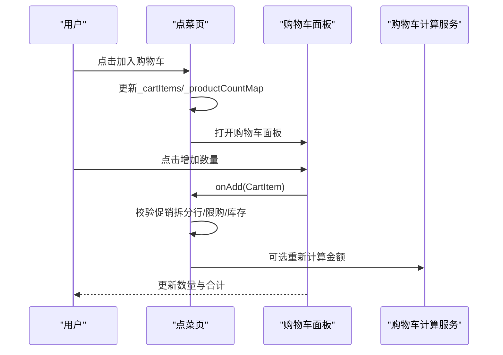

**图表来源**
- [cart_panel_sheet.dart:1-180](file://lib/pages/order/widgets/cart_panel_sheet.dart#L1-L180)
- [order_page.dart:180-420](file://lib/pages/order/order_page.dart#L180-L420)
- [cart_calc_service.dart:1-180](file://lib/util/cart_calc_service.dart#L1-L180)

**章节来源**
- [order_page.dart:180-420](file://lib/pages/order/order_page.dart#L180-L420)
- [cart_panel_sheet.dart:1-260](file://lib/pages/order/widgets/cart_panel_sheet.dart#L1-L260)
- [order_models.dart:180-360](file://lib/pages/order/order_models.dart#L180-L360)
- [cart_calc_service.dart:1-278](file://lib/util/cart_calc_service.dart#L1-L278)

### 规格、做法与套餐选择流程
- 规格做法弹窗统一处理“加购模式”和“修改模式”：
  - 加购模式：默认选中推荐规格与做法，支持数量输入、整份/数量加价、加入购物车或立即下单。
  - 修改模式：仅做法选择，支持私有/全局Tab、回显已选做法、计算整份加价与数量加价合计。
- 套餐选择弹窗：
  - 支持跨组选择记录、默认选中（defflag=1）且校验库存与沽清。
  - 编辑模式恢复已选明细（优先按套餐明细配置ID匹配），计算组内已选数量与总价。
  - 提交时生成套餐子行快照，不拼接进主行规格字段。

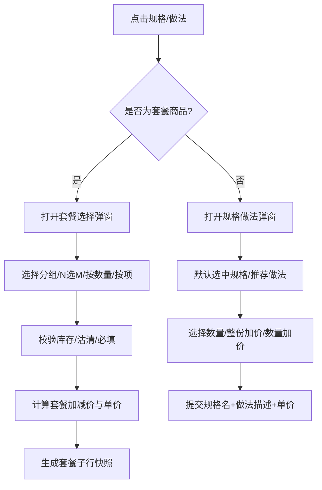

**图表来源**
- [spec_cook_sheet.dart:1-260](file://lib/components/spec_cook_sheet.dart#L1-L260)
- [set_meal_sheet.dart:1-260](file://lib/pages/order/widgets/set_meal_sheet.dart#L1-L260)
- [order_models.dart:1-180](file://lib/pages/order/order_models.dart#L1-L180)

**章节来源**
- [spec_cook_sheet.dart:1-260](file://lib/components/spec_cook_sheet.dart#L1-L260)
- [set_meal_sheet.dart:1-260](file://lib/pages/order/widgets/set_meal_sheet.dart#L1-L260)
- [order_models.dart:1-180](file://lib/pages/order/order_models.dart#L1-L180)

### 临时菜与必点菜机制
- 临时菜录入：
  - 从本地下载表读取分类、单位、快捷备注与档口，若分类为空则回退到点菜页同源接口获取分类。
  - 支持自定义备注与快捷备注拼接、做法描述、可打折标志、保存资料（主设备限制）、厨打方案选择。
  - 返回结果包含分类ID/名称、价格、数量、单位、做法描述、厨打方案与是否去下单页标记。
- 必点菜：
  - 点菜页维护必点菜规则缓存，修改人数后复用检查结果，避免重复计算。

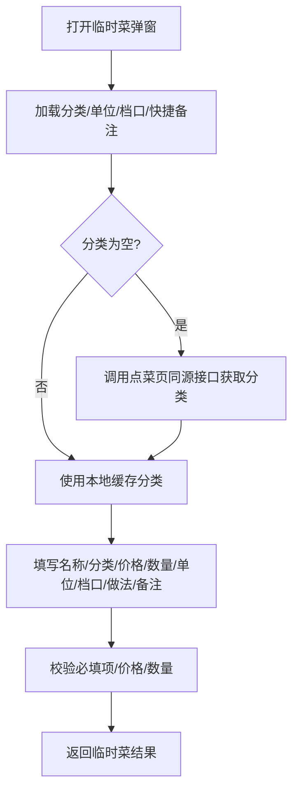

**图表来源**
- [temporary_dish_sheet.dart:1-240](file://lib/components/temporary_dish_sheet.dart#L1-L240)
- [order_page.dart:1-180](file://lib/pages/order/order_page.dart#L1-L180)

**章节来源**
- [temporary_dish_sheet.dart:1-240](file://lib/components/temporary_dish_sheet.dart#L1-L240)
- [order_page.dart:1-180](file://lib/pages/order/order_page.dart#L1-L180)

### 扫码点菜与扫码支付
扫码支付页提供摄像头预览、红色标题栏、蓝色扫描线动画、连续扫描开关、相册图片识别条码功能。扫描成功后将条形码原始值返回上一页。该能力主要用于收款扫码，也可作为扩展的扫码点菜入口（如扫码订单号/桌牌）。

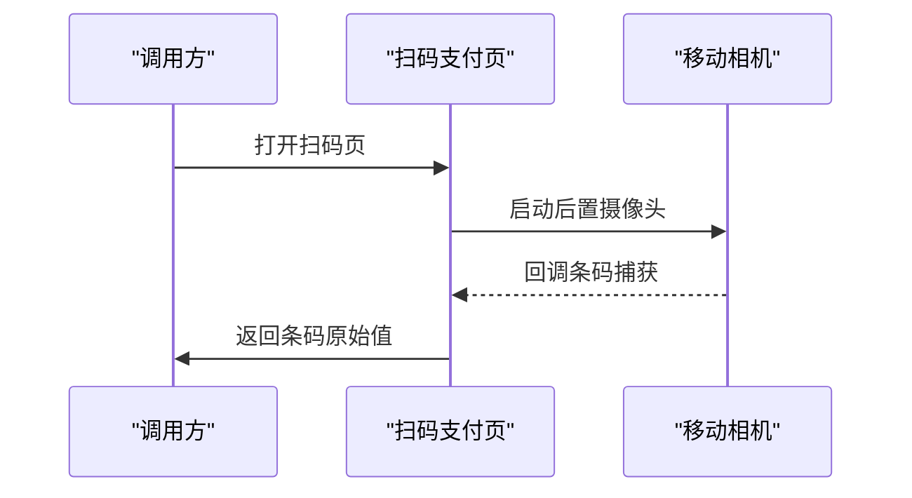

**图表来源**
- [pay_scan_page.dart:1-260](file://lib/pages/order/pay_scan_page.dart#L1-L260)

**章节来源**
- [pay_scan_page.dart:1-260](file://lib/pages/order/pay_scan_page.dart#L1-L260)

### 促销计算引擎
促销引擎分为两个层次：
- 客户端基础促销（分类折扣/菜品折扣/特价菜）与第N份促销：
  - 基础促销从本地促销表加载，按分类层级包含或商品ID匹配，选择最优折扣价。
  - 第N份促销将购物车还原历史拆分行，按同商品/不同商品规则选出享受优惠的份，物理拆行生成促销行（含活动ID与促销单价）。
- 服务端促销（买赠/满赠/满减/满折）：
  - 通过促销助手或服务调用云端接口，传入订单明细、金额、数量、会员ID等参数，返回可用活动或折扣后明细。

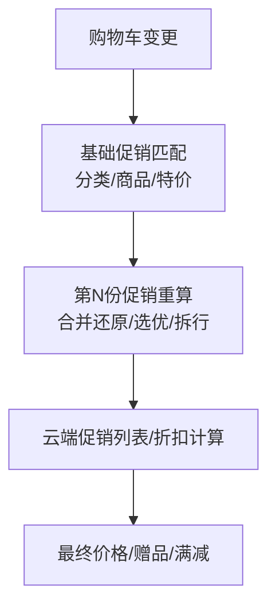

**图表来源**
- [promotion_manager.dart:1-220](file://lib/pages/order/promotion_manager.dart#L1-L220)
- [nth_discount_manager.dart:1-267](file://lib/pages/order/nth_discount_manager.dart#L1-L267)
- [promotion_helper.dart:1-220](file://lib/util/promotion_helper.dart#L1-L220)
- [promotion_service.dart:1-242](file://lib/util/promotion_service.dart#L1-L242)

**章节来源**
- [promotion_manager.dart:1-320](file://lib/pages/order/promotion_manager.dart#L1-L320)
- [nth_discount_manager.dart:1-267](file://lib/pages/order/nth_discount_manager.dart#L1-L267)
- [promotion_helper.dart:1-320](file://lib/util/promotion_helper.dart#L1-L320)
- [promotion_service.dart:1-242](file://lib/util/promotion_service.dart#L1-L242)

### 商品数据结构与库存检查
商品数据模型包含商品标识、名称、售价、会员价、是否可打折、厨打/杯贴标记、是否时价/称重/售罄、起售/增售数量、最低消费计入标志、积分标志、成本价、售卖日期范围等。库存检查贯穿：
- 点菜页实时快照：加购前校验停用/改价，分类级缓存。
- 规格/套餐选择：规格与套餐子项均校验卖清标志与库存数量。
- 购物车计算：赠送/改价/称重商品的有效数量与金额计算。

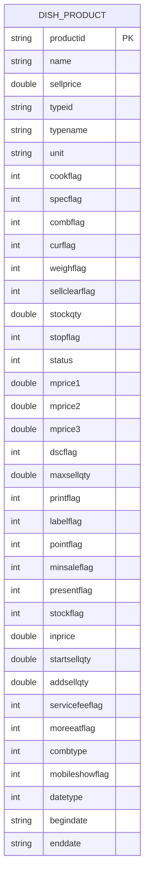

**图表来源**
- [order_repository.dart:120-320](file://lib/pages/order/order_repository.dart#L120-L320)

**章节来源**
- [order_repository.dart:120-320](file://lib/pages/order/order_repository.dart#L120-L320)
- [order_models.dart:1-180](file://lib/pages/order/order_models.dart#L1-L180)

### 价格计算与低消/服务费
购物车计算服务提供单品价格计算、购物车总额、数量统计、低消计入金额、会员价应用、整单折扣计算等方法。金额工具提供精确四则运算、多种抹零策略、低消差与服务费计算。

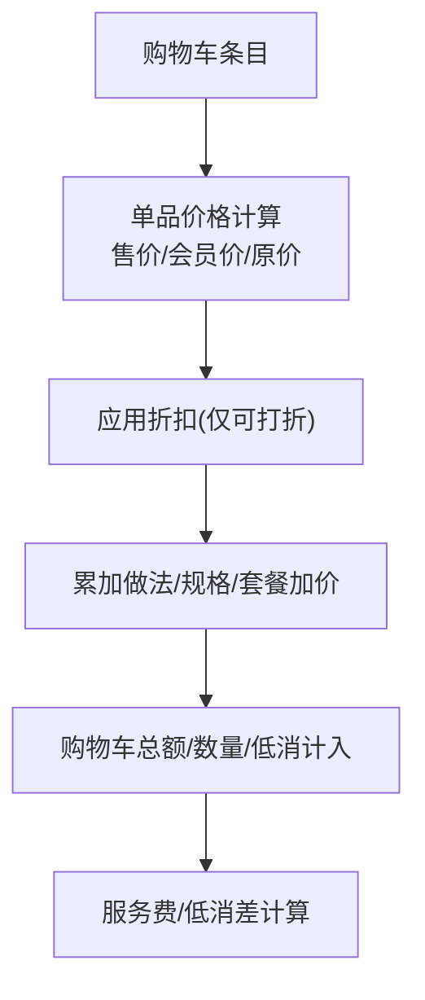

**图表来源**
- [cart_calc_service.dart:1-278](file://lib/util/cart_calc_service.dart#L1-L278)
- [amount_calc_utils.dart:1-240](file://lib/util/amount_calc_utils.dart#L1-L240)

**章节来源**
- [cart_calc_service.dart:1-278](file://lib/util/cart_calc_service.dart#L1-L278)
- [amount_calc_utils.dart:1-240](file://lib/util/amount_calc_utils.dart#L1-L240)

### 与桌台管理与结账收银的数据流转
- 点菜页进入时自动锁台（非快餐模式且未锁定），退出时释放锁；支持并发锁事件监听，其他设备锁台时提示退出。
- 结账页在进入时同样监听锁台事件，并在支付/上传流水前校验桌台仍处于待结算且订单未被清台；必要时弹窗提示并返回桌台页刷新。
- 结账页承接订单详情页的价格信息，支持促销活动选择、会员优惠券、抹零、暂结开关，最终提交支付流水。

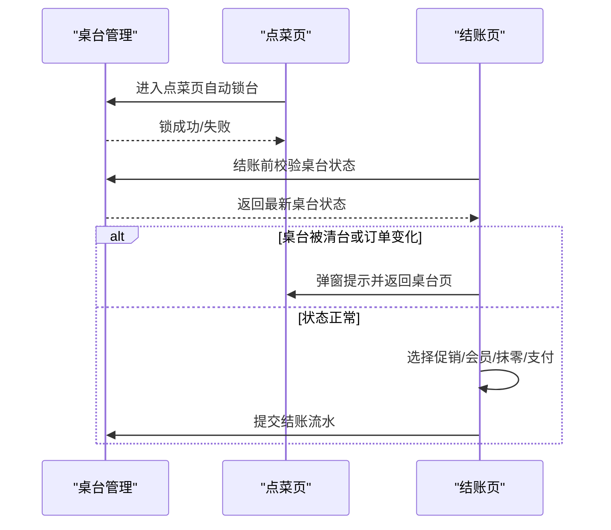

**图表来源**
- [order_page.dart:1-180](file://lib/pages/order/order_page.dart#L1-L180)
- [settle_page.dart:1-200](file://lib/pages/order/settle_page.dart#L1-L200)

**章节来源**
- [order_page.dart:1-180](file://lib/pages/order/order_page.dart#L1-L180)
- [settle_page.dart:1-320](file://lib/pages/order/settle_page.dart#L1-L320)

### 离线数据处理策略
- 促销数据：Web端tabledown内存缓存缺失时按需全量拉取促销表；移动端SQLite不受影响。促销初始化失败时静默降级并记录日志。
- 临时菜数据：分类/单位/档口/快捷备注优先从本地下载表读取，分类为空时回退到点菜页同源接口，保证“点菜页有分类则临时菜弹窗必有分类”。
- 购物车与订单金额：所有金额计算使用精确四则运算工具，避免浮点误差；促销计算在本地与云端协同，云端负责复杂规则匹配。

**章节来源**
- [promotion_manager.dart:120-320](file://lib/pages/order/promotion_manager.dart#L120-L320)
- [temporary_dish_sheet.dart:120-240](file://lib/components/temporary_dish_sheet.dart#L120-L240)
- [amount_calc_utils.dart:1-240](file://lib/util/amount_calc_utils.dart#L1-L240)

## 依赖关系分析
- 点菜页依赖订单仓储获取分类与商品，依赖促销管理器与第N份促销管理器处理价格与促销标签，依赖购物车面板进行购物车操作。
- 购物车面板依赖购物车计算服务进行合计与数量统计。
- 结账页依赖促销助手与服务获取可用活动与折扣明细，依赖金额工具进行抹零与服务费计算，依赖桌台并发保护确保结账安全。

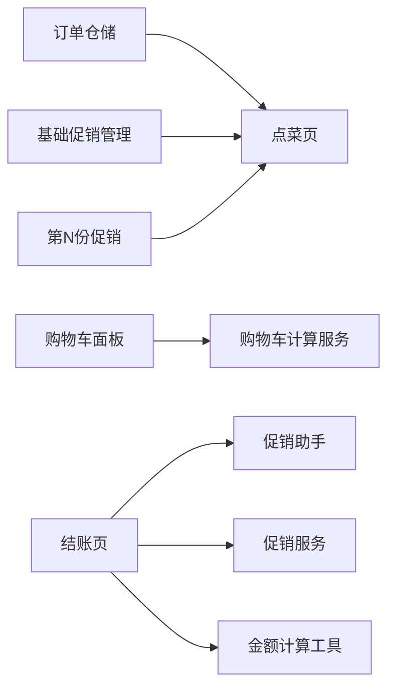

**图表来源**
- [order_repository.dart:1-120](file://lib/pages/order/order_repository.dart#L1-L120)
- [promotion_manager.dart:1-120](file://lib/pages/order/promotion_manager.dart#L1-L120)
- [nth_discount_manager.dart:1-120](file://lib/pages/order/nth_discount_manager.dart#L1-L120)
- [cart_panel_sheet.dart:1-120](file://lib/pages/order/widgets/cart_panel_sheet.dart#L1-L120)
- [cart_calc_service.dart:1-120](file://lib/util/cart_calc_service.dart#L1-L120)
- [settle_page.dart:1-120](file://lib/pages/order/settle_page.dart#L1-L120)
- [promotion_helper.dart:1-120](file://lib/util/promotion_helper.dart#L1-L120)
- [promotion_service.dart:1-120](file://lib/util/promotion_service.dart#L1-L120)
- [amount_calc_utils.dart:1-120](file://lib/util/amount_calc_utils.dart#L1-L120)

**章节来源**
- [order_repository.dart:1-120](file://lib/pages/order/order_repository.dart#L1-L120)
- [promotion_manager.dart:1-120](file://lib/pages/order/promotion_manager.dart#L1-L120)
- [nth_discount_manager.dart:1-120](file://lib/pages/order/nth_discount_manager.dart#L1-L120)
- [cart_panel_sheet.dart:1-120](file://lib/pages/order/widgets/cart_panel_sheet.dart#L1-L120)
- [cart_calc_service.dart:1-120](file://lib/util/cart_calc_service.dart#L1-L120)
- [settle_page.dart:1-120](file://lib/pages/order/settle_page.dart#L1-L120)
- [promotion_helper.dart:1-120](file://lib/util/promotion_helper.dart#L1-L120)
- [promotion_service.dart:1-120](file://lib/util/promotion_service.dart#L1-L120)
- [amount_calc_utils.dart:1-120](file://lib/util/amount_calc_utils.dart#L1-L120)

## 性能与体验优化
- 滚动联动节流：避免频繁重建UI，减少卡顿。
- 商品实时快照：分类级缓存2秒内复用，降低价格抖动与重复请求。
- O(1)商品数量与分类反查：用Map替代线性遍历，提高购物车角标统计与限购校验效率。
- 促销初始化降级：Web端促销表缺失时按需同步，失败时静默降级并记录日志。
- 金额精确计算：统一四舍五入到两位小数，避免浮点误差累积。

[本节为通用指导，不直接分析具体文件]

## 故障排查指南
- 促销不生效：
  - 检查促销初始化是否成功，Web端是否完成促销表同步。
  - 查看促销日志输出，确认是否因规格限制导致无法比对。
- 购物车金额异常：
  - 核对购物车计算服务是否正确使用精确四则运算。
  - 检查赠送/改价/称重商品的有效数量逻辑是否符合预期。
- 规格做法价格不一致：
  - 检查“做法修改后同步价格”方法是否正确剥离旧数量加价并叠加新值。
- 结账页无法继续收款：
  - 检查桌台并发锁事件与桌台状态校验逻辑，确认是否被清台或订单变化。

**章节来源**
- [promotion_manager.dart:180-320](file://lib/pages/order/promotion_manager.dart#L180-L320)
- [cart_calc_service.dart:1-278](file://lib/util/cart_calc_service.dart#L1-L278)
- [order_models.dart:180-360](file://lib/pages/order/order_models.dart#L180-L360)
- [settle_page.dart:120-320](file://lib/pages/order/settle_page.dart#L120-L320)

## 结论
点菜下单模块围绕“分类导航—商品展示—规格/做法/套餐选择—购物车管理—促销计算—结账收银”的主链路构建，兼顾本地离线能力与云端规则计算。通过精确的金额计算、严格的库存与沽清校验、完善的促销引擎与桌台并发保护，保障点餐体验的稳定与准确。后续可扩展扫码点菜入口、更多促销类型与更细粒度的权限控制。

[本节为总结性内容，不直接分析具体文件]

## 附录：业务代码示例路径
- 商品分类自定义：
  - [order_repository.dart:1-120](file://lib/pages/order/order_repository.dart#L1-L120)
- 促销活动配置（基础促销与第N份促销）：
  - [promotion_manager.dart:1-320](file://lib/pages/order/promotion_manager.dart#L1-L320)
  - [nth_discount_manager.dart:1-267](file://lib/pages/order/nth_discount_manager.dart#L1-L267)
- 购物车操作（增删改查与数量编辑）：
  - [cart_panel_sheet.dart:1-260](file://lib/pages/order/widgets/cart_panel_sheet.dart#L1-L260)
  - [order_page.dart:180-420](file://lib/pages/order/order_page.dart#L180-L420)
- 规格做法选择与修改：
  - [spec_cook_sheet.dart:1-260](file://lib/components/spec_cook_sheet.dart#L1-L260)
- 套餐选择与库存校验：
  - [set_meal_sheet.dart:1-260](file://lib/pages/order/widgets/set_meal_sheet.dart#L1-L260)
- 临时菜录入与分类回退：
  - [temporary_dish_sheet.dart:1-240](file://lib/components/temporary_dish_sheet.dart#L1-L240)
- 扫码支付与条码识别：
  - [pay_scan_page.dart:1-260](file://lib/pages/order/pay_scan_page.dart#L1-L260)
- 结账收银与桌台校验：
  - [settle_page.dart:1-320](file://lib/pages/order/settle_page.dart#L1-L320)
- 价格与金额计算：
  - [cart_calc_service.dart:1-278](file://lib/util/cart_calc_service.dart#L1-L278)
  - [amount_calc_utils.dart:1-240](file://lib/util/amount_calc_utils.dart#L1-L240)