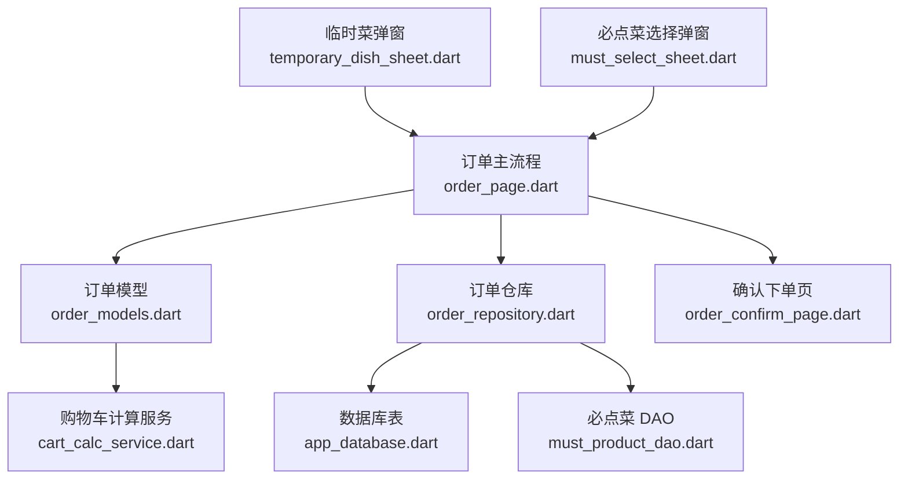
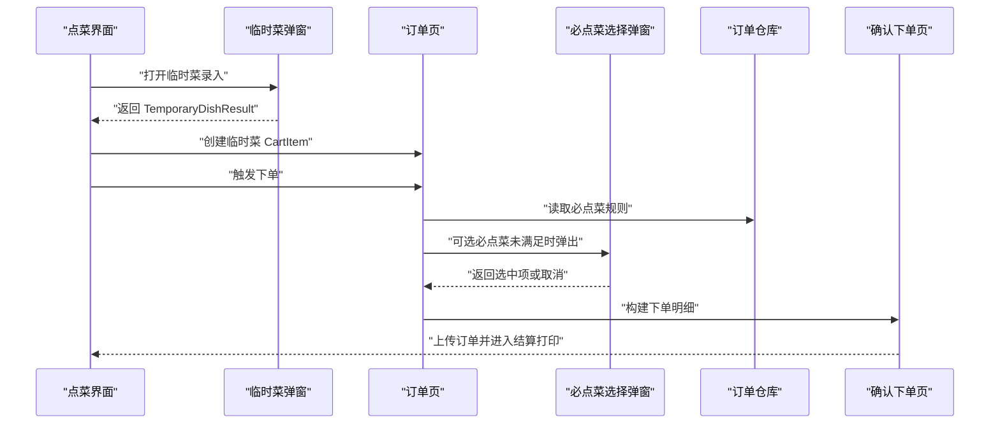
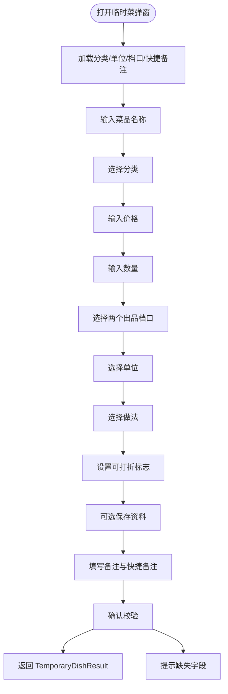
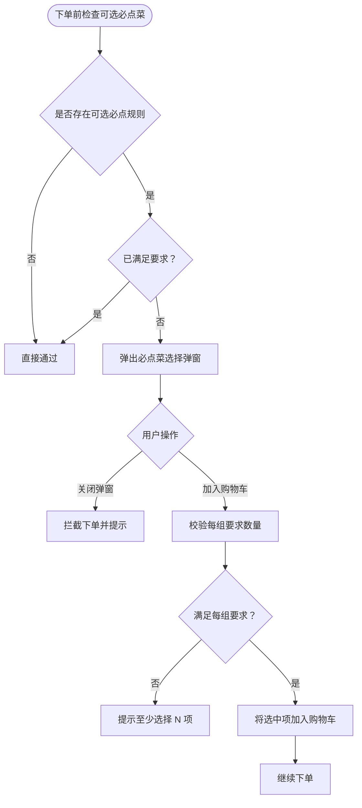
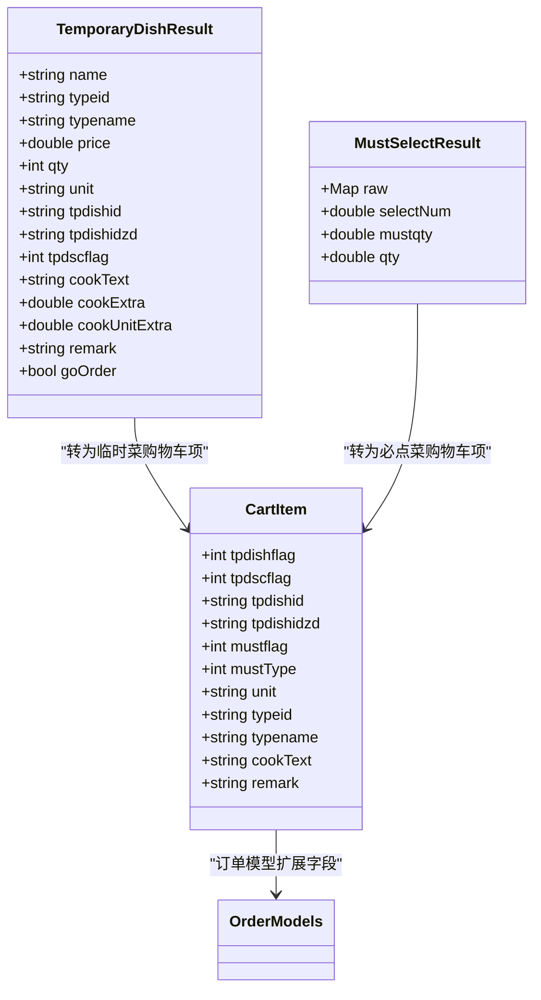

# 特殊菜品处理

<cite>
**本文引用的文件**   
- [临时菜弹窗](file://lib/components/temporary_dish_sheet.dart)
- [订单页](file://lib/pages/order/order_page.dart)
- [必点菜选择弹窗](file://lib/pages/order/widgets/must_select_sheet.dart)
- [订单模型](file://lib/pages/order/order_models.dart)
- [订单仓库](file://lib/pages/order/order_repository.dart)
- [购物车计算服务](file://lib/util/cart_calc_service.dart)
- [确认下单页](file://lib/pages/order/order_confirm_page.dart)
- [订单详情页](file://lib/pages/order/order_detail_page.dart)
- [必点菜实体](file://lib/db/entity/must_product_entity.dart)
- [必点菜 DAO](file://lib/db/dao/must_product_dao.dart)
- [数据库定义](file://lib/db/app_database.dart)
</cite>

## 目录
1. [引言](#引言)
2. [项目结构定位](#项目结构定位)
3. [核心组件总览](#核心组件总览)
4. [架构概览](#架构概览)
5. [临时菜处理流程](#临时菜处理流程)
6. [必点菜处理机制](#必点菜处理机制)
7. [特殊菜品与普通菜品的区别](#特殊菜品与普通菜品的区别)
8. [模板与规则配置参考](#模板与规则配置参考)
9. [订单生成与结算打印中的处理](#订单生成与结算打印中的处理)
10. [依赖关系分析](#依赖关系分析)
11. [性能与健壮性考虑](#性能与健壮性考虑)
12. [故障排查指南](#故障排查指南)
13. [结论](#结论)

## 引言
本文件聚焦“特殊菜品处理”功能，围绕两类业务对象展开：
- **临时菜**：在点菜时直接录入名称、分类、价格、数量、单位、做法、备注等信息，并可选择是否保存到基础资料。
- **必点菜**：按门店规则强制或引导顾客选择，包括固定必点自动加购、可选必点弹窗校验、必点菜验证规则和提示提醒。

文档从界面交互、数据模型、购物车计算、订单上传和打印字段等角度，给出可追溯的实现路径说明，帮助开发者快速定位临时菜与必点菜在各层的处理方式。

## 项目结构定位
特殊菜品相关代码主要分布在以下位置：
- 临时菜录入弹窗：`lib/components/temporary_dish_sheet.dart`
- 订单主流程与临时菜落单：`lib/pages/order/order_page.dart`
- 必点菜选择弹窗：`lib/pages/order/widgets/must_select_sheet.dart`
- 购物车与订单数据模型：`lib/pages/order/order_models.dart`
- 必点菜本地缓存与规则加载：`lib/pages/order/order_repository.dart`
- 购物车金额计算：`lib/util/cart_calc_service.dart`
- 下单明细构建与打印字段：`lib/pages/order/order_confirm_page.dart`
- 订单详情展示与特殊字段：`lib/pages/order/order_detail_page.dart`
- 必点菜持久化表结构与 DAO：`lib/db/app_database.dart`、`lib/db/entity/must_product_entity.dart`、`lib/db/dao/must_product_dao.dart`

**图表来源**
- [临时菜弹窗:16-119](file://lib/components/temporary_dish_sheet.dart#L16-L119)
- [订单页:1920-1975](file://lib/pages/order/order_page.dart#L1920-L1975)
- [必点菜选择弹窗:1-90](file://lib/pages/order/widgets/must_select_sheet.dart#L1-L90)
- [订单仓库:1870-2020](file://lib/pages/order/order_repository.dart#L1870-L2020)
- [数据库定义:670-700](file://lib/db/app_database.dart#L670-L700)

**章节来源**
- [临时菜弹窗:16-119](file://lib/components/temporary_dish_sheet.dart#L16-L119)
- [订单页:1920-1975](file://lib/pages/order/order_page.dart#L1920-L1975)
- [必点菜选择弹窗:1-90](file://lib/pages/order/widgets/must_select_sheet.dart#L1-L90)
- [订单仓库:1870-2020](file://lib/pages/order/order_repository.dart#L1870-L2020)
- [数据库定义:670-700](file://lib/db/app_database.dart#L670-L700)

## 核心组件总览
- **TemporaryDishResult**：临时菜录入结果的数据载体，包含名称、分类、价格、数量、单位、厨打方案、折价标志、做法描述、做法加价、备注、是否去下单页等字段。
- **MustSelectResult**：可选必点菜选中项，包含原始商品数据和用户选择的份数，并提供每份必点数量和最终加入购物车数量的计算属性。
- **CartItem（扩展字段）**：订单模型中的购物车条目增加了临时菜标识、必点菜标识、必点菜类型、单位、分类、厨打方案等字段，使同一购物车能同时承载普通菜品、临时菜和必点菜。
- **OrderRepository.fetchMustDishesFromLocal**：从本地 tabledown 表装配必点菜规则，过滤区域、时段、日期、开关等条件，并组装 mustproductlist。
- **CartCalcService**：统一计算单个商品和购物车总金额、会员价、低消金额等，是临时菜和普通菜共同的价格计算后端。

**章节来源**
- [临时菜弹窗:16-59](file://lib/components/temporary_dish_sheet.dart#L16-L59)
- [必点菜选择弹窗:1-30](file://lib/pages/order/widgets/must_select_sheet.dart#L1-L30)
- [订单模型:470-490](file://lib/pages/order/order_models.dart#L470-L490)
- [订单仓库:1870-2020](file://lib/pages/order/order_repository.dart#L1870-L2020)
- [购物车计算服务:1-120](file://lib/util/cart_calc_service.dart#L1-L120)

## 架构概览
特殊菜品处理贯穿“输入 → 购物车 → 校验 → 下单 → 打印”链路：

**图表来源**
- [临时菜弹窗:85-119](file://lib/components/temporary_dish_sheet.dart#L85-L119)
- [订单页:1920-1975](file://lib/pages/order/order_page.dart#L1920-L1975)
- [订单仓库:1870-2020](file://lib/pages/order/order_repository.dart#L1870-L2020)
- [必点菜选择弹窗:32-90](file://lib/pages/order/widgets/must_select_sheet.dart#L32-L90)
- [确认下单页:1390-1450](file://lib/pages/order/order_confirm_page.dart#L1390-L1450)

## 临时菜处理流程
### 输入界面与字段
临时菜弹窗提供以下输入能力：
- **菜品名称**：默认值为“临时菜”，必填。
- **菜品分类**：从本地分类表或点菜页同源接口回退加载。
- **价格**：必填，格式错误会提示。
- **数量**：支持加减，上限 999.99。
- **出品档口 1 与出品档口 2**：首项固定“不打印”，用于控制厨打方案。
- **单位**：从本地单位表加载。
- **做法**：调用全局做法选择器，支持整份加价和数量加价。
- **可打折标志**：临时菜可折标记，影响折扣计算。
- **保存资料**：非主设备模式下可将当前临时菜写入基础资料。
- **快捷备注与自定义备注**：拼接为最终 remark。

**图表来源**
- [临时菜弹窗:201-270](file://lib/components/temporary_dish_sheet.dart#L201-L270)
- [临时菜弹窗:300-430](file://lib/components/temporary_dish_sheet.dart#L300-L430)
- [临时菜弹窗:430-570](file://lib/components/temporary_dish_sheet.dart#L430-L570)

### 数据校验与提交逻辑
临时菜确认时会执行以下校验：
- 名称不能为空。
- 分类必须选择。
- 价格必须可解析为数字。
- 数量必须大于 0。
- 两个出品档口必须选择。
- 单位必须选择。

若勾选“保存资料”，且非主设备模式，则先获取条码并调用新增临时菜接口；成功后再返回结果。否则直接返回 `TemporaryDishResult`，由调用方决定是否跳转到下单页。

**章节来源**
- [临时菜弹窗:430-570](file://lib/components/temporary_dish_sheet.dart#L430-L570)

### 加入购物车与订单跳转
订单页收到 `TemporaryDishResult` 后：
- 使用固定商品 ID “00000000000000000000” 表示临时菜。
- 单价 = 输入价格 + 做法数量加价。
- 规格文本写入做法描述。
- 整份做法加价走额外价格字段。
- 根据厨打方案判断是否需要厨打和杯贴。
- 设置临时菜标识、可折标志、厨打方案、单位、分类、备注等。
- 若 `goOrder` 为真，则自动跳转确认下单页。

**章节来源**
- [订单页:1920-1975](file://lib/pages/order/order_page.dart#L1920-L1975)

## 必点菜处理机制
### 必点菜数据来源
必点菜规则来自本地 tabledown 的几类表：
- `t_must_master`：必点菜主规则。
- `t_must_tablearea`：规则与区域关联。
- `t_must_product`：规则对应的商品清单。
- `t_bi_product` / `t_bi_product_spec`：商品与规格信息。

仓库方法会按门店、区域、时段、日期、开关等条件过滤，并组装出每组规则的 `mustproductlist`，其中包含商品 ID、名称、售价、规格、套餐标志、必点数量等。

**章节来源**
- [订单仓库:1870-2020](file://lib/pages/order/order_repository.dart#L1870-L2020)
- [数据库定义:670-700](file://lib/db/app_database.dart#L670-L700)

### 固定必点菜自动加购
订单页初始化时：
- 仅对 `mustrule == 0` 的固定必点菜执行自动加购。
- 正餐模式且 `musttype == 0` 表示每人必点，数量 = 每份必点数量 × 人数。
- 其他情况数量为每份必点数量。
- 已加入购物车的数量会被扣除，只补差额。
- 退菜不计入已有数量。

**章节来源**
- [订单页:390-520](file://lib/pages/order/order_page.dart#L390-L520)

### 可选必点菜弹窗与验证规则
可选必点菜在下单前检查：
- 若没有可选必点规则，直接放行。
- 若已满足要求，直接放行。
- 若未满足，弹出必点菜选择弹窗。
- 弹窗中每个方案组显示“每人必点一份”或“每笔订单必点一份”。
- 点击商品增加数量，角标显示已选数量。
- 提交时，每组实际选择总数不得小于要求数量。
- 关闭弹窗视为取消，下单被拦截并提示“可选必点菜未选择”。
- 确认后，将选中项以 `mustflag=1`、`mustType=1` 加入购物车。

**图表来源**
- [订单页:1640-1700](file://lib/pages/order/order_page.dart#L1640-L1700)
- [必点菜选择弹窗:90-180](file://lib/pages/order/widgets/must_select_sheet.dart#L90-L180)

**章节来源**
- [订单页:1640-1700](file://lib/pages/order/order_page.dart#L1640-L1700)
- [必点菜选择弹窗:90-180](file://lib/pages/order/widgets/must_select_sheet.dart#L90-L180)

### 必点菜数据模型与持久化
必点菜商品实体包含：
- 门店 ID、分店 ID。
- 规则 ID、商品 ID、规格 ID。
- 规格名称、必点数量。

DAO 提供按门店和分店查询所有记录的方法，以及按规则 ID 联表查询商品详情的方法。

**章节来源**
- [必点菜实体:1-35](file://lib/db/entity/must_product_entity.dart#L1-L35)
- [必点菜 DAO:1-43](file://lib/db/dao/must_product_dao.dart#L1-L43)

## 特殊菜品与普通菜品的区别
### 数据处理差异
| 维度 | 临时菜 | 普通菜品 | 必点菜 |
|---|---|---|---|
| 商品来源 | 点菜界面手动录入 | 菜单商品列表 | 规则驱动的商品清单 |
| 商品 ID | 固定临时菜 ID | 真实 productid | 规则中的 productid |
| 名称来源 | 用户输入 | 商品名称 | 商品名称或规则映射名称 |
| 价格来源 | 用户输入 + 做法加价 | 商品售价 + 规格/做法加价 | 商品售价或规格售价 |
| 分类与单位 | 用户选择 | 商品自带 | 规则映射商品 |
| 备注 | 自定义备注 + 快捷备注 | 单品备注 | 通常无备注，但可继承商品备注 |
| 标识字段 | `tpdishflag`、`tpdishid`、`tpdishidzd` | 通常为 0 或空 | `mustflag`、`mustType` |

**章节来源**
- [订单模型:470-490](file://lib/pages/order/order_models.dart#L470-L490)
- [订单页:1920-1975](file://lib/pages/order/order_page.dart#L1920-L1975)

### 价格计算差异
- 临时菜单价 = 输入价格 + 做法数量加价；整份做法加价作为额外价格参与总价。
- 普通菜品单价来自商品或规格，叠加规格、做法、套餐加价。
- 必点菜购物车行与普通商品共用购物车计算逻辑，但其数量可能由规则推导。
- 购物车计算服务统一处理赠送、改价、称重、折扣、会员价等，临时菜和普通菜都使用该服务。

**章节来源**
- [订单页:1920-1975](file://lib/pages/order/order_page.dart#L1920-L1975)
- [购物车计算服务:1-120](file://lib/util/cart_calc_service.dart#L1-L120)

### 库存管理差异
- 普通商品具有库存标志、库存数量、沽清标志等字段，仓库模型中体现库存与可售状态。
- 临时菜不依赖商品库存，而是用户直接录入销售信息。
- 必点菜本身不是独立库存实体，其商品仍按普通商品或套餐商品的库存逻辑处理；规则只决定“是否必须点”。

**章节来源**
- [订单仓库:1-250](file://lib/pages/order/order_repository.dart#L1-L250)
- [订单仓库:250-600](file://lib/pages/order/order_repository.dart#L250-L600)

## 模板与规则配置参考
### 临时菜模板配置参考
临时菜并非从模板库中选择，而是每次录入形成一次交易数据。但若开启“保存资料”，系统会尝试将本次临时菜写入基础资料，以便后续复用。关键配置点包括：
- 分类：必须选择有效分类。
- 单位：必须选择有效单位。
- 可打折标志：影响折扣计算。
- 厨打方案：两个出品档口决定厨打输出。
- 做法：支持整份加价和数量加价。
- 保存资料：非主设备模式才允许。

参考实现路径：
- [临时菜弹窗:430-570](file://lib/components/temporary_dish_sheet.dart#L430-L570)
- [订单页:1920-1975](file://lib/pages/order/order_page.dart#L1920-L1975)

### 必点菜规则设置参考
必点菜规则通过本地表装配，关键规则字段包括：
- `mustrule`：0 表示固定必点，1 表示可选必点。
- `musttype`：0 表示每人必点一份，1 表示每笔订单必点一份。
- `mustproductlist`：规则对应商品清单，每项含 `mustqty`。
- 时段、日期、区域、门店开关等控制规则生效范围。

参考实现路径：
- [订单仓库:1870-2020](file://lib/pages/order/order_repository.dart#L1870-L2020)
- [数据库定义:670-700](file://lib/db/app_database.dart#L670-L700)

## 订单生成与结算打印中的处理
### 订单明细构建
确认下单时将购物车项转换为订单明细，临时菜和必点菜都会写入对应标识：
- 临时菜字段：`tpdishflag`、`tpdscflag`、`tpdishid`、`tpdishidzd`。
- 必点菜字段：`mustflag`、`mustType`。
- 其他通用字段：单位、分类、规格、做法、会员价、做法明细等。

这些字段会影响服务端订单明细落库、厨房打印、杯贴打印和报表统计。

**章节来源**
- [确认下单页:1390-1450](file://lib/pages/order/order_confirm_page.dart#L1390-L1450)

### 订单详情展示
订单详情页在展示时也识别临时菜和必点菜字段，用于显示特殊标签、打印方案和必点标识。

**章节来源**
- [订单详情页:2491-2495](file://lib/pages/order/order_detail_page.dart#L2491-L2495)

## 依赖关系分析
临时菜与必点菜的依赖关系如下：

**图表来源**
- [临时菜弹窗:16-59](file://lib/components/temporary_dish_sheet.dart#L16-L59)
- [必点菜选择弹窗:1-30](file://lib/pages/order/widgets/must_select_sheet.dart#L1-L30)
- [订单模型:470-490](file://lib/pages/order/order_models.dart#L470-L490)

**章节来源**
- [临时菜弹窗:16-59](file://lib/components/temporary_dish_sheet.dart#L16-L59)
- [必点菜选择弹窗:1-30](file://lib/pages/order/widgets/must_select_sheet.dart#L1-L30)
- [订单模型:470-490](file://lib/pages/order/order_models.dart#L470-L490)

## 性能与健壮性考虑
- 临时菜弹窗在加载分类、单位、档口、快捷备注时，优先读本地 tabledown 数据；若本地为空，回退到点菜页同源接口，避免 Web 平台 SQLite 不支持导致的异常。
- 必点菜规则从本地多表装配，捕获异常后返回空列表，不会阻塞主流程。
- 购物车计算使用统一的金额计算工具，避免浮点误差扩散。
- 临时菜和必点菜在购物车合并、数量管理、促销拆分等场景中通过标识字段隔离，避免与普通商品混淆。

**章节来源**
- [临时菜弹窗:201-270](file://lib/components/temporary_dish_sheet.dart#L201-L270)
- [订单仓库:1870-2020](file://lib/pages/order/order_repository.dart#L1870-L2020)
- [购物车计算服务:1-120](file://lib/util/cart_calc_service.dart#L1-L120)

## 故障排查指南
### 临时菜无法保存资料
- 检查是否处于主设备模式；主设备模式不允许保存。
- 检查分类是否为空；分类为空会导致保存失败。
- 检查新增临时菜接口返回值；retcode 非 0 时提示后端返回消息。

**章节来源**
- [临时菜弹窗:300-430](file://lib/components/temporary_dish_sheet.dart#L300-L430)
- [临时菜弹窗:430-570](file://lib/components/temporary_dish_sheet.dart#L430-L570)

### 必点菜未生效
- 检查规则是否启用：`stopflag`、`status`、`dateflag`。
- 检查区域匹配：快餐模式 areaid 为空时查全部。
- 检查时段校验：timeperiod1/2/3 链式判定，命中任一时段即有效。
- 检查规则类型：`mustrule == 0` 才会自动加购；`mustrule == 1` 需要用户选择。

**章节来源**
- [订单仓库:1870-2020](file://lib/pages/order/order_repository.dart#L1870-L2020)
- [订单页:390-520](file://lib/pages/order/order_page.dart#L390-L520)

### 下单时被拦截
- 若存在可选必点规则且未满足，弹窗关闭后会提示“可选必点菜未选择”。
- 检查购物车中是否已有可选必点菜且数量足够。
- 检查必点菜选择弹窗是否成功返回选中项。

**章节来源**
- [订单页:1640-1700](file://lib/pages/order/order_page.dart#L1640-L1700)
- [必点菜选择弹窗:90-180](file://lib/pages/order/widgets/must_select_sheet.dart#L90-L180)

### 临时菜未打印厨打
- 检查两个出品档口是否都不是“-1”。
- 检查临时菜加入购物车时是否正确设置 `printflag` 和 `labelflag`。
- 检查下单明细中是否携带 `tpdishid`、`tpdishidzd`。

**章节来源**
- [订单页:1920-1975](file://lib/pages/order/order_page.dart#L1920-L1975)
- [确认下单页:1390-1450](file://lib/pages/order/order_confirm_page.dart#L1390-L1450)

## 结论
特殊菜品处理在本项目中通过明确的标识字段和分层实现完成：
- 临时菜通过弹窗录入，直接转化为购物车项，并在下单时携带厨打、杯贴、分类、单位、备注等字段。
- 必点菜通过本地规则装配，区分固定必点和可选必点，前者自动加购，后者弹窗校验。
- 购物车计算服务统一处理价格、折扣、会员价，临时菜与普通菜共享该能力。
- 订单明细构建阶段将临时菜和必点菜字段写入，确保服务端、打印、报表一致。

开发人员在扩展或修复特殊菜品功能时，应优先关注临时菜弹窗确认逻辑、订单页临时菜转购物车逻辑、必点菜规则装配与校验逻辑，以及确认下单页的字段映射。