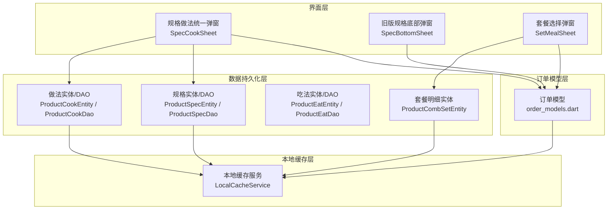
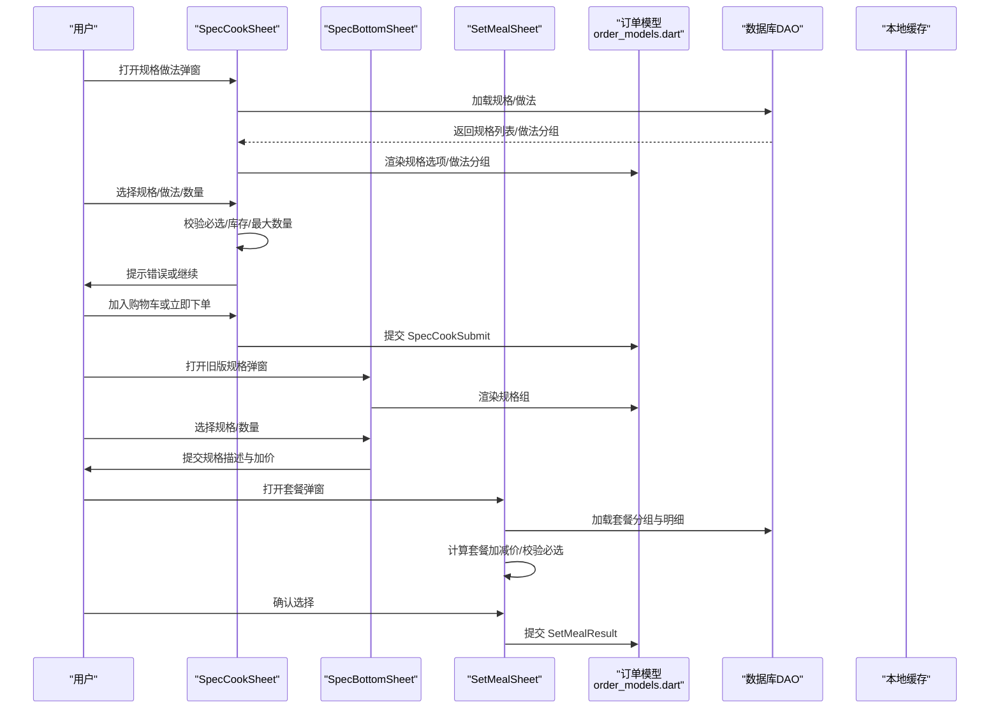
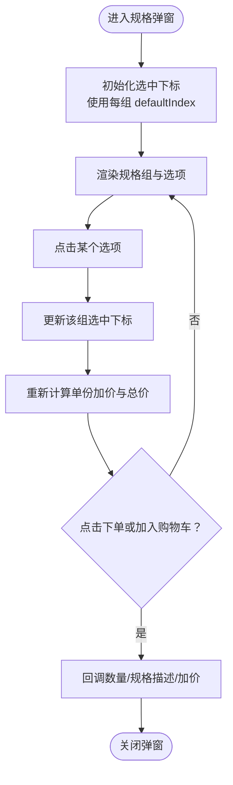
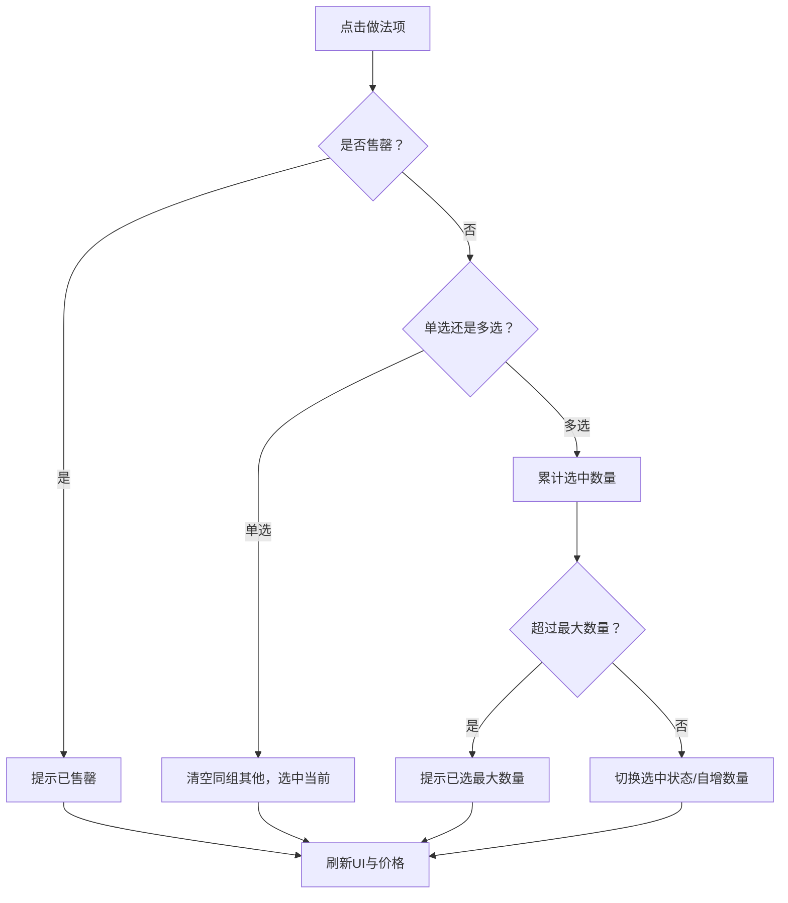
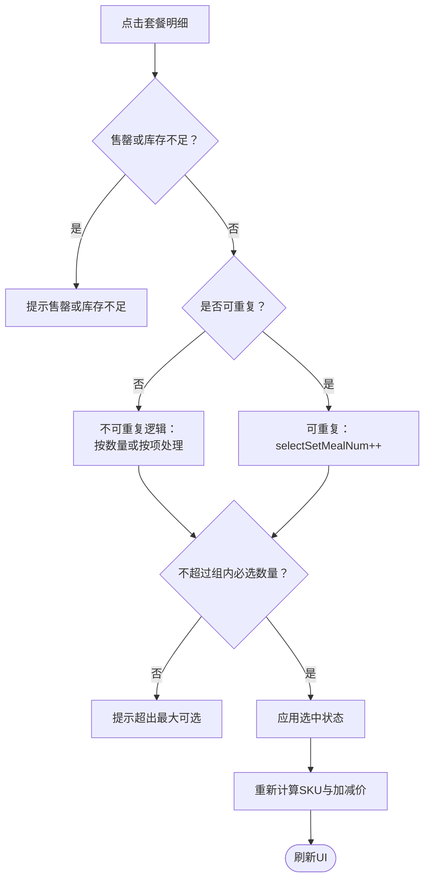
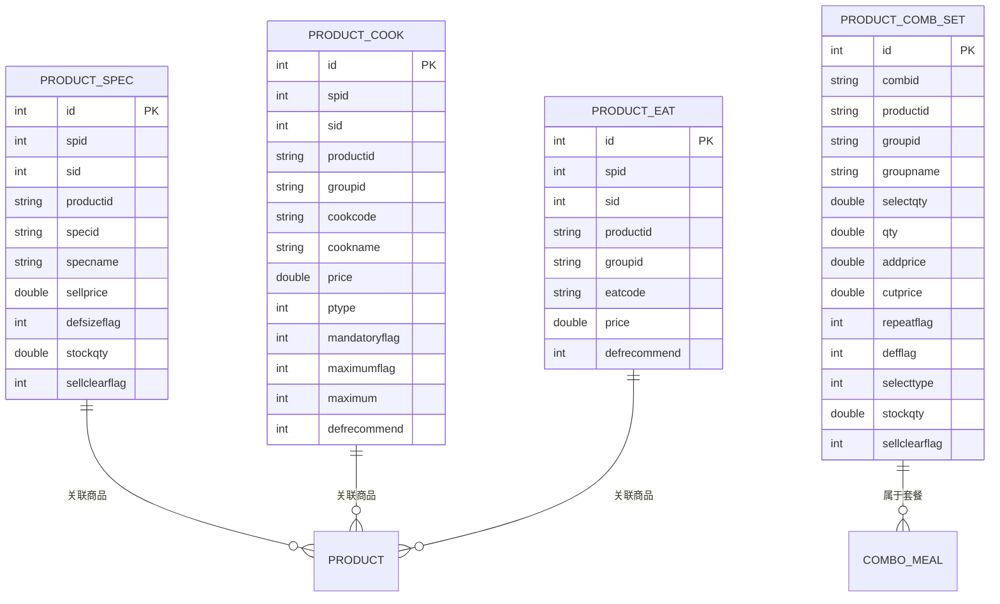
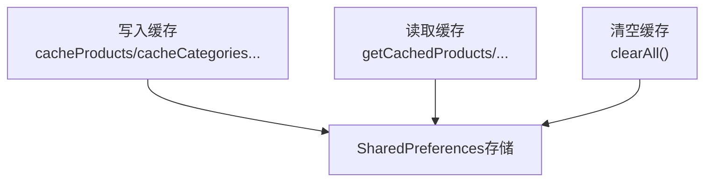

# 规格做法套餐选择

<cite>
**本文引用的文件**   
- [spec_cook_sheet.dart](file://lib/components/spec_cook_sheet.dart)
- [spec_bottom_sheet.dart](file://lib/pages/order/widgets/spec_bottom_sheet.dart)
- [set_meal_sheet.dart](file://lib/pages/order/widgets/set_meal_sheet.dart)
- [order_models.dart](file://lib/pages/order/order_models.dart)
- [product_spec_entity.dart](file://lib/db/entity/product_spec_entity.dart)
- [product_cook_entity.dart](file://lib/db/entity/product_cook_entity.dart)
- [product_comb_set_entity.dart](file://lib/db/entity/product_comb_set_entity.dart)
- [product_eat_entity.dart](file://lib/db/entity/product_eat_entity.dart)
- [product_spec_dao.dart](file://lib/db/dao/product_spec_dao.dart)
- [product_cook_dao.dart](file://lib/db/dao/product_cook_dao.dart)
- [product_eat_dao.dart](file://lib/db/dao/product_eat_dao.dart)
- [local_cache_service.dart](file://lib/util/local_cache_service.dart)
</cite>

## 目录
1. [引言](#引言)
2. [项目结构定位](#项目结构定位)
3. [核心组件总览](#核心组件总览)
4. [架构与数据流总览](#架构与数据流总览)
5. [规格选择交互与校验](#规格选择交互与校验)
6. [做法选择业务逻辑](#做法选择业务逻辑)
7. [套餐组合选择机制](#套餐组合选择机制)
8. [数据模型与主数据关联](#数据模型与主数据关联)
9. [缓存策略与离线能力](#缓存策略与离线能力)
10. [配置示例与扩展指南](#配置示例与扩展指南)
11. [性能与复杂度分析](#性能与复杂度分析)
12. [故障排查](#故障排查)
13. [结论](#结论)

## 引言
本文围绕“规格、做法、套餐”三项选择能力，整理 Flutter 端实现、UI 交互流程、价格计算规则、必填校验、默认选中、做法分类与互斥、套餐分组选择与替换、以及数据库实体与 DAO 的关联关系。文档既适合开发者对照源码定位实现，也适合产品与运营人员理解业务规则。

## 项目结构定位
规格做法套餐选择功能主要分布在以下模块：
- UI 弹窗层：规格做法统一弹窗、旧版规格底部弹窗、套餐弹窗。
- 订单模型层：商品、规格组、做法明细、套餐明细等运行时数据结构。
- 数据持久化层：规格、做法、吃法、套餐明细的 SQLite 实体与 DAO。
- 本地缓存层：商品、分类、桌台、支付方式等轻量缓存。

**图表来源**
- [spec_cook_sheet.dart:1-120](file://lib/components/spec_cook_sheet.dart#L1-L120)
- [spec_bottom_sheet.dart:1-60](file://lib/pages/order/widgets/spec_bottom_sheet.dart#L1-L60)
- [set_meal_sheet.dart:1-80](file://lib/pages/order/widgets/set_meal_sheet.dart#L1-L80)
- [order_models.dart:1-120](file://lib/pages/order/order_models.dart#L1-L120)
- [product_spec_entity.dart:1-83](file://lib/db/entity/product_spec_entity.dart#L1-L83)
- [product_cook_entity.dart:1-83](file://lib/db/entity/product_cook_entity.dart#L1-L83)
- [product_eat_entity.dart:1-48](file://lib/db/entity/product_eat_entity.dart#L1-L48)
- [product_comb_set_entity.dart:1-134](file://lib/db/entity/product_comb_set_entity.dart#L1-L134)
- [product_spec_dao.dart:1-69](file://lib/db/dao/product_spec_dao.dart#L1-L69)
- [product_cook_dao.dart:1-87](file://lib/db/dao/product_cook_dao.dart#L1-L87)
- [product_eat_dao.dart:1-69](file://lib/db/dao/product_eat_dao.dart#L1-L69)
- [local_cache_service.dart:1-137](file://lib/util/local_cache_service.dart#L1-L137)

**章节来源**
- [spec_cook_sheet.dart:1-120](file://lib/components/spec_cook_sheet.dart#L1-L120)
- [spec_bottom_sheet.dart:1-60](file://lib/pages/order/widgets/spec_bottom_sheet.dart#L1-L60)
- [set_meal_sheet.dart:1-80](file://lib/pages/order/widgets/set_meal_sheet.dart#L1-L80)
- [order_models.dart:1-120](file://lib/pages/order/order_models.dart#L1-L120)

## 核心组件总览
| 组件 | 职责 | 关键行为 |
|---|---|---|
| SpecCookSheet | 规格+做法统一弹窗 | 支持加购模式与做法修改模式；单选规格；多选/单选做法；整份加价与数量加价；必填校验；提交规格与做法分开上传 |
| SpecBottomSheet | 旧版规格底部弹窗 | 多规格组单选；按选项加价累计；展示原价/现价；数量加减 |
| SetMealSheet | 套餐选择弹窗 | 分组 N 选 M；按数量/按项选择；可重复/不可重复；库存与售罄校验；实时计算套餐加减价 |
| order_models.dart | 运行时模型 | 定义 Product、SpecGroup、SpecOption、SelectedCook、ComboSelectedItem 等 |
| ProductSpecEntity/ProductSpecDao | 规格数据 | 查询规格详情、按 spid/sid/productid 过滤 |
| ProductCookEntity/ProductCookDao | 做法数据 | 查询私有做法、全局做法、无加价做法 |
| ProductEatEntity/ProductEatDao | 吃法数据 | 查询商品专属吃法、公共吃法 |
| ProductCombSetEntity | 套餐明细 | 记录分组、选择类型、默认、可选数量、加减价、库存与沽清标记 |
| LocalCacheService | 本地缓存 | 商品、分类、桌台、支付方式 JSON 缓存 |

**章节来源**
- [spec_cook_sheet.dart:1-120](file://lib/components/spec_cook_sheet.dart#L1-L120)
- [spec_bottom_sheet.dart:1-60](file://lib/pages/order/widgets/spec_bottom_sheet.dart#L1-L60)
- [set_meal_sheet.dart:1-120](file://lib/pages/order/widgets/set_meal_sheet.dart#L1-L120)
- [order_models.dart:1-200](file://lib/pages/order/order_models.dart#L1-L200)
- [product_spec_entity.dart:1-83](file://lib/db/entity/product_spec_entity.dart#L1-L83)
- [product_cook_entity.dart:1-83](file://lib/db/entity/product_cook_entity.dart#L1-L83)
- [product_eat_entity.dart:1-48](file://lib/db/entity/product_eat_entity.dart#L1-L48)
- [product_comb_set_entity.dart:1-134](file://lib/db/entity/product_comb_set_entity.dart#L1-L134)
- [product_spec_dao.dart:1-69](file://lib/db/dao/product_spec_dao.dart#L1-L69)
- [product_cook_dao.dart:1-87](file://lib/db/dao/product_cook_dao.dart#L1-L87)
- [product_eat_dao.dart:1-69](file://lib/db/dao/product_eat_dao.dart#L1-L69)
- [local_cache_service.dart:1-137](file://lib/util/local_cache_service.dart#L1-L137)

## 架构与数据流总览
从用户点击到最终提交，典型流程如下：

**图表来源**
- [spec_cook_sheet.dart:201-650](file://lib/components/spec_cook_sheet.dart#L201-L650)
- [spec_bottom_sheet.dart:1-497](file://lib/pages/order/widgets/spec_bottom_sheet.dart#L1-L497)
- [set_meal_sheet.dart:200-637](file://lib/pages/order/widgets/set_meal_sheet.dart#L200-L637)
- [order_models.dart:1-200](file://lib/pages/order/order_models.dart#L1-L200)
- [product_spec_dao.dart:1-69](file://lib/db/dao/product_spec_dao.dart#L1-L69)
- [product_cook_dao.dart:1-87](file://lib/db/dao/product_cook_dao.dart#L1-L87)

**章节来源**
- [spec_cook_sheet.dart:201-650](file://lib/components/spec_cook_sheet.dart#L201-L650)
- [spec_bottom_sheet.dart:1-497](file://lib/pages/order/widgets/spec_bottom_sheet.dart#L1-L497)
- [set_meal_sheet.dart:200-637](file://lib/pages/order/widgets/set_meal_sheet.dart#L200-L637)
- [order_models.dart:1-200](file://lib/pages/order/order_models.dart#L1-L200)

## 规格选择交互与校验
### UI 交互流程
- 每个规格组显示一个名称和一组选项 Chip。
- 每组内单选；初始值取每组 `defaultIndex`。
- 每个选项可带“推荐”角标与价格后缀（加价）。
- 底部显示数量控制器，当前单价=基础价+所有选中规格加价合计。
- 提供“下单”和“加入购物车”两个入口。

**图表来源**
- [spec_bottom_sheet.dart:1-200](file://lib/pages/order/widgets/spec_bottom_sheet.dart#L1-L200)
- [spec_bottom_sheet.dart:200-497](file://lib/pages/order/widgets/spec_bottom_sheet.dart#L200-L497)

### 规格价格差异
- 单份实际单价=商品基础价+各规格选项 `extraPrice` 之和。
- 原价=原标价+各规格加价；若未设置原价则回退为基础价。
- 总价=单价×数量；划线价=原价×数量。
- 规格描述由各组选中选项名拼接。

### 必填规格校验
- 旧版 `SpecBottomSheet` 不强制必须选择某一项；若未选择，默认以 `defaultIndex` 作为初始值。
- 新版 `SpecCookSheet` 在加购模式下会优先选择 `defsizeflag=1` 且未售罄的规格；若无默认，则选择第一个未售罄规格。
- 当存在规格且未选中任何规格时，提交会提示“请选择规格”。

**章节来源**
- [spec_bottom_sheet.dart:1-200](file://lib/pages/order/widgets/spec_bottom_sheet.dart#L1-L200)
- [spec_bottom_sheet.dart:200-497](file://lib/pages/order/widgets/spec_bottom_sheet.dart#L200-L497)
- [spec_cook_sheet.dart:201-450](file://lib/components/spec_cook_sheet.dart#L201-L450)

## 做法选择业务逻辑
### 做法分类
- 私有做法：绑定到具体商品的 `cookdata`。
- 全局做法：系统级 `publiccook`，在做法修改模式中可与私有做法切换。
- 做法分组来自 `groupname`，由做法表关联做法分组表得到。

### 默认做法设置
- 加购模式：对每个做法分组，默认选中 `defrecommend=1` 且未售罄的做法，并设置数量为 1。
- 修改模式：优先根据传入的已选做法明细按 `code` 精确匹配回显；失败时回退为按当前规格做法文本包含做法名匹配。

### 做法互斥与数量规则
- `maximum=1` 且不可编辑数量时，同一组内单选。
- `maximum=1` 且可编辑数量时，只能选择一个但数量可累加；达到最大数量时阻止再次增加。
- 多选模式：
  - 可重复做法：点击自增数量。
  - 不可重复做法：超过上限时取消最早选中的一项，再允许新增。
- 已售罄做法不可选，并提示“已售罄”。

### 必填做法校验
- 当商品开启做法标志后，对每个做法组检查 `mandatoryflag` 与 `mandatoryqty`。
- 若选中数量不足，返回错误“做法组X至少选择Y项”，并阻止提交。

### 做法价格计算
- 整份加价：`ptype=1`，不乘商品数量，直接累加。
- 数量加价：`ptype=2`，按单份口径累加；总价再乘以数量。
- 提交结果包含：
  - `specName`：规格名。
  - `cookText`：做法描述文本。
  - `unitPrice`：单份价=规格价+数量加价。
  - `wholeExtra`：整份加价合计。
  - `cooks`：做法明细列表，用于下单上传 `cooklist`。

**图表来源**
- [spec_cook_sheet.dart:450-650](file://lib/components/spec_cook_sheet.dart#L450-L650)

**章节来源**
- [spec_cook_sheet.dart:201-650](file://lib/components/spec_cook_sheet.dart#L201-L650)
- [product_cook_entity.dart:1-83](file://lib/db/entity/product_cook_entity.dart#L1-L83)
- [product_cook_dao.dart:1-87](file://lib/db/dao/product_cook_dao.dart#L1-L87)

## 套餐组合选择机制
### 套餐内容展示
- 顶部展示套餐图片、名称、标签、售价与划线会员价。
- 主体为多个分组，每个分组包含若干套餐明细项。
- 每个明细项显示商品名、单位、可选数量/项数、加减价信息。

### 套餐选择规则
- 每组有 `selectqty`（必选数量或项数）和 `selecttype`（1=按数量，2=按项）。
- 不可重复选择：
  - 按数量：选中即赋 `selectSetMealNum=qty`，取消则归零。
  - 按项：单选行为，取消上一个选中项，再选中当前项。
- 可重复选择：
  - 点击增加 `selectSetMealNum`，减少按钮递减。
  - 受组级 `selectqty` 限制。
- 默认选中：
  - 仅 `defflag=1` 的明细会被尝试默认选中。
  - 默认选中需满足库存条件：`sellclearflag==0` 或 `stockqty>0`。
- 编辑模式恢复：
  - 优先通过 `combsetproductid` 匹配；回退到 `productid+specname`。
  - 数量还原遵循价格计算时的 qty 口径。

### 套餐价格计算
- 遍历选中明细：
  - 减价：累计 `-cutprice × qty`。
  - 加价：累计 `addprice × qty`。
  - 明细行数量与加减价：
    - 按数量：`detailQty = selectSetMealNum`。
    - 按项：`detailQty = selectSetMealNum × item.qty`。
- SKU 展示文本：拼接“商品名x数量”，末尾逗号去除。
- 套餐总价：`(套餐销售价 + 单份加减价总和) × 数量`。

### 套餐替换与校验
- 替换：不可重复按项时，新选中会替换上一次选中项。
- 校验：
  - 每组必选项数量必须等于 `selectqty`，不多不少。
  - 售罄商品跳过默认选中与恢复选中。
  - 库存不足时阻止选择并提示。

**图表来源**
- [set_meal_sheet.dart:200-637](file://lib/pages/order/widgets/set_meal_sheet.dart#L200-L637)

**章节来源**
- [set_meal_sheet.dart:1-200](file://lib/pages/order/widgets/set_meal_sheet.dart#L1-L200)
- [set_meal_sheet.dart:200-637](file://lib/pages/order/widgets/set_meal_sheet.dart#L200-L637)
- [product_comb_set_entity.dart:1-134](file://lib/db/entity/product_comb_set_entity.dart#L1-L134)

## 数据模型与主数据关联
### 规格主数据
- 规格实体字段包括 `spid`、`sid`、`productid`、`specid`、`specname`、`sellprice`、`defsizeflag`、`stockqty`、`sellclearflag` 等。
- DAO 查询规格详情时联表 `t_bi_spec`，并按门店、分店、商品过滤。

### 做法主数据
- 做法实体包含 `cookcode`、`cookname`、`groupid`、`groupname`、`price`、`ptype`、`mandatoryflag`、`mandatoryqty`、`maximumflag`、`maximum`、`defrecommend` 等。
- DAO 查询做法详情时联表 `t_cook_info` 与 `t_cook_group`，支持查询私有做法、无加价做法与全局做法。

### 吃法主数据
- 吃法实体包含 `eatcode`、`groupid`、`price`、`defrecommend` 等。
- DAO 支持查询商品专属吃法、公共吃法，并与吃法分组、吃法信息表联查。

### 套餐明细主数据
- 套餐明细实体包含 `repeatflag`、`defflag`、`selectqty`、`selecttype`、`addprice`、`cutprice`、`stockqty`、`sellclearflag` 等。
- 套餐选择与价格计算依赖这些字段进行分组约束、默认选中与库存校验。

**图表来源**
- [product_spec_entity.dart:1-83](file://lib/db/entity/product_spec_entity.dart#L1-L83)
- [product_cook_entity.dart:1-83](file://lib/db/entity/product_cook_entity.dart#L1-L83)
- [product_eat_entity.dart:1-48](file://lib/db/entity/product_eat_entity.dart#L1-L48)
- [product_comb_set_entity.dart:1-134](file://lib/db/entity/product_comb_set_entity.dart#L1-L134)

**章节来源**
- [product_spec_entity.dart:1-83](file://lib/db/entity/product_spec_entity.dart#L1-L83)
- [product_cook_entity.dart:1-83](file://lib/db/entity/product_cook_entity.dart#L1-L83)
- [product_eat_entity.dart:1-48](file://lib/db/entity/product_eat_entity.dart#L1-L48)
- [product_comb_set_entity.dart:1-134](file://lib/db/entity/product_comb_set_entity.dart#L1-L134)
- [product_spec_dao.dart:1-69](file://lib/db/dao/product_spec_dao.dart#L1-L69)
- [product_cook_dao.dart:1-87](file://lib/db/dao/product_cook_dao.dart#L1-L87)
- [product_eat_dao.dart:1-69](file://lib/db/dao/product_eat_dao.dart#L1-L69)

## 缓存策略与离线能力
- 本地缓存服务基于 `SharedPreferences`，提供商品、分类、桌台、支付方式的 JSON 缓存。
- 商品缓存支持列表缓存、按 ID 读取。
- 退出登录时可清空所有缓存。
- 当前未对规格、做法、吃法、套餐明细做独立缓存实现，相关数据主要通过 DAO 查询 SQLite。

**图表来源**
- [local_cache_service.dart:1-137](file://lib/util/local_cache_service.dart#L1-L137)

**章节来源**
- [local_cache_service.dart:1-137](file://lib/util/local_cache_service.dart#L1-L137)

## 配置示例与扩展指南
本节给出如何配置自定义规格类型、做法模板、套餐配置的实现要点。为避免泄露代码内容，这里以路径与字段说明代替直接代码。

### 自定义规格类型
- 在商品主数据中扩展规格组：
  - 在订单模型中增加新的 `SpecGroup` 类型，并通过 `SpecOption.extraPrice` 表达加价。
  - 参考路径：[order_models.dart:1-200](file://lib/pages/order/order_models.dart#L1-L200)。
- 在持久化层映射新规格字段：
  - 扩展 `ProductSpecEntity` 对应字段，并在 `fromMap`/`toMap` 中处理。
  - 参考路径：[product_spec_entity.dart:1-83](file://lib/db/entity/product_spec_entity.dart#L1-L83)。
- 在 UI 层渲染新规格组：
  - 复用 `SpecBottomSheet` 的规格组渲染逻辑。
  - 参考路径：[spec_bottom_sheet.dart:200-497](file://lib/pages/order/widgets/spec_bottom_sheet.dart#L200-L497)。

### 自定义做法模板
- 做法模板由 `ProductCookEntity` 定义，关键字段：
  - `groupid`/`groupname`：做法分组。
  - `cookcode`/`cookname`：做法编码与名称。
  - `price`/`ptype`：加价金额与加价类型。
  - `mandatoryflag`/`mandatoryqty`：必填标志与数量。
  - `maximumflag`/`maximum`：最大选择数量。
  - `defrecommend`：默认推荐。
- 做法查询接口：
  - 私有做法：`queryCookInfo`。
  - 无加价做法：`queryCookInfoNoPrice`。
  - 全局做法：`queryCookAll`。
- 参考路径：
  - [product_cook_entity.dart:1-83](file://lib/db/entity/product_cook_entity.dart#L1-L83)
  - [product_cook_dao.dart:1-87](file://lib/db/dao/product_cook_dao.dart#L1-L87)
  - [spec_cook_sheet.dart:201-650](file://lib/components/spec_cook_sheet.dart#L201-L650)

### 自定义套餐配置
- 套餐分组与明细由 `ProductCombSetEntity` 定义，关键字段：
  - `selectqty`：必选数量或项数。
  - `selecttype`：1=按数量，2=按项。
  - `repeatflag`：是否可重复选择。
  - `defflag`：是否默认选中。
  - `addprice`/`cutprice`：单项加价或减价。
  - `stockqty`/`sellclearflag`：库存与沽清标记。
- 套餐选择与价格计算逻辑位于 `SetMealSheet`。
- 参考路径：
  - [product_comb_set_entity.dart:1-134](file://lib/db/entity/product_comb_set_entity.dart#L1-L134)
  - [set_meal_sheet.dart:200-637](file://lib/pages/order/widgets/set_meal_sheet.dart#L200-L637)

**章节来源**
- [order_models.dart:1-200](file://lib/pages/order/order_models.dart#L1-L200)
- [product_spec_entity.dart:1-83](file://lib/db/entity/product_spec_entity.dart#L1-L83)
- [product_cook_entity.dart:1-83](file://lib/db/entity/product_cook_entity.dart#L1-L83)
- [product_cook_dao.dart:1-87](file://lib/db/dao/product_cook_dao.dart#L1-L87)
- [product_comb_set_entity.dart:1-134](file://lib/db/entity/product_comb_set_entity.dart#L1-L134)
- [spec_bottom_sheet.dart:200-497](file://lib/pages/order/widgets/spec_bottom_sheet.dart#L200-L497)
- [spec_cook_sheet.dart:201-650](file://lib/components/spec_cook_sheet.dart#L201-L650)
- [set_meal_sheet.dart:200-637](file://lib/pages/order/widgets/set_meal_sheet.dart#L200-L637)

## 性能与复杂度分析
- 规格选择：
  - 渲染复杂度 O(G×O)，G 为规格组数，O 为每组选项数。
  - 选择更新为 O(1) 每组成员。
- 做法选择：
  - 默认初始化与回显复杂度 O(C)，C 为所有做法项总数。
  - 点击选择时按组遍历，最坏 O(Gc×Oc)，Gc 为做法组数，Oc 为每组做法数。
- 套餐选择：
  - 初始化默认选中 O(Gm×Om)，Gm 为套餐分组数，Om 为每组明细数。
  - 点击选择时按组统计已选数量 O(Om)，计算价格 O(S)，S 为选中明细数。
- 总体建议：
  - 大数据量时避免频繁重建整个弹窗树，可使用局部 `setState`。
  - 对于规格、做法、套餐的大列表，可考虑分页或懒加载。
  - 价格计算应尽量复用中间结果，避免重复遍历。

**章节来源**
- [spec_bottom_sheet.dart:200-497](file://lib/pages/order/widgets/spec_bottom_sheet.dart#L200-L497)
- [spec_cook_sheet.dart:201-650](file://lib/components/spec_cook_sheet.dart#L201-L650)
- [set_meal_sheet.dart:200-637](file://lib/pages/order/widgets/set_meal_sheet.dart#L200-L637)

## 故障排查
| 现象 | 可能原因 | 排查建议 |
|---|---|---|
| 规格未选中无法提交 | 未选择任何规格 | 检查 `SpecCookSheet` 提交前的规格校验逻辑 |
| 做法提示“至少选择N项” | 必填做法组未满足 `mandatoryqty` | 检查做法分组 `mandatoryflag` 与 `mandatoryqty` |
| 做法已售罄仍被默认选中 | 默认推荐但未校验售罄 | 检查默认选中逻辑中的 `sellclearflag` |
| 套餐提示“缺少必选项或多选了必选项” | 组内选中数量不等于 `selectqty` | 检查 `validateSelection` 与 `selectSetMealNum` 累计 |
| 套餐默认项未生效 | 默认项售罄或库存不足 | 检查 `defflag` 与 `sellclearflag`/`stockqty` |
| 做法数量无法增加 | 已达最大数量或单选限制 | 检查 `maximumflag`/`maximum` 与 `editqtyflag` |
| 旧版规格弹窗价格异常 | 规格加价未正确累加 | 检查 `_extraPrice` 与各 `SpecOption.extraPrice` |

**章节来源**
- [spec_cook_sheet.dart:201-650](file://lib/components/spec_cook_sheet.dart#L201-L650)
- [set_meal_sheet.dart:200-637](file://lib/pages/order/widgets/set_meal_sheet.dart#L200-L637)
- [spec_bottom_sheet.dart:200-497](file://lib/pages/order/widgets/spec_bottom_sheet.dart#L200-L497)

## 结论
本项目实现了规格、做法、套餐三类选择能力的完整闭环：规格组单选、做法分类与互斥、套餐分组选择与替换。价格计算严格对齐业务语义，必填校验覆盖规格、做法、套餐三大场景。数据模型与 DAO 清晰分离，便于后续扩展自定义规格类型、做法模板与套餐配置。当前本地缓存主要面向商品、分类、桌台与支付方式，未来可为规格、做法、套餐引入更完善的离线缓存策略。