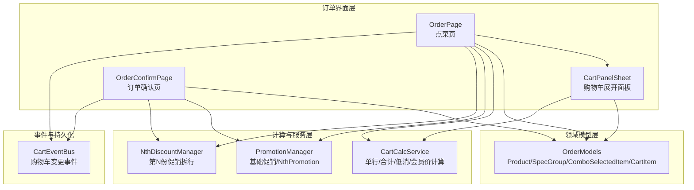
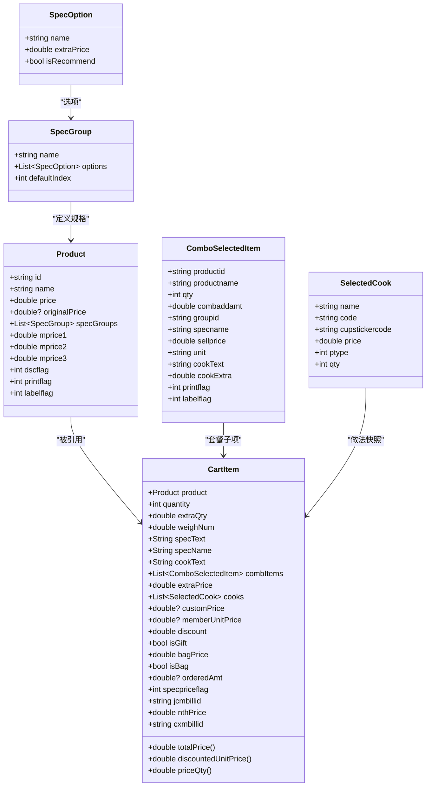
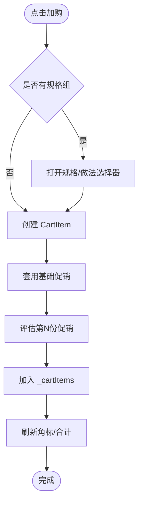
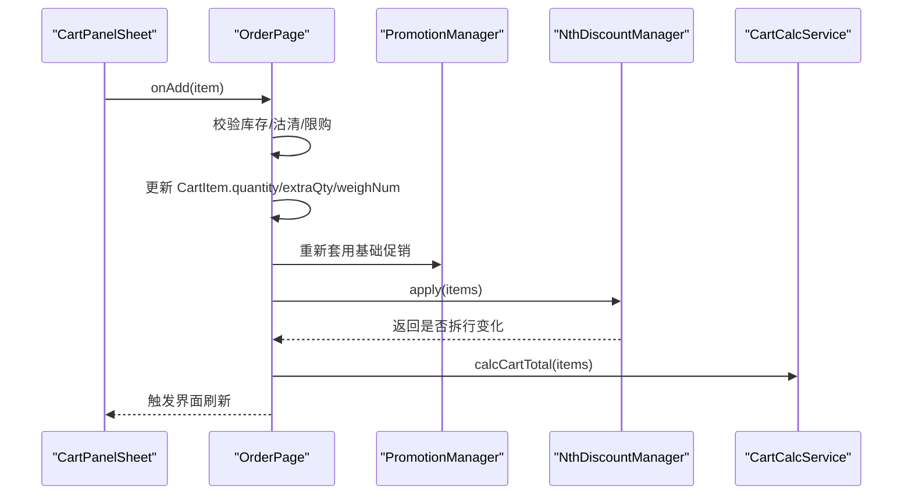
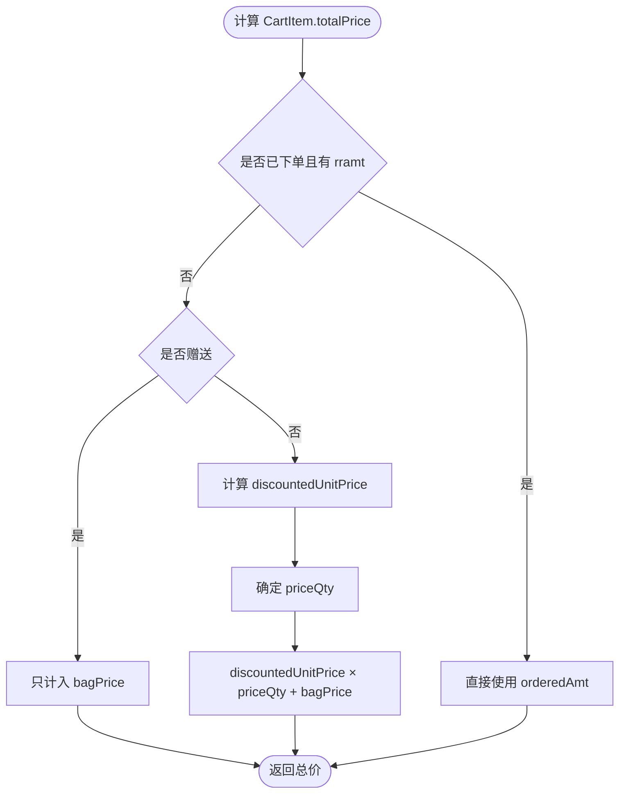
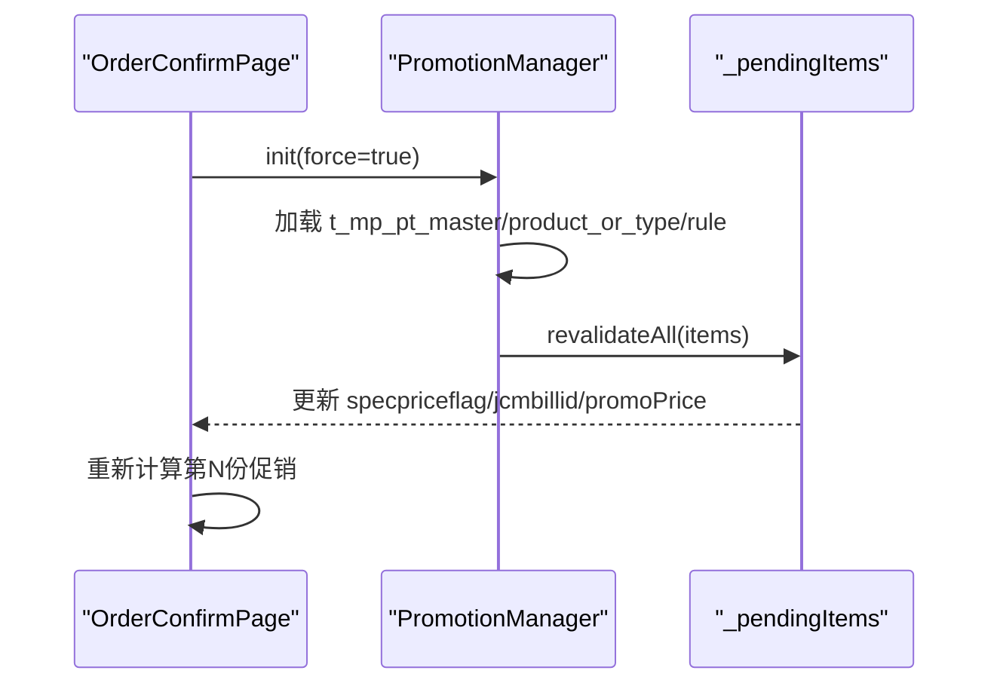
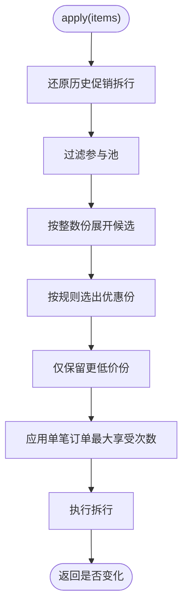
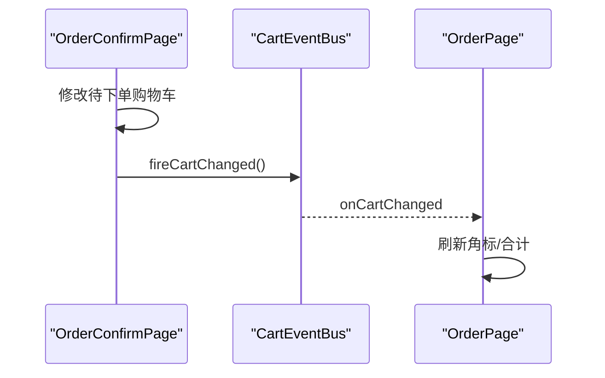
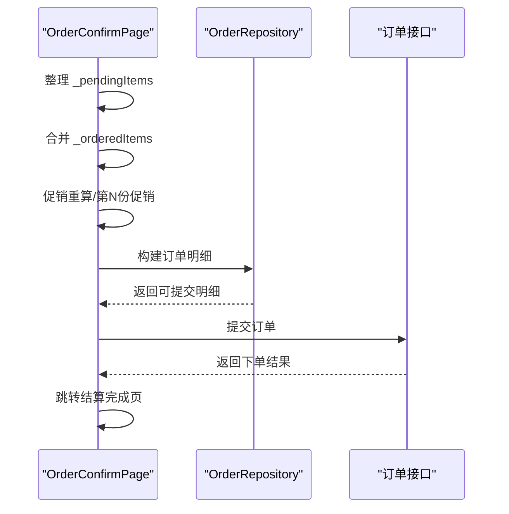

# 购物车管理

<cite>
**本文引用的文件**   
- [order_models.dart](file://lib/pages/order/order_models.dart)
- [cart_calc_service.dart](file://util/cart_calc_service.dart)
- [cart_event_bus.dart](file://net/cart_event_bus.dart)
- [promotion_manager.dart](file://pages/order/promotion_manager.dart)
- [nth_discount_manager.dart](file://pages/order/nth_discount_manager.dart)
- [order_page.dart](file://pages/order/order_page.dart)
- [cart_panel_sheet.dart](file://pages/order/widgets/cart_panel_sheet.dart)
- [order_confirm_page.dart](file://pages/order/order_confirm_page.dart)
</cite>

## 目录
1. [简介](#简介)
2. [项目结构与职责划分](#项目结构与职责划分)
3. [核心数据模型与结构](#核心数据模型与结构)
4. [购物车增删改查业务逻辑](#购物车增删改查业务逻辑)
5. [实时价格计算机制](#实时价格计算机制)
6. [促销与优惠计算](#促销与优惠计算)
7. [跨页面共享与事件通知](#跨页面共享与事件通知)
8. [购物车到订单提交的数据流转](#购物车到订单提交的数据流转)
9. [性能与复杂度分析](#性能与复杂度分析)
10. [常见问题排查](#常见问题排查)
11. [结论](#结论)

## 简介
本文件面向购物车管理功能，聚焦以下目标：
- 解释购物车商品项 `CartItem` 的数据结构设计，包括数量、规格组合、做法、套餐子项、促销标记等。
- 说明购物车的添加、删除、修改数量、清空等操作的完整业务流程。
- 分析小计金额、总金额、会员价、折扣、第N份促销等实时计算机制。
- 说明购物车在点菜页和订单确认页之间的共享方式、本地事件总线通知机制。
- 梳理购物车数据如何参与订单提交、已下单明细合并、促销拆行与上限控制。

## 项目结构与职责划分
购物车相关代码主要分布在订单模块、工具计算层和网络事件层：

图表来源
- [order_page.dart:1-120](file://pages/order/order_page.dart#L1-L120)
- [cart_panel_sheet.dart:1-60](file://pages/order/widgets/cart_panel_sheet.dart#L1-L60)
- [order_confirm_page.dart:1-80](file://pages/order/order_confirm_page.dart#L1-L80)
- [order_models.dart:240-560](file://pages/order/order_models.dart#L240-L560)
- [cart_calc_service.dart:1-120](file://util/cart_calc_service.dart#L1-L120)
- [promotion_manager.dart:1-80](file://pages/order/promotion_manager.dart#L1-L80)
- [nth_discount_manager.dart:1-60](file://pages/order/nth_discount_manager.dart#L1-L60)
- [cart_event_bus.dart:1-22](file://net/cart_event_bus.dart#L1-L22)

章节来源
- [order_page.dart:1-120](file://pages/order/order_page.dart#L1-L120)
- [cart_panel_sheet.dart:1-60](file://pages/order/widgets/cart_panel_sheet.dart#L1-L60)
- [order_confirm_page.dart:1-80](file://pages/order/order_confirm_page.dart#L1-L80)
- [cart_event_bus.dart:1-22](file://net/cart_event_bus.dart#L1-L22)

## 核心数据模型与结构
购物车的核心实体是 `CartItem`，它同时承担“购物车条目”和“订单明细候选”的角色；另一个关键类是 `CartCalcService`，用于统一计算单行金额、合计金额、低消金额、会员价和折扣。

### CartItem 数据结构总览
`CartItem` 不是简单包装商品数量和价格，而是围绕点餐业务建模：

| 字段或属性 | 含义 | 对购物车的影响 |
|---|---|---|
| `product` | 商品对象，包含基础单价、规格组、会员价、是否可打折等 | 决定计价基准、会员价、打印标签、杯贴标志 |
| `quantity` | 整数数量 | 普通商品按份计价的基础 |
| `extraQty` | 小数数量部分 | 支持半份、1.5份等场景 |
| `qtyValue` | `quantity + extraQty` | 普通商品计价数量 |
| `weighNum` | 称重重量 | 称重菜不依赖 `quantity`，改用重量计价 |
| `priceQty` | 实际计价数量 | 称重取重量，普通取 `qtyValue` |
| `specText` | 规格+做法描述文本 | 显示和唯一标识辅助 |
| `specName` | 仅规格名 | 与做法分离，便于上传 spec 字段 |
| `cookText` | 仅做法描述 | 打包、加肉等做法进入 cooklist |
| `cooks` | 已选做法快照 | 支持重复做法、整份加价、数量加价 |
| `combItems` | 套餐子项 | 套餐商品时非空，下单生成套餐子行 |
| `extraPrice` | 规格+做法加价合计（单份） | 影响 `unitPrice` 和总价 |
| `customPrice` | 手工改价 | 覆盖会员价和基础价 |
| `memberUnitPrice` | 会员优惠后单价 | 优先于基础价+加价 |
| `discount` | 单品折扣率 | 小于100时生效 |
| `isGift` | 赠送 | 赠送商品不计入购物车合计金额 |
| `bagPrice` / `isBag` | 打包费与打包状态 | 打包费按行计入，不按数量翻倍 |
| `specpriceflag` | 促销类型标记 | 分类折扣、菜品折扣、特价菜、第N份促销 |
| `jcmbillid` | 基础促销活动ID | 用于促销关联 |
| `nthPrice` | 第N份促销单价 | 拆分行时使用 |
| `isNthPromo` | 是否为第N份促销拆分行 | 限制直接加减操作 |
| `cxmbillid` | 活动ID/赠品归属 | 区分正常行、促销行、赠品行 |
| `orderedAmt` | 已下单服务端行总额 | 已下单行直接使用该值作为总价 |
| `totalPrice` | 当前行总价 | 订单确认页展示、下单汇总使用 |
| `uniqueKey` | `product.id + specText` | 用于去重和匹配 |

图表来源
- [order_models.dart:240-560](file://pages/order/order_models.dart#L240-L560)
- [order_models.dart:1-239](file://pages/order/order_models.dart#L1-L239)

### CartCalcService 的职责
`CartCalcService` 提供纯计算能力，不持有购物车列表：
- `calcProductPrice`：按赠送、改价、称重、普通四类规则计算售价、会员价、原价。
- `calcItemAmt`：便捷获取单行应收金额。
- `calcCartTotal`：遍历购物车累加三列金额。
- `calcCartQty`：统计购物车数量，赠送商品不计入。
- `calcMinSaleAmt`：计算计入低消的金额，排除赠送、数量为0、不计低消、套餐子项等。
- `applyMemberPrice`：应用会员价，赠送和改价商品不覆盖。
- `resolveMemberPrice`：根据会员优惠类型解析会员单价。
- `calcOrderDiscount`：计算整单折扣后的金额与折扣额。

章节来源
- [cart_calc_service.dart:1-120](file://util/cart_calc_service.dart#L1-L120)
- [cart_calc_service.dart:201-278](file://util/cart_calc_service.dart#L201-L278)
- [order_models.dart:240-560](file://pages/order/order_models.dart#L240-L560)

## 购物车增删改查业务逻辑

### 添加商品：规格选择与库存校验
点菜页负责把商品转化为 `CartItem`，并加入内部购物车列表 `_cartItems`。添加流程通常包含：
1. 从分类商品中选取 `DishProduct` 或 `Product`。
2. 如果商品存在规格组，先弹出规格选择器，用户选择规格、口味、做法。
3. 生成 `CartItem`，填充 `product`、`specText`、`specName`、`cookText`、`cooks`、`extraPrice`。
4. 调用促销引擎套用基础促销，可能设置 `specpriceflag`、`jcmbillid`、`promoPrice`。
5. 调用第N份促销管理器评估是否需要拆行。
6. 更新购物车数量索引，触发界面刷新。

图表来源
- [order_page.dart:1-120](file://pages/order/order_page.dart#L1-L120)
- [order_models.dart:240-560](file://pages/order/order_models.dart#L240-L560)
- [promotion_manager.dart:1-80](file://pages/order/promotion_manager.dart#L1-L80)
- [nth_discount_manager.dart:1-60](file://pages/order/nth_discount_manager.dart#L1-L60)

### 修改数量：库存检查与促销保护
购物车面板提供加号、减号和编辑数量入口：
- 点击加号：调用上层 `onAdd`，由点菜页执行增加逻辑。
- 点击减号：调用上层 `onRemove`，由点菜页执行减少逻辑。
- 编辑数量：支持小数数量输入，最终同步回 `CartItem.quantity`、`extraQty` 或称重 `weighNum`。
- 第N份促销拆分行禁止直接加减数量，避免破坏促销拆行语义。
- 数量变化后重新计算促销拆行和购物车合计。

图表来源
- [cart_panel_sheet.dart:90-130](file://pages/order/widgets/cart_panel_sheet.dart#L90-L130)
- [order_page.dart:1-120](file://pages/order/order_page.dart#L1-L120)
- [nth_discount_manager.dart:1-60](file://pages/order/nth_discount_manager.dart#L1-L60)

### 删除商品：确认流程
购物车面板清空购物车前会弹出确认对话框；删除单个商品时，也通过点菜页提供的删除回调处理。典型流程：
1. 用户点击清空或删除。
2. 弹出确认提示。
3. 确认后调用对应回调。
4. 清理购物车列表、数量索引、分类角标。
5. 广播购物车变更事件，其他页面刷新角标和合计。

章节来源
- [cart_panel_sheet.dart:90-130](file://pages/order/widgets/cart_panel_sheet.dart#L90-L130)
- [order_page.dart:1-120](file://pages/order/order_page.dart#L1-L120)

### 查询购物车
购物车查询主要通过两种方式：
- 点菜页内部维护 `_cartItems` 列表，并通过 `_productCountMap`、`_categoryCountMap` 实现 O(1) 数量的分类角标统计。
- 订单确认页接收外部传入的 `cartItems`，复制为 `_pendingItems`，用于待下单明细展示和编辑。

章节来源
- [order_page.dart:1-120](file://pages/order/order_page.dart#L1-L120)
- [order_confirm_page.dart:1-80](file://pages/order/order_confirm_page.dart#L1-L80)

## 实时价格计算机制

### 单行价格计算
`CartItem.totalPrice` 的计算遵循以下优先级：
1. 已下单行：若 `orderedAmt` 非空，直接使用服务端行总额。
2. 赠送行：只计入打包费 `bagPrice`，不计商品主价。
3. 普通行：`discountedUnitPrice * priceQty + bagPrice`。
   - `baseUnitPrice`：第N份促销价 > 特价菜价 > 商品原价。
   - `unitPrice`：手工改价 > 会员价 > 基础价 + 规格加价。
   - `discountedUnitPrice`：应用单品折扣。
   - `priceQty`：称重菜用 `weighNum`，普通菜用 `qtyValue`。
   - `bagPrice`：打包费按行整份计入，不按数量翻倍。

图表来源
- [order_models.dart:515-560](file://pages/order/order_models.dart#L515-L560)

### 购物车合计与低消
`CartCalcService.calcCartTotal` 遍历所有 `CartItem`，调用单行价格计算并累加：
- 总售价：所有行应收金额之和。
- 总会员价：所有行会员价之和。
- 总原价：所有行原价之和。
- 低消金额：排除赠送、数量为0、不计低消、套餐子项后累加。

章节来源
- [cart_calc_service.dart:1-120](file://util/cart_calc_service.dart#L1-L120)
- [cart_calc_service.dart:201-278](file://util/cart_calc_service.dart#L201-L278)

## 促销与优惠计算

### 基础促销
`PromotionManager` 负责加载分类折扣、菜品折扣、特价菜以及第N份促销主数据：
- 登录、跨天、切换会员后需要重新初始化。
- Web 端缓存缺失时按需同步促销表。
- 对 `CartItem` 调用 `applyToCartItem` 设置 `specpriceflag`、`jcmbillid`、`promoPrice`。
- 订单确认页进入时强制刷新促销，保证价格与促销标签一致。

图表来源
- [promotion_manager.dart:1-120](file://pages/order/promotion_manager.dart#L1-L120)
- [order_confirm_page.dart:120-200](file://pages/order/order_confirm_page.dart#L120-L200)

### 第N份促销
`NthDiscountManager.apply` 对购物车整体重算第N份促销，核心步骤：
1. 还原历史促销拆行，恢复为普通行等待本轮重新分配。
2. 过滤参与池：同商品或不同商品、排除赠送、团购核销、称重、改价、已退等。
3. 按整数份展开候选集合。
4. 按规则选出享受优惠的份数。
5. 仅保留优惠后确实更便宜的份。
6. 考虑单笔订单最大享受次数，扣除已下单占用份数。
7. 执行拆行：整行转促销行或拆分出新促销行。

图表来源
- [nth_discount_manager.dart:1-200](file://pages/order/nth_discount_manager.dart#L1-L200)

章节来源
- [promotion_manager.dart:1-200](file://pages/order/promotion_manager.dart#L1-L200)
- [nth_discount_manager.dart:1-200](file://pages/order/nth_discount_manager.dart#L1-L200)
- [order_confirm_page.dart:120-200](file://pages/order/order_confirm_page.dart#L120-L200)

## 跨页面共享与事件通知

### 购物车共享方式
购物车在点菜页和订单确认页之间并非完全独立：
- 点菜页维护 `_cartItems`。
- 订单确认页构造时接收 `cartItems`，并复制为 `_pendingItems`。
- 两页共用同一批 `CartItem` 引用时，任一页面的修改都会反映到另一页，因为 Dart 对象引用传递默认共享可变对象。
- 当订单确认页进行促销重算、第N份促销拆行、备注或服务员信息变更后，通过购物车事件总线通知点菜页刷新角标和合计。

### 购物车事件总线
`CartEventBus` 是一个基于广播流的本地事件通道：
- `onCartChanged`：订阅方监听购物车变更。
- `fireCartChanged`：购物车操作成功后触发。
- 点菜页订阅该流，在删除菜品、整单打包、改服务员等操作后刷新角标与合计金额。

图表来源
- [cart_event_bus.dart:1-22](file://net/cart_event_bus.dart#L1-L22)
- [order_confirm_page.dart:1-80](file://pages/order/order_confirm_page.dart#L1-L80)
- [order_page.dart:1-120](file://pages/order/order_page.dart#L1-L120)

章节来源
- [cart_event_bus.dart:1-22](file://net/cart_event_bus.dart#L1-L22)
- [order_confirm_page.dart:1-80](file://pages/order/order_confirm_page.dart#L1-L80)
- [order_page.dart:1-120](file://pages/order/order_page.dart#L1-L120)

## 购物车到订单提交的数据流转
购物车数据在订单确认页进一步加工后参与订单提交：

1. **待下单明细**：`_pendingItems` 来自购物车，可继续编辑数量、备注、服务员、打包等。
2. **已下单明细**：非快餐模式下加载桌台已有订单，合并为 `_orderedItems`。
3. **促销重算**：进入订单确认页时重新验证基础促销，再重算第N份促销。
4. **订单构建**：将待下单与已下单明细转换为服务端要求的明细结构，其中：
   - 普通行写入商品、规格、做法、数量、价格、促销标记。
   - 套餐子行按 `combItems` 生成。
   - 第N份促销拆行携带 `specpriceflag=7` 和活动ID。
   - 赠送行、退菜行、临时菜、团券菜等按对应标志上传。
5. **下单接口**：调用订单服务提交，成功后跳转结算完成页。

图表来源
- [order_confirm_page.dart:1-200](file://pages/order/order_confirm_page.dart#L1-L200)
- [order_models.dart:240-560](file://pages/order/order_models.dart#L240-L560)

章节来源
- [order_confirm_page.dart:1-200](file://pages/order/order_confirm_page.dart#L1-L200)
- [order_models.dart:240-560](file://pages/order/order_models.dart#L240-L560)

## 性能与复杂度分析
- 购物车数量统计：点菜页使用 `_productCountMap` 和 `_categoryCountMap`，查询时间接近 O(1)，避免每次遍历购物车。
- 购物车合计计算：`CartCalcService.calcCartTotal` 时间复杂度为 O(n)，n 为购物车行数；单次刷新开销较小。
- 第N份促销拆行：参与池过滤、分组、排序和拆行操作的时间复杂度与购物车行数及活动数量相关，通常仍保持在可接受范围；但频繁修改数量时应避免无意义重复重算。
- 促销初始化：Web 端缓存缺失时按需全量同步促销表，应避免在热路径上频繁触发，建议登录、跨天、切换会员时触发。

[本节为通用性能讨论，不直接分析具体代码片段]

## 常见问题排查

### 问题一：购物车合计不更新
可能原因：
- 未调用购物车变更回调或未触发界面重建。
- 第N份促销拆行后未重新计算合计。
- 购物车事件总线未正确订阅或事件流已关闭。

排查要点：
- 检查 `onAdd`、`onRemove`、`onEditQty` 是否真正更新 `_cartItems`。
- 检查 `CartCalcService.calcCartTotal` 是否在界面重建前被消费。
- 检查 `CartEventBus.fireCartChanged()` 是否在执行完购物车变更后调用。

章节来源
- [cart_panel_sheet.dart:90-130](file://pages/order/widgets/cart_panel_sheet.dart#L90-L130)
- [cart_calc_service.dart:1-120](file://util/cart_calc_service.dart#L1-L120)
- [cart_event_bus.dart:1-22](file://net/cart_event_bus.dart#L1-L22)

### 问题二：第N份促销拆行异常
可能原因：
- 历史促销拆行未正确还原。
- 参与池过滤条件不符合预期，例如误排除称重菜或改价行。
- 单笔订单最大享受次数与已下单占用份数计算错误。
- 促销单价计算后未保证比原价便宜，导致不应出现促销标记。

排查要点：
- 检查 `NthDiscountManager.applyToItems` 中的还原与过滤逻辑。
- 检查 `lockedByBill` 是否正确累计已下单促销行。
- 检查 `CartItem.markNthPromo`、`resetNthPromo`、`copyAsNthPromo` 的状态字段是否完整。

章节来源
- [nth_discount_manager.dart:1-200](file://pages/order/nth_discount_manager.dart#L1-L200)
- [order_models.dart:383-450](file://pages/order/order_models.dart#L383-L450)

### 问题三：促销标签与价格不一致
可能原因：
- 点菜时促销数据尚未就绪。
- 订单确认页未强制刷新促销。
- 商品分类信息缺失导致基础促销无法命中。

排查要点：
- 检查 `PromotionManager.init(force=true)` 是否在订单确认页进入时调用。
- 检查 `revalidateAll` 是否正确设置 `specpriceflag`、`jcmbillid`、`promoPrice`。
- 检查本地商品库回填分类ID的逻辑。

章节来源
- [promotion_manager.dart:1-200](file://pages/order/promotion_manager.dart#L1-L200)
- [order_confirm_page.dart:120-200](file://pages/order/order_confirm_page.dart#L120-L200)

### 问题四：赠送商品参与合计或低消
可能原因：
- 赠送判断条件不完整。
- 低消计算未排除赠送、数量为0、不计低消标志。

排查要点：
- 检查 `CartItem.isGift`、`presentflag`、`effectiveQty`。
- 检查 `CartCalcService.calcMinSaleAmt` 排除逻辑。

章节来源
- [cart_calc_service.dart:201-278](file://util/cart_calc_service.dart#L201-L278)
- [order_models.dart:240-560](file://pages/order/order_models.dart#L240-L560)

## 结论
购物车管理在该项目中以 `CartItem` 为核心数据模型，结合 `CartCalcService` 的统一计算能力、`PromotionManager` 的基础促销引擎和 `NthDiscountManager` 的第N份促销拆行机制，实现了完整的点餐购物车生命周期：
- 数据结构层面，`CartItem` 同时承载商品、规格、做法、套餐、促销、打包、赠送、称重、会员价、改价、折扣等多维信息。
- 业务流程层面，点菜页负责加购、规格选择、数量修改、删除确认，订单确认页负责促销重算、已下单合并、订单构建与提交。
- 实时计算层面，单行价格和购物车合计在每次变更后重新计算，低消金额、会员价、折扣、促销标签均保持一致口径。
- 跨页面共享层面，通过对象引用共享购物车数据，并通过 `CartEventBus` 实现轻量级事件通知。
- 订单流转层面，购物车明细逐步演化为订单明细，兼容普通行、套餐子行、促销拆行、赠送行、退菜行等多种场景。

在实际使用中，应重点关注：
- 修改数量后必须重新套用促销并重算第N份促销。
- 订单确认页进入时必须强制刷新促销数据。
- 购物车变更后及时触发界面刷新和事件通知。
- 对第N份促销拆行保持不可直接加减的保护策略。
- 确保赠送、称重、改价、打包等边界条件在价格计算和低消计算中被正确处理。