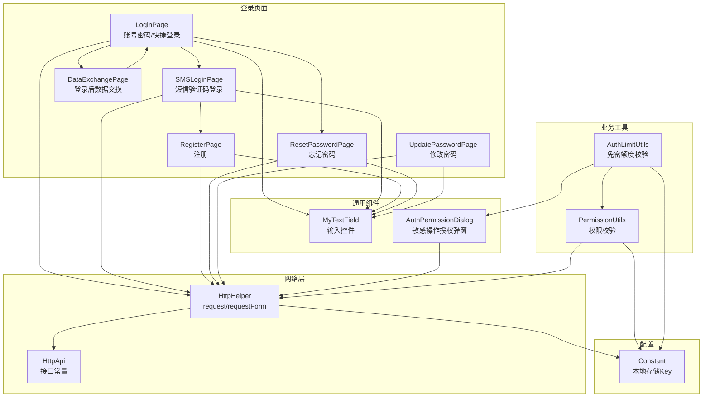
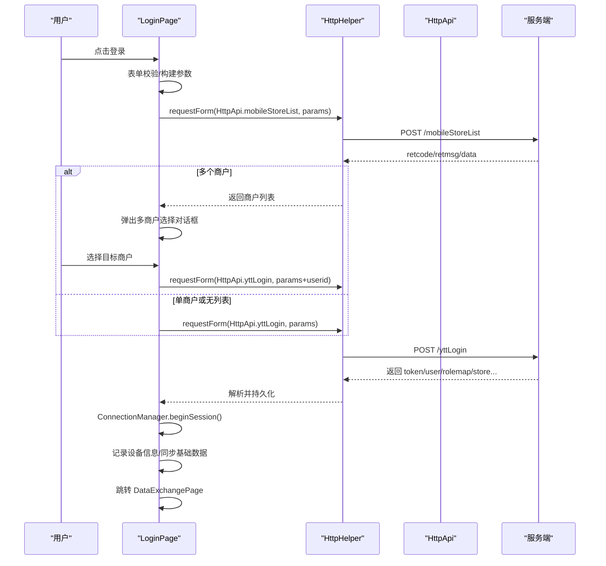
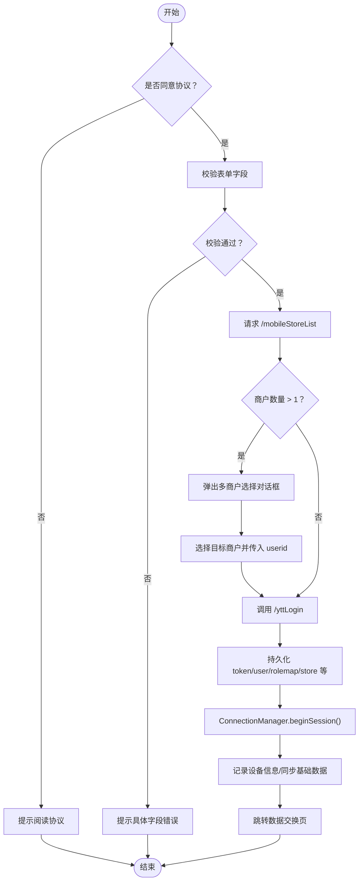
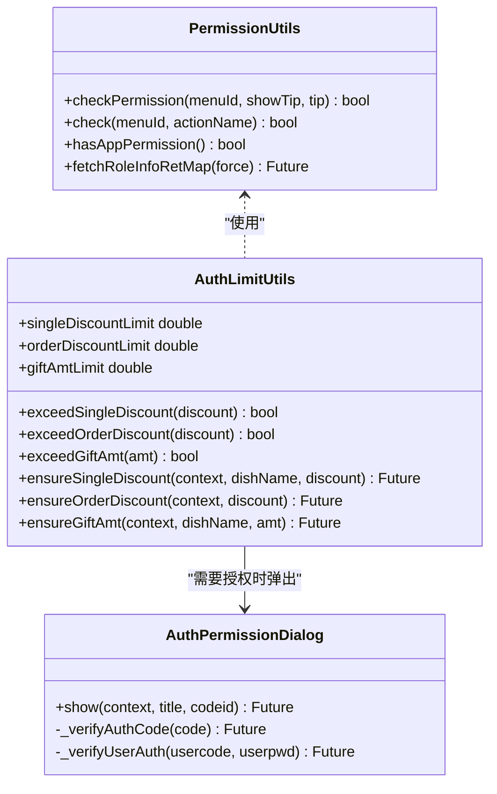
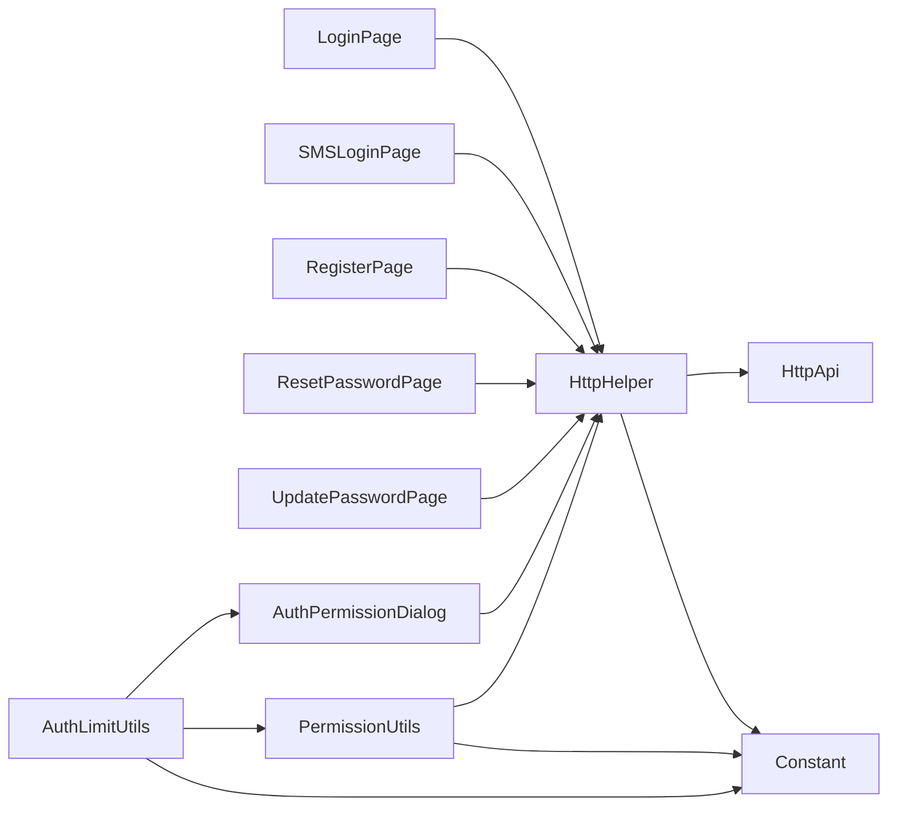

# 用户认证模块

<cite>
**本文引用的文件**   
- [login_page.dart](file://lib/pages/login/page/login_page.dart)
- [register_page.dart](file://lib/pages/login/page/register_page.dart)
- [sms_login_page.dart](file://lib/pages/login/page/sms_login_page.dart)
- [reset_password_page.dart](file://lib/pages/login/page/reset_password_page.dart)
- [update_password_page.dart](file://lib/pages/login/page/update_password_page.dart)
- [data_exchange_page.dart](file://lib/pages/login/page/data_exchange_page.dart)
- [my_text_field.dart](file://lib/pages/login/widgets/my_text_field.dart)
- [login_router.dart](file://lib/pages/login/login_router.dart)
- [auth_permission_dialog.dart](file://lib/components/auth_permission_dialog.dart)
- [permission_utils.dart](file://lib/util/permission_utils.dart)
- [auth_limit_utils.dart](file://lib/util/auth_limit_utils.dart)
- [http_api.dart](file://lib/net/http_api.dart)
- [http_helper.dart](file://lib/net/http_helper.dart)
- [constant.dart](file://lib/res/constant.dart)
</cite>

## 目录
1. [引言](#引言)
2. [项目结构](#项目结构)
3. [核心组件](#核心组件)
4. [架构总览](#架构总览)
5. [详细组件分析](#详细组件分析)
6. [依赖关系分析](#依赖关系分析)
7. [性能与体验优化建议](#性能与体验优化建议)
8. [常见问题排查指南](#常见问题排查指南)
9. [结论](#结论)
10. [附录：扩展新认证方式示例](#附录扩展新认证方式示例)

## 引言
本文围绕聚客美滋滋应用的用户认证模块，系统化梳理账号密码登录、短信验证码登录、注册、密码重置、密码修改等流程，并解释多商户选择机制、权限控制逻辑与会话管理实现。文档同时覆盖登录页面的交互设计、表单校验、错误处理策略、后端接口调用路径，以及不同登录方式的适用场景与安全考虑，并提供扩展新认证方式的具体代码级指引和常见问题排查方案。

## 项目结构
认证相关的前端页面集中在 `lib/pages/login` 下，采用“按功能页面 + 共享输入控件”的组织方式：
- 页面层：登录、快捷短信登录、注册、忘记密码、修改密码、登录后数据交换页。
- 公共输入控件：统一手机号/验证码/密码输入框，包含倒计时、明文切换、清空等能力。
- 路由层：登录相关路由集中定义。
- 权限与额度：权限校验工具、免密额度校验、授权弹窗。
- 网络层：API 常量、HTTP 请求封装、会话过期与强制下线处理。
- 配置常量：登录态、记住密码、权限、连接模式等本地存储 Key。

**图示来源** 
- [login_page.dart:1-1023](file://lib/pages/login/page/login_page.dart#L1-L1023)
- [sms_login_page.dart:1-141](file://lib/pages/login/page/sms_login_page.dart#L1-L141)
- [register_page.dart:1-135](file://lib/pages/login/page/register_page.dart#L1-L135)
- [reset_password_page.dart:1-123](file://lib/pages/login/page/reset_password_page.dart#L1-L123)
- [update_password_page.dart:1-108](file://lib/pages/login/page/update_password_page.dart#L1-L108)
- [data_exchange_page.dart:1-281](file://lib/pages/login/page/data_exchange_page.dart#L1-L281)
- [my_text_field.dart:1-220](file://lib/pages/login/widgets/my_text_field.dart#L1-L220)
- [auth_permission_dialog.dart:1-275](file://lib/components/auth_permission_dialog.dart#L1-L275)
- [permission_utils.dart:1-266](file://lib/util/permission_utils.dart#L1-L266)
- [auth_limit_utils.dart:1-98](file://lib/util/auth_limit_utils.dart#L1-L98)
- [http_api.dart:1-200](file://lib/net/http_api.dart#L1-L200)
- [http_helper.dart:1-400](file://lib/net/http_helper.dart#L1-L400)
- [constant.dart:1-93](file://lib/res/constant.dart#L1-L93)

**章节来源**
- [login_page.dart:1-1023](file://lib/pages/login/page/login_page.dart#L1-L1023)
- [login_router.dart:1-40](file://lib/pages/login/login_router.dart#L1-L40)

## 核心组件
- 登录页面（LoginPage）：支持两种登录方式（快捷手机号+密码、普通商户号+员工工号+密码），含记住密码、协议勾选、多商户选择、登录成功后的会话建立与数据交换跳转。
- 短信验证码登录页（SMSLoginPage）：提供手机号+验证码输入，当前为占位实现，预留发送验证码与登录入口。
- 注册页（RegisterPage）：手机号+验证码+密码的占位实现，包含基础长度校验。
- 忘记密码页（ResetPasswordPage）：手机号+验证码+新密码，占位实现。
- 修改密码页（UpdatePasswordPage）：旧密码+新密码，成功后返回上一页。
- 输入控件（MyTextField）：统一手机号、验证码、密码输入，支持倒计时、明文切换、清空、输入法限制。
- 权限工具（PermissionUtils）：基于 rolemap 的权限判断、APP 端权限判断、权限缓存刷新。
- 免密额度校验（AuthLimitUtils）：根据角色折扣上限判断是否需要经理授权。
- 授权弹窗（AuthPermissionDialog）：支持授权码或用户名+密码二次授权。
- 网络层（HttpApi/HttpHelper）：统一 POST 请求、签名、token/sid/spid/userid 注入、retcode 拦截、登录失效与强制下线处理。
- 配置常量（Constant）：登录态、权限、记住密码、连接模式等 Key。

**章节来源**
- [login_page.dart:1-1023](file://lib/pages/login/page/login_page.dart#L1-L1023)
- [my_text_field.dart:1-220](file://lib/pages/login/widgets/my_text_field.dart#L1-L220)
- [permission_utils.dart:1-266](file://lib/util/permission_utils.dart#L1-L266)
- [auth_limit_utils.dart:1-98](file://lib/util/auth_limit_utils.dart#L1-L98)
- [auth_permission_dialog.dart:1-275](file://lib/components/auth_permission_dialog.dart#L1-L275)
- [http_api.dart:1-200](file://lib/net/http_api.dart#L1-L200)
- [http_helper.dart:1-400](file://lib/net/http_helper.dart#L1-L400)
- [constant.dart:1-93](file://lib/res/constant.dart#L1-L93)

## 架构总览
认证模块整体遵循“页面 UI → 页面逻辑 → 网络层 → 服务端接口”的分层模型；权限与额度在业务操作中二次校验；登录成功后进入数据交换流程，完成基础表下载后再进入主界面。

**图示来源** 
- [login_page.dart:1-500](file://lib/pages/login/page/login_page.dart#L1-L500)
- [http_helper.dart:1-200](file://lib/net/http_helper.dart#L1-L200)
- [http_api.dart:1-120](file://lib/net/http_api.dart#L1-L120)

## 详细组件分析

### 登录页面（LoginPage）
- 交互设计
  - 顶部品牌展示与版本号；白色卡片区域承载登录表单。
  - Tab 切换“快捷登录”和“普通登录”。
  - 快捷登录：手机号 + 密码。
  - 普通登录：商户号 + 员工工号 + 密码。
  - “记住密码”开关：可记住账号及密码（由用户决定）。
  - 协议勾选：未勾选时阻止登录。
  - 登录按钮带加载状态。
- 表单验证规则
  - 快捷登录：手机号必须 11 位数字，密码非空。
  - 普通登录：商户号、员工工号、密码均非空。
  - 输入控件层对手机号/数字进行字符过滤，密码禁止中文。
- 多商户选择机制
  - 第一步调用 `/mobileStoreList` 获取商户列表。
  - 列表数量 > 1：弹出选择对话框，选择后携带 userid 再次调用登录接口。
  - 列表数量 = 1：直接保存 sid/spid 并登录。
  - 列表为空：不传 userid 登录（与 smdcapp 行为一致）。
- 会话管理与数据持久化
  - 登录成功后写入 token、accessToken、user、rolemap、store、sysStoreAccount、verservicelist、pstore、mach 等字段到本地。
  - 初始化连接会话，检查主设备可达性（仅直连 PC 模式下）。
  - 记录设备日志，异步同步基础数据，最后跳转到数据交换页。
- 错误处理
  - 登录过程 try/catch 包裹，失败时恢复加载状态。
  - 网络异常通过 HttpHelper 统一提示，避免暴露底层英文错误。

**图示来源** 
- [login_page.dart:1-500](file://lib/pages/login/page/login_page.dart#L1-L500)
- [login_page.dart:501-1023](file://lib/pages/login/page/login_page.dart#L501-L1023)

**章节来源**
- [login_page.dart:1-1023](file://lib/pages/login/page/login_page.dart#L1-L1023)

### 短信验证码登录（SMSLoginPage）
- 当前实现为占位 UI，提供手机号与验证码输入框，校验手机号 11 位、验证码 6 位。
- 验证码按钮回调返回 Future<bool>，当前仅显示 Toast，未真正调用发送接口。
- 登录按钮同样为占位，预留接入后端短信验证码登录接口的入口。

**章节来源**
- [sms_login_page.dart:1-141](file://lib/pages/login/page/sms_login_page.dart#L1-L141)
- [my_text_field.dart:1-220](file://lib/pages/login/widgets/my_text_field.dart#L1-L220)

### 注册（RegisterPage）
- 占位实现，包含手机号、验证码、密码三个输入项。
- 校验规则：手机号 11 位、验证码 6 位、密码至少 6 位。
- 验证码按钮返回 true，但注释说明“没有真正发送哦”，便于后续替换为真实发送逻辑。

**章节来源**
- [register_page.dart:1-135](file://lib/pages/login/page/register_page.dart#L1-L135)

### 忘记密码（ResetPasswordPage）
- 占位实现，包含手机号、验证码、新密码三项。
- 校验规则：手机号 11 位、验证码 6 位、密码至少 6 位。
- 确认按钮为占位，需对接后端重置密码接口。

**章节来源**
- [reset_password_page.dart:1-123](file://lib/pages/login/page/reset_password_page.dart#L1-L123)

### 修改密码（UpdatePasswordPage）
- 输入旧密码与新密码，两者均需至少 6 位。
- 确认后显示“修改成功”并返回上一页，实际接口调用待补充。

**章节来源**
- [update_password_page.dart:1-108](file://lib/pages/login/page/update_password_page.dart#L1-L108)

### 输入控件（MyTextField）
- 能力要点
  - 支持手机号、验证码、密码三类输入。
  - 手机号/数字键盘限制为 0-9，密码禁止中文。
  - 密码可见切换、清空按钮、字数限制。
  - 验证码倒计时：成功回调后启动 30 秒倒计时。
  - Android 安全键盘兼容处理。
- 复杂度与优化
  - 使用 Stream.periodic 驱动倒计时，注意 dispose 取消订阅。
  - 输入监听减少不必要的 setState。

**章节来源**
- [my_text_field.dart:1-220](file://lib/pages/login/widgets/my_text_field.dart#L1-L220)

### 权限控制与会话管理
- 权限数据来源
  - 登录接口返回 rolemap，持久化到本地。
  - PermissionUtils 读取 rolemap 并结合 user.roleid/code 判断超级管理员放行。
- 权限校验规则
  - rolemap 为空视为无操作权限（登录本身不拦截）。
  - rolemap 中存在对应 menuId 且值不为 falsy 即放行。
  - 超级管理员（roleid/code=1001）始终放行。
- APP 端权限
  - hasAppPermission 判断是否存在 01/02/03 开头的权限码，用于判定是否有 APP 端使用权限。
- 权限缓存刷新
  - fetchRoleInfoRetMap 调用 /role/getRoleInfo 更新 rolemap，内置 10s 节流与并发保护。
- 免密额度
  - AuthLimitUtils 根据角色折扣/赠送上限判断是否需要经理授权。
- 授权弹窗
  - AuthPermissionDialog 支持授权码或用户名+密码二次授权，调用 searchUserAuth 接口。

**图示来源** 
- [permission_utils.dart:1-266](file://lib/util/permission_utils.dart#L1-L266)
- [auth_limit_utils.dart:1-98](file://lib/util/auth_limit_utils.dart#L1-L98)
- [auth_permission_dialog.dart:1-275](file://lib/components/auth_permission_dialog.dart#L1-L275)

**章节来源**
- [permission_utils.dart:1-266](file://lib/util/permission_utils.dart#L1-L266)
- [auth_limit_utils.dart:1-98](file://lib/util/auth_limit_utils.dart#L1-L98)
- [auth_permission_dialog.dart:1-275](file://lib/components/auth_permission_dialog.dart#L1-L275)

### 登录页面 UI 交互设计总结
- 颜色与布局：品牌红背景 + 白色圆角卡片，清晰区分品牌区与操作区。
- Tab 切换：直观切换快捷/普通登录。
- 输入体验：统一输入框样式，数字键盘限制，密码可见切换。
- 协议合规：强制勾选用户协议与隐私政策。
- 版本展示：显示应用版本与构建号，便于问题定位。
- 加载反馈：登录按钮加载动画，避免重复提交。

**章节来源**
- [login_page.dart:501-1023](file://lib/pages/login/page/login_page.dart#L501-L1023)

### 与后端 API 的交互流程
- 登录流程
  - 先调用 `/mobileStoreList` 获取商户列表。
  - 再调用 `/yttLogin` 完成认证，返回 token、user、rolemap、store、verservicelist、pstore、mach 等。
- 权限刷新
  - 可选调用 `/role/getRoleInfo` 刷新 rolemap，10s 内不重复请求。
- 授权码/用户名授权
  - 调用 `searchUserAuth` 进行二次授权。
- HTTP 封装
  - HttpHelper 统一注入 sid/spid/userid/client/token/sign/requestId。
  - 解析 retcode：0 表示成功；-2/-3 触发登录失效处理；其他错误抛出异常并提示。
  - 网络异常时友好提示，避免暴露 Dio 原始错误。

**章节来源**
- [http_api.dart:1-120](file://lib/net/http_api.dart#L1-L120)
- [http_helper.dart:1-400](file://lib/net/http_helper.dart#L1-L400)

## 依赖关系分析
- 页面依赖网络层发起登录、权限、授权等请求。
- 权限与额度工具依赖本地缓存（rolemap、user、折扣上限等）。
- 授权弹窗依赖网络层调用授权接口。
- 所有本地存储 Key 统一在 Constant 中声明。

**图示来源** 
- [login_page.dart:1-1023](file://lib/pages/login/page/login_page.dart#L1-L1023)
- [http_helper.dart:1-400](file://lib/net/http_helper.dart#L1-L400)
- [http_api.dart:1-200](file://lib/net/http_api.dart#L1-L200)
- [permission_utils.dart:1-266](file://lib/util/permission_utils.dart#L1-L266)
- [auth_limit_utils.dart:1-98](file://lib/util/auth_limit_utils.dart#L1-L98)
- [constant.dart:1-93](file://lib/res/constant.dart#L1-L93)

**章节来源**
- [login_page.dart:1-1023](file://lib/pages/login/page/login_page.dart#L1-L1023)
- [http_helper.dart:1-400](file://lib/net/http_helper.dart#L1-L400)

## 性能与体验优化建议
- 登录流程
  - 已对多商户选择与登录步骤分离，避免阻塞 UI。
  - 建议在发送验证码与登录请求前增加防抖与重试机制。
- 权限刷新
  - 已有 10s 节流与并发保护，建议在首次进入首页或关键权限点主动刷新一次。
- 输入体验
  - MyTextField 已做 Android 安全键盘兼容，建议在弱网环境下禁用验证码倒计时，避免误判。
- 日志与可观测性
  - HttpHelper 已对接口成功/失败记录日志，建议在生产环境开启远端日志上报，结合崩溃日志联合分析。

[本节为通用指导，无需源码引用]

## 常见问题排查指南
- 网络异常
  - 现象：登录或验证码发送失败，提示“网络请求异常”。
  - 排查：检查 HttpHelper 的网络异常分支与 _friendlyNetworkError 输出；确认 baseUrlYttRoot 配置是否正确。
  - 解决：切换 dev/prod 域名，检查 DNS 与防火墙；必要时启用抓包。
- 验证码发送失败
  - 现象：点击获取验证码无响应或失败。
  - 排查：SMSLoginPage 与 RegisterPage 当前为占位，getVCode 未真实调用后端；确认 getVCode 回调返回值与倒计时逻辑。
  - 解决：接入真实短信接口，并在失败时提示用户重试。
- 会话过期或强制下线
  - 现象：登录后一段时间被踢出或提示“登录信息失效”。
  - 排查：HttpHelper 对 retcode=-2/-3 进行处理，清除缓存并跳转登录页；检查服务端 token 有效期与续签策略。
  - 解决：确保客户端与服务端时间一致；必要时引入 refresh token 机制。
- 多商户选择卡死
  - 现象：多商户弹窗无法关闭或选择无效。
  - 排查：确认 stores 列表结构与 sid/spid 字段存在；检查选择回调是否保存 store 并传入 userid。
  - 解决：补全字段映射，确保 _doLogin 能正确接收 userid。
- 权限不足
  - 现象：某些操作被拦截并提示“无权限”。
  - 排查：检查 rolemap 是否有效，PermissionUtils.checkPermission 逻辑；确认是否超级管理员。
  - 解决：后台配置对应菜单权限；或在必要位置调用 fetchRoleInfoRetMap 刷新权限。

**章节来源**
- [http_helper.dart:201-400](file://lib/net/http_helper.dart#L201-L400)
- [permission_utils.dart:1-266](file://lib/util/permission_utils.dart#L1-L266)
- [login_page.dart:1-500](file://lib/pages/login/page/login_page.dart#L1-L500)

## 结论
本认证模块以登录页为核心，整合了账号密码与快捷手机号登录，具备完整的多商户选择、会话建立、权限与额度校验、授权二次确认等能力。注册、短信登录、忘记密码、修改密码目前多为占位 UI，便于快速扩展真实后端对接。网络层提供了统一的请求封装、签名、错误处理与会话失效处理，配合本地缓存与权限工具，形成稳定可靠的认证体系。后续可按附录中的扩展指引，新增更多认证方式并保持架构一致性。

[本节为总结，无需源码引用]

## 附录：扩展新认证方式示例
以下以“扫码登录”为例，说明如何在现有架构中新增一种认证方式。该示例强调代码级路径与改动点，不包含具体代码内容。

- 页面层
  - 新增扫码登录页面（例如 ScanLoginPage），复用 MyTextField 或新增扫码组件。
  - 在 LoginPage 增加新的 Tab 或入口，引导至扫码登录页。
  - 参考路径：
    - [login_page.dart:501-1023](file://lib/pages/login/page/login_page.dart#L501-L1023)
    - [login_router.dart:1-40](file://lib/pages/login/login_router.dart#L1-L40)
- 网络层
  - 在 HttpApi 中新增扫码登录接口常量（例如 scanLogin）。
  - 在 HttpHelper 中复用 requestForm 或 request，确保 token/sid/spid/userid 注入。
  - 参考路径：
    - [http_api.dart:1-120](file://lib/net/http_api.dart#L1-L120)
    - [http_helper.dart:1-200](file://lib/net/http_helper.dart#L1-L200)
- 业务流程
  - 扫码成功后，调用服务端扫码登录接口，返回 token/user/rolemap。
  - 将返回数据持久化（同 LoginPage 的登录成功处理）。
  - 建立会话并跳转数据交换页。
  - 参考路径：
    - [login_page.dart:201-500](file://lib/pages/login/page/login_page.dart#L201-L500)
    - [data_exchange_page.dart:1-281](file://lib/pages/login/page/data_exchange_page.dart#L1-L281)
- 权限与额度
  - 复用 PermissionUtils 与 AuthLimitUtils，无需额外改造。
  - 参考路径：
    - [permission_utils.dart:1-266](file://lib/util/permission_utils.dart#L1-L266)
    - [auth_limit_utils.dart:1-98](file://lib/util/auth_limit_utils.dart#L1-L98)
- 测试与埋点
  - 使用 ChangeNotifierMixin 或原有输入控制器进行表单校验。
  - 在扫码结果、登录成功、失败处添加日志上报。
  - 参考路径：
    - [my_text_field.dart:1-220](file://lib/pages/login/widgets/my_text_field.dart#L1-L220)
    - [http_helper.dart:1-200](file://lib/net/http_helper.dart#L1-L200)

通过以上步骤，可在不破坏现有架构的前提下，平滑扩展新的认证方式。

**章节来源**
- [login_page.dart:201-500](file://lib/pages/login/page/login_page.dart#L201-L500)
- [login_router.dart:1-40](file://lib/pages/login/login_router.dart#L1-L40)
- [http_api.dart:1-120](file://lib/net/http_api.dart#L1-L120)
- [http_helper.dart:1-200](file://lib/net/http_helper.dart#L1-L200)
- [data_exchange_page.dart:1-281](file://lib/pages/login/page/data_exchange_page.dart#L1-L281)
- [permission_utils.dart:1-266](file://lib/util/permission_utils.dart#L1-L266)
- [auth_limit_utils.dart:1-98](file://lib/util/auth_limit_utils.dart#L1-L98)
- [my_text_field.dart:1-220](file://lib/pages/login/widgets/my_text_field.dart#L1-L220)