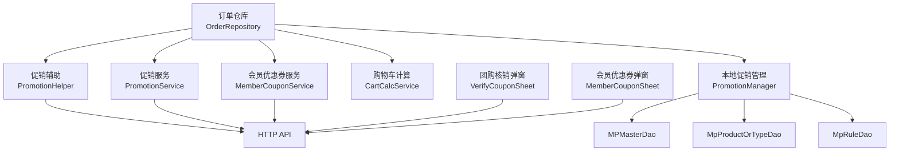
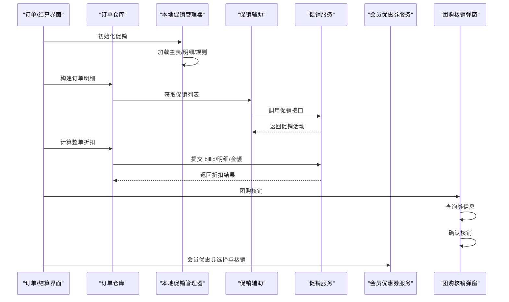
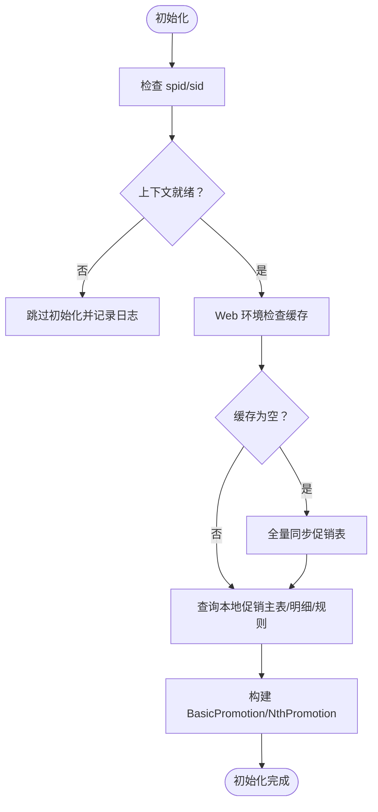
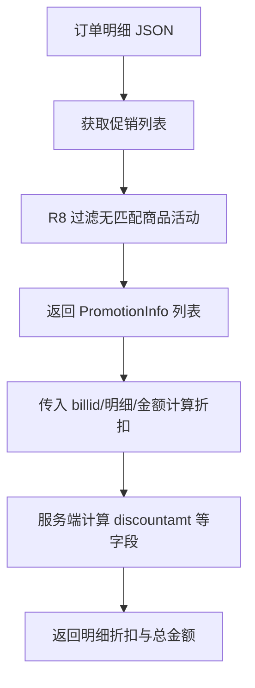
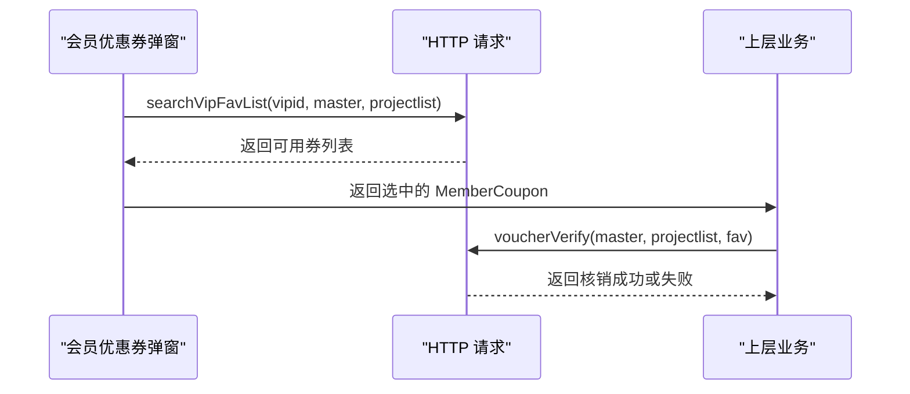
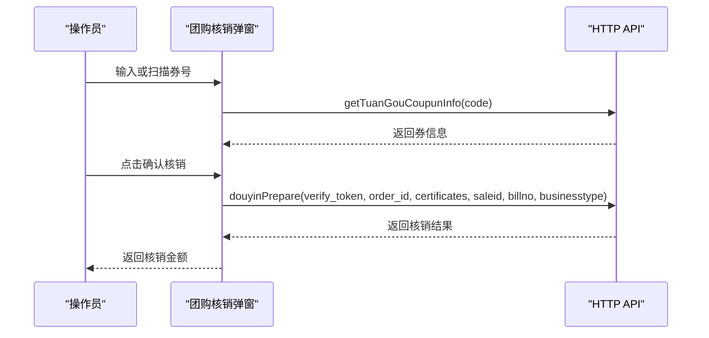
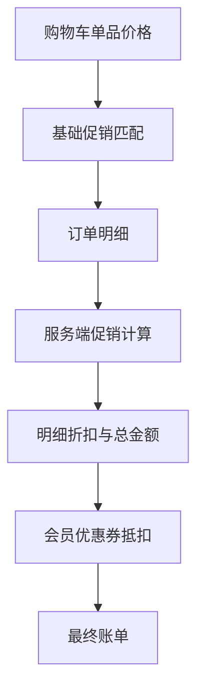
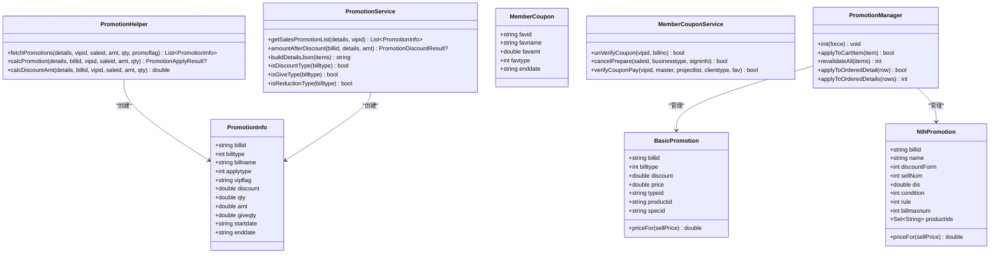

# 促销优惠与优惠券核销

<cite>
**本文引用的文件**   
- [promotion_manager.dart](file://lib/pages/order/promotion_manager.dart)
- [order_repository.dart](file://lib/pages/order/order_repository.dart)
- [member_coupon_service.dart](file://lib/util/member_coupon_service.dart)
- [verify_coupon_sheet.dart](file://lib/components/verify_coupon_sheet.dart)
- [member_coupon_sheet.dart](file://lib/components/member_coupon_sheet.dart)
- [promotion_helper.dart](file://lib/util/promotion_helper.dart)
- [promotion_service.dart](file://lib/util/promotion_service.dart)
- [cart_calc_service.dart](file://lib/util/cart_calc_service.dart)
- [constant.dart](file://lib/res/constant.dart)
</cite>

## 目录
1. [引言](#引言)
2. [项目结构定位](#项目结构定位)
3. [核心模型与职责](#核心模型与职责)
4. [系统架构总览](#系统架构总览)
5. [促销活动引擎详解](#促销活动引擎详解)
6. [会员优惠券流程](#会员优惠券流程)
7. [团购核销流程](#团购核销流程)
8. [叠加规则、分摊与金额校验](#叠加规则分摊与金额校验)
9. [订单仓库中的调用方式](#订单仓库中的调用方式)
10. [依赖关系分析](#依赖关系分析)
11. [性能优化建议](#性能优化建议)
12. [异常处理与排错指南](#异常处理与排错指南)
13. [结论](#结论)

## 引言
本模块围绕“促销优惠”和“优惠券核销”两条主线：  
- 促销侧：通过本地基础促销管理器与服务端促销接口，对分类折扣、菜品折扣、特价菜、第N份促销进行匹配，并在下单前调用云端计算满减、满折等整单优惠。  
- 优惠券侧：会员可用代金券、折扣券、礼品券在结账时选择并参与抵扣；团购券支持抖音、美团、快手扫码或输入券号后核销。  

该文档从代码级角度梳理 `PromotionInfo`、`PromotionManager`、`MemberCoupon`、`VerifyCouponSheet`、`OrderRepository` 以及会员、促销、购物车、HTTP 接口之间的关系，帮助开发者理解价格计算、活动匹配、优惠券应用和异常处理的完整链路。

## 项目结构定位
促销与优惠券能力分布在以下层次：
- 订单层：订单页面、结算页、订单仓库负责组装明细、展示活动、发起促销与优惠券调用。
- 工具层：促销辅助类、促销服务类、购物车计算服务、会员优惠券服务。
- 组件层：会员优惠券选择弹窗、团购核销弹窗。
- 数据层：本地促销表（主表、商品/分类明细、规则、时间、门店等）由表下载器同步，供 `PromotionManager` 使用。
- 网络层：统一 HTTP API 定义与请求封装，提供促销查询、促销计算、优惠券查询、核销、撤销等接口。

**图表来源**  
- [promotion_manager.dart:1-455](file://lib/pages/order/promotion_manager.dart#L1-L455)  
- [promotion_helper.dart:1-440](file://lib/util/promotion_helper.dart#L1-L440)  
- [promotion_service.dart:1-242](file://lib/util/promotion_service.dart#L1-L242)  
- [member_coupon_service.dart:1-126](file://lib/util/member_coupon_service.dart#L1-L126)  
- [verify_coupon_sheet.dart:1-310](file://lib/components/verify_coupon_sheet.dart#L1-L310)  
- [member_coupon_sheet.dart:1-258](file://lib/components/member_coupon_sheet.dart#L1-L258)  
- [cart_calc_service.dart:1-278](file://lib/util/cart_calc_service.dart#L1-L278)

**章节来源**  
- [promotion_manager.dart:1-455](file://lib/pages/order/promotion_manager.dart#L1-L455)  
- [order_repository.dart:1-300](file://lib/pages/order/order_repository.dart#L1-L300)

## 核心模型与职责
本节聚焦促销与优惠券的核心数据结构及其业务含义。

| 模型 | 关键属性 | 业务含义 |
|---|---|---|
| `PromotionInfo` | `billid`、`billtype`、`billname`、`applytype`、`vipflag`、`discount`、`qty`、`amt`、`giveqty`、`status`、`startdate`、`enddate` | 服务端返回的促销活动信息，包含活动类型、适用范围、折扣/门槛/赠品等字段。 |
| `BasicPromotion` | `billid`、`billtype`、`discount`、`price`、`typeid`、`productid`、`specid` | 本地基础促销，用于分类折扣、菜品折扣、特价菜的单价匹配。 |
| `NthPromotion` | `billid`、`name`、`discountForm`、`sellNum`、`dis`、`condition`、`rule`、`billmaxnum`、`productIds` | 第N份促销，按购买数量触发折扣、特价或减价。 |
| `PromotionGiftActivity` | `billid`、`billtype`、`name`、`giveqty`、`sumgiveqty`、`prolsit` | 买赠或满赠活动，包含可赠送的商品列表及上限。 |
| `MemberCoupon` | `favid`、`favname`、`favamt`、`favtype`、`enddate` | 会员优惠券，`favtype=1` 代金券、`favtype=2` 折扣券、`favtype=3` 礼品券。 |
| `CartItem` | `productid`、`sellprice`、`qty`、`discount`、`dscflag`、`isGive`、`presentflag`、`weighflag`、`cookaddamt`、`specaddamt`、`combaddamt` | 购物车项，承载售价、数量、折扣标志、做法规格加价等信息，是促销与优惠计算的载体。 |

`PromotionInfo.billtype` 的活动类型映射如下：
- 1：分类折扣
- 2：菜品折扣
- 3：特价菜
- 4：买赠
- 5：满量折扣
- 6：满减
- 7：满赠
- 8：满折

这些类型贯穿促销列表获取、前端展示、服务端折扣计算与客户端过滤逻辑。

**章节来源**  
- [promotion_helper.dart:1-200](file://lib/util/promotion_helper.dart#L1-L200)  
- [promotion_service.dart:1-120](file://lib/util/promotion_service.dart#L1-L120)  
- [promotion_manager.dart:1-120](file://lib/pages/order/promotion_manager.dart#L1-L120)  
- [member_coupon_sheet.dart:1-80](file://lib/components/member_coupon_sheet.dart#L1-L80)  
- [cart_calc_service.dart:1-120](file://lib/util/cart_calc_service.dart#L1-L120)

## 系统架构总览
促销与优惠券体系可以拆分为四个阶段：
1. **促销数据准备**：登录或跨天切换后初始化本地促销表；Web 环境缓存缺失时按需拉取。
2. **购物车与订单明细计算**：购物车逐项套用基础促销，订单确认前调用服务端促销接口计算整单优惠。
3. **会员优惠券选择与核销**：会员账户拉取可用券，选择后参与账单抵扣；团购券扫码/输入券号后核销。
4. **最终账单生成**：汇总原价、促销折扣、会员优惠、优惠券抵扣、支付方式，完成下单。

**图表来源**  
- [promotion_manager.dart:120-455](file://lib/pages/order/promotion_manager.dart#L120-L455)  
- [promotion_helper.dart:120-440](file://lib/util/promotion_helper.dart#L120-L440)  
- [promotion_service.dart:120-242](file://lib/util/promotion_service.dart#L120-L242)  
- [member_coupon_service.dart:1-126](file://lib/util/member_coupon_service.dart#L1-L126)  
- [verify_coupon_sheet.dart:1-310](file://lib/components/verify_coupon_sheet.dart#L1-L310)

## 促销活动引擎详解

### 基础促销与第N份促销
本地促销引擎由 `PromotionManager` 承担，主要负责：
- 读取门店与会员上下文（`spid`、`sid`）。
- Web 环境检测本地表缓存，为空则调用表下载器拉取促销相关表。
- 解析主促销表、商品/分类明细、规则表，构造 `BasicPromotion` 与 `NthPromotion`。
- 为购物车条目和应用已下单明细匹配最优促销。

**图表来源**  
- [promotion_manager.dart:1-200](file://lib/pages/order/promotion_manager.dart#L1-L200)

#### 基础促销匹配规则
`BasicPromotion.applyToCartItem` 的实现体现以下优先级与约束：
- 若购物车项已是第N份促销行（`specpriceflag==7`），不重复套用基础促销。
- 团购商品不参与基础促销。
- 分类匹配：促销分类与商品分类相等，或存在层级前缀包含关系。
- 商品匹配：`productid` 完全相同；若促销限定 `specid`，客户端因未保存规格ID而跳过。
- 特价菜（`billtype==3`）不受商品是否可打折限制，直接设置特价单价。
- 分类/菜品折扣需满足商品 `dscflag==1`。
- 多个活动命中时，取最终单价最低者。

#### 第N份促销
`NthPromotion.priceFor` 根据优惠形式计算单价：
- 1：折扣形式，按百分比打折。
- 2：特价形式，固定价格。
- 3：减价形式，价格不低于0。

第N份促销由独立参数控制：每 `sellNum` 份触发一次，支持购买相同商品或不同商品的策略，并有单笔订单最大享受次数限制。

**章节来源**  
- [promotion_manager.dart:1-120](file://lib/pages/order/promotion_manager.dart#L1-L120)  
- [promotion_manager.dart:120-455](file://lib/pages/order/promotion_manager.dart#L120-L455)

### 服务端促销列表与折扣计算
服务端促销能力由 `PromotionHelper` 和 `PromotionService` 共同描述：
- `PromotionHelper.fetchPromotions` 向 `/mp/getSalesPromotionList` 提交订单明细、会员ID、金额、数量等参数，获取当前订单可用的促销活动。
- 返回后做 R8 过滤：对于买赠/满赠/满量/满减/满折等整单类活动，即使没有直接匹配商品也保留；其他类型要求订单明细中包含活动商品或分类。
- `PromotionHelper.calcPromotion` 与 `PromotionService.amountAfterDiscount` 调用 `/mp/amountAfterDiscount`，将活动ID、明细、金额传给服务端，由服务器完成复杂规则匹配与折扣分摊。

**图表来源**  
- [promotion_helper.dart:120-440](file://lib/util/promotion_helper.dart#L120-L440)  
- [promotion_service.dart:120-242](file://lib/util/promotion_service.dart#L120-L242)

**章节来源**  
- [promotion_helper.dart:120-440](file://lib/util/promotion_helper.dart#L120-L440)  
- [promotion_service.dart:1-242](file://lib/util/promotion_service.dart#L1-L242)

## 会员优惠券流程
会员优惠券流程包括三个关键步骤：拉取可用券、展示并按类型区分、选择后参与结算抵扣。

### 会员优惠券模型
`MemberCoupon` 表示一张可用优惠券：
- `favid`：优惠券ID。
- `favname`：优惠券名称。
- `favamt`：优惠金额或折扣值。
- `favtype`：券类型，`1` 代表代金券，`2` 代表折扣券，`3` 代表礼品券。
- `enddate`：有效期。

UI 层通过 `typeText` 显示“代金券/折扣券/礼品券”，并通过 `amountText` 展示“¥金额”或“X折”。

### 拉取可用券
`MemberCouponSheet._loadCoupons` 调用 `HttpApi.searchVipFavList`，携带：
- `vipid`：会员ID。
- `master`：主单JSON。
- `projectlist`：项目明细JSON。
- `clienttype`：APP。

接口返回可能位于 `data.list` 或 `data.favlist`，也可能直接为数组；实现中对两种结构做了兼容。

### 选择与核销
用户点击某张券后，弹窗返回 `MemberCoupon`；随后由上层决定如何参与结算。  
此外，`CouponVerifyHelper.verify` 封装了券号核销接口 `HttpApi.voucherVerify`，返回成功与否。

**图表来源**  
- [member_coupon_sheet.dart:1-258](file://lib/components/member_coupon_sheet.dart#L1-L258)  
- [member_coupon_service.dart:1-126](file://lib/util/member_coupon_service.dart#L1-L126)

**章节来源**  
- [member_coupon_sheet.dart:1-258](file://lib/components/member_coupon_sheet.dart#L1-L258)  
- [member_coupon_service.dart:1-126](file://lib/util/member_coupon_service.dart#L1-L126)

## 团购核销流程
`VerifyCouponSheet` 是品牌团购券核销弹窗，支持扫码或手动输入券号，然后查询券信息并确认核销。它面向抖音、美团、快手平台，通过 `businesstype` 区分：
- 0：抖音
- 1：美团
- 3：快手

### 查询券信息
用户输入券号后，先调用 `HttpApi.getTuanGouCoupunInfo` 自动识别券源。成功后展示券名称、面值、类型与平台标签。

### 确认核销
点击确认后，调用 `HttpApi.douyinPrepare`，传递：
- `verify_token`、`order_id`、`certificates`：券凭证信息。
- `saleid`、`billno`：销售单与单号。
- `marketcode`、`marketname`、`dytype`、`productprice`、`businesstype`：渠道与金额信息。

核销成功后返回券面值作为核销金额，并由调用方应用到账单。

**图表来源**  
- [verify_coupon_sheet.dart:1-310](file://lib/components/verify_coupon_sheet.dart#L1-L310)

**章节来源**  
- [verify_coupon_sheet.dart:1-310](file://lib/components/verify_coupon_sheet.dart#L1-L310)

## 叠加规则、分摊与金额校验

### 促销与优惠券的叠加边界
从代码行为看，促销与优惠券并非简单相加，而是分阶段作用：
1. **购物车层面**：基础促销影响单品 `discount`、`promoprice`、`specpriceflag` 等字段，用于计算单品应收金额。
2. **订单层面**：服务端促销接口根据活动ID计算整单折扣，返回明细折扣与总金额。
3. **会员优惠券**：作为结算时的抵扣项，与促销折扣并行存在于账单中，但具体叠加顺序由服务端与结算逻辑决定。
4. **团购核销**：团购券核销金额通常直接冲抵支付环节，与会员优惠券属于不同业务通道。

### 折扣分摊算法
服务端折扣分摊体现在 `/mp/amountAfterDiscount` 的返回结构中：
- `PromotionDiscountResult.details` 包含每项明细的折扣信息。
- `totalDiscountAmt` 是明细折扣金额的累计值。
- 客户端需要结合 `onlyid`、`productid`、`discountamt` 将折扣回写到对应订单行，避免整单折扣丢失归属。

购物车侧也有独立的折扣计算工具：
- `CartCalcService.calcOrderDiscount` 对购物车总额应用折扣率。
- `CartCalcService.applyDiscount` 对单个金额应用折扣。
- `CartCalcService.calcProductPrice` 在单品层面处理改价、称重、赠送、做法规格加价，再应用商品折扣。

**图表来源**  
- [cart_calc_service.dart:120-278](file://lib/util/cart_calc_service.dart#L120-L278)  
- [promotion_service.dart:120-242](file://lib/util/promotion_service.dart#L120-L242)

### 金额校验逻辑
- 基础促销中，特价菜直接设置单价；分类/菜品折扣受 `dscflag` 限制。
- 第N份促销的减价形式保证价格不低于0。
- 服务端促销返回 `discountamt`，客户端累计得到总折扣金额。
- 会员优惠券与团购券核销成功后，调用方应更新应付金额，避免重复抵扣。
- 优惠券不可用、重复使用、核销失败等场景，应通过接口返回与本地状态判断后提示用户，而不是盲目继续下单。

**章节来源**  
- [promotion_manager.dart:120-455](file://lib/pages/order/promotion_manager.dart#L120-L455)  
- [promotion_service.dart:120-242](file://lib/util/promotion_service.dart#L120-L242)  
- [cart_calc_service.dart:120-278](file://lib/util/cart_calc_service.dart#L120-L278)

## 订单仓库中的调用方式
`OrderRepository` 是订单相关数据的聚合入口，虽然其主体内容偏重菜品、规格、分类等模型，但从导入结构与常量引用可以看出它与促销、优惠券、会员系统的集成点：
- 导入 `http_api.dart`、`http_helper.dart`、`table_download_manager.dart`，说明订单流程会发起网络请求与表数据同步。
- 导入 `store_mode_utils.dart`、`user_helper.dart`，说明订单上下文依赖门店模式与登录信息。
- 导入 `constant.dart`，说明订单配置与功能开关来自常量中心。

在实际业务中，订单仓库通常承担以下职责：
1. 构建订单明细 JSON，供 `PromotionHelper` 与 `PromotionService` 使用。
2. 调用 `getSalesPromotionList` 获取促销列表，并结合本地 `PromotionManager` 展示基础促销标签。
3. 调用 `amountAfterDiscount` 计算整单折扣，并将明细折扣写回订单行。
4. 在支付前调用会员优惠券接口，完成优惠券核销。
5. 对团购券核销结果进行金额合并，最终生成支付账单。

由于本仓库中 `order_repository.dart` 的大段代码集中在商品与规格模型定义，促销与优惠券的具体调用多由页面或工具类组合完成；因此建议在订单确认页与结算页集中编排调用顺序，确保：
- 先完成促销计算。
- 再完成会员优惠券核销。
- 最后处理团购核销与支付方式。

**章节来源**  
- [order_repository.dart:1-300](file://lib/pages/order/order_repository.dart#L1-L300)  
- [constant.dart:1-93](file://lib/res/constant.dart#L1-L93)

## 依赖关系分析

**图表来源**  
- [promotion_helper.dart:1-440](file://lib/util/promotion_helper.dart#L1-L440)  
- [promotion_service.dart:1-242](file://lib/util/promotion_service.dart#L1-L242)  
- [promotion_manager.dart:1-455](file://lib/pages/order/promotion_manager.dart#L1-L455)  
- [member_coupon_service.dart:1-126](file://lib/util/member_coupon_service.dart#L1-L126)  
- [member_coupon_sheet.dart:1-80](file://lib/components/member_coupon_sheet.dart#L1-L80)

**章节来源**  
- [promotion_helper.dart:1-440](file://lib/util/promotion_helper.dart#L1-L440)  
- [promotion_service.dart:1-242](file://lib/util/promotion_service.dart#L1-L242)  
- [promotion_manager.dart:1-455](file://lib/pages/order/promotion_manager.dart#L1-L455)  
- [member_coupon_service.dart:1-126](file://lib/util/member_coupon_service.dart#L1-L126)  
- [member_coupon_sheet.dart:1-80](file://lib/components/member_coupon_sheet.dart#L1-L80)

## 性能优化建议
针对促销与优惠券的高频调用场景，可从以下方面优化：

1. **促销结果缓存**
   - 对 `getSalesPromotionList` 的结果按 `details` 摘要或订单快照哈希做短期缓存，避免重复网络请求。
   - 对 `amountAfterDiscount` 的结果按 `billid+details+amt` 做缓存，注意金额变化时需失效。

2. **批量查询优化**
   - 订单确认前一次性提交完整明细，避免多次调用促销接口。
   - 对买赠/满赠活动，使用 `promoflag=2` 单独拉取，减少无关活动解析开销。

3. **本地促销预加载**
   - `PromotionManager.init` 已在 Web 环境处理缓存缺失时同步促销表；可在登录后提前预热，避免首次进入订单页卡顿。
   - 对 `spid/sid` 变化时强制刷新，避免过期促销导致价格错误。

4. **优惠券与团购核销重试**
   - 对核销失败进行限次重试，避免网络抖动造成重复扣券。
   - 对重复使用场景，先本地标记 `used`，再调用撤销接口，保证一致性。

5. **金额计算精度**
   - 使用 `AmountCalcUtils` 进行加减乘除，避免浮点误差导致的金额不一致。
   - 服务端返回折扣金额后，客户端应校验总和与分项之和的容差范围。

[本节为通用优化建议，不直接分析具体代码片段]

## 异常处理与排错指南

### 常见异常场景
| 场景 | 表现 | 处理策略 |
|---|---|---|
| 会员优惠券不可用 | 接口返回空列表或券状态无效 | 提示“暂无可用优惠券”，允许用户继续结算但不使用该券。 |
| 优惠券核销失败 | `voucherVerify` 或 `verifyCouponPay` 返回失败 | 记录日志，提示“核销失败”，允许用户更换优惠券或取消核销。 |
| 团购券查询失败 | `getTuanGouCoupunInfo` 无数据 | 提示“未查询到券信息”，让用户重新输入券号。 |
| 团购券核销失败 | `douyinPrepare` 抛异常 | 提示“核销失败”，不清空已核销状态，允许重试。 |
| 促销列表为空 | 本地促销或服务端促销均未返回 | 记录日志，按普通订单计价，允许用户继续下单。 |
| 促销计算失败 | `amountAfterDiscount` 返回 null | 降级为无促销折扣，记录详细参数以便排查。 |

### 排错建议
- 打开促销日志标签，查看 `促销初始化`、`促销命中`、`促销未采用`、`促销列表`、`促销计算失败` 等日志。
- 核对 `spid`、`sid`、`vipid` 是否正确，避免促销与会员数据错位。
- 检查订单明细 JSON 是否包含 `productid`、`typeid`、`qty`、`sellprice`，缺少关键字段会导致促销无法匹配。
- 对团购核销，核对 `businesstype` 与券平台一致，`verify_token`、`order_id`、`certificates` 是否完整。
- 对会员优惠券，核对 `master`、`projectlist`、`fav` 是否与当前订单一致，避免误用历史券。

**章节来源**  
- [promotion_manager.dart:200-455](file://lib/pages/order/promotion_manager.dart#L200-L455)  
- [promotion_helper.dart:120-440](file://lib/util/promotion_helper.dart#L120-L440)  
- [member_coupon_service.dart:1-126](file://lib/util/member_coupon_service.dart#L1-L126)  
- [verify_coupon_sheet.dart:1-310](file://lib/components/verify_coupon_sheet.dart#L1-L310)

## 结论
该促销与优惠券子系统通过“本地基础促销 + 服务端整单促销 + 会员优惠券 + 团购核销”四层协作，覆盖了餐厅常见的折扣、特价、买赠、满减、满折与第三方平台券核销场景。  
- `PromotionInfo` 是服务端促销的统一模型，贯穿列表、过滤、计算。  
- `PromotionManager` 负责本地分类/菜品/特价/第N份促销的匹配与购物车定价。  
- `PromotionHelper` 与 `PromotionService` 负责与服务器交互，完成促销列表获取与折扣分摊计算。  
- `MemberCoupon` 与 `MemberCouponService` 提供会员券拉取与核销能力。  
- `VerifyCouponSheet` 提供团购券扫码/输入、查询、核销的一体化流程。  

在生产环境中，建议以“服务端为准、本地为辅”的原则设计价格链路，强化幂等、重试、日志与金额校验，确保促销与优惠券不会重复抵扣或漏算。