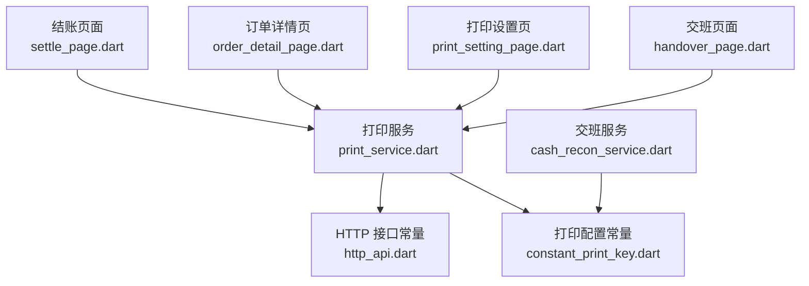
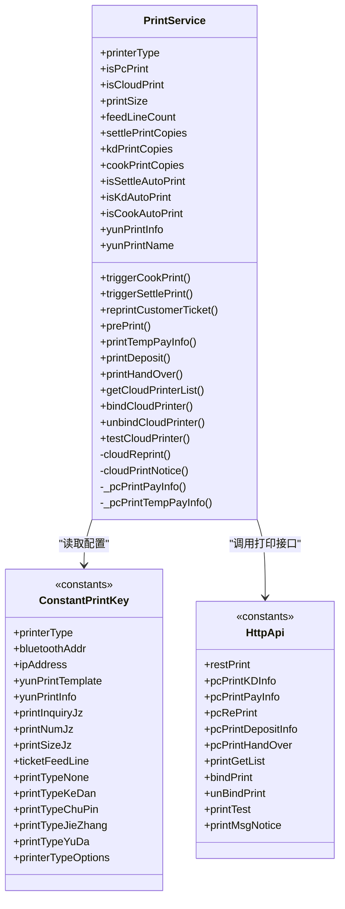
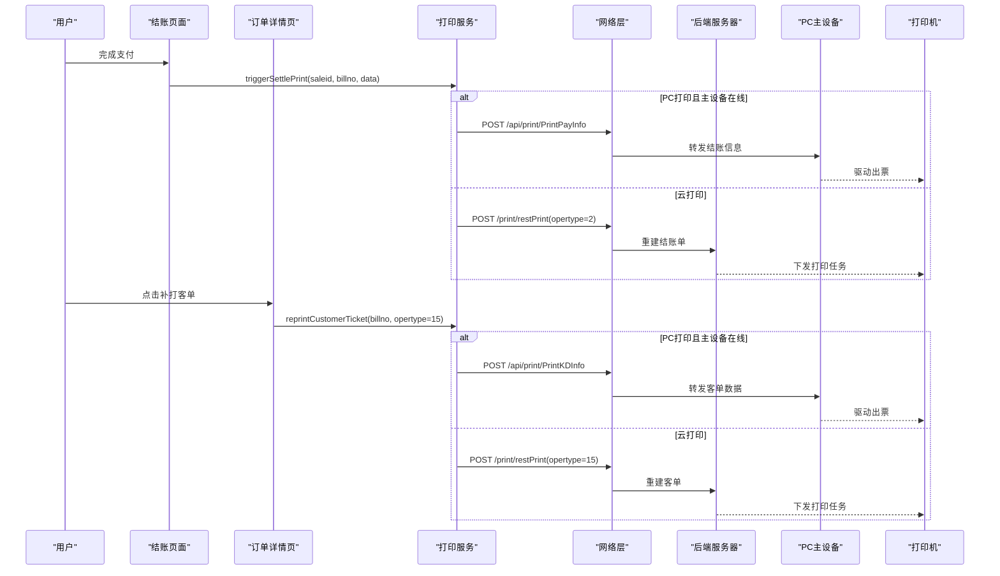
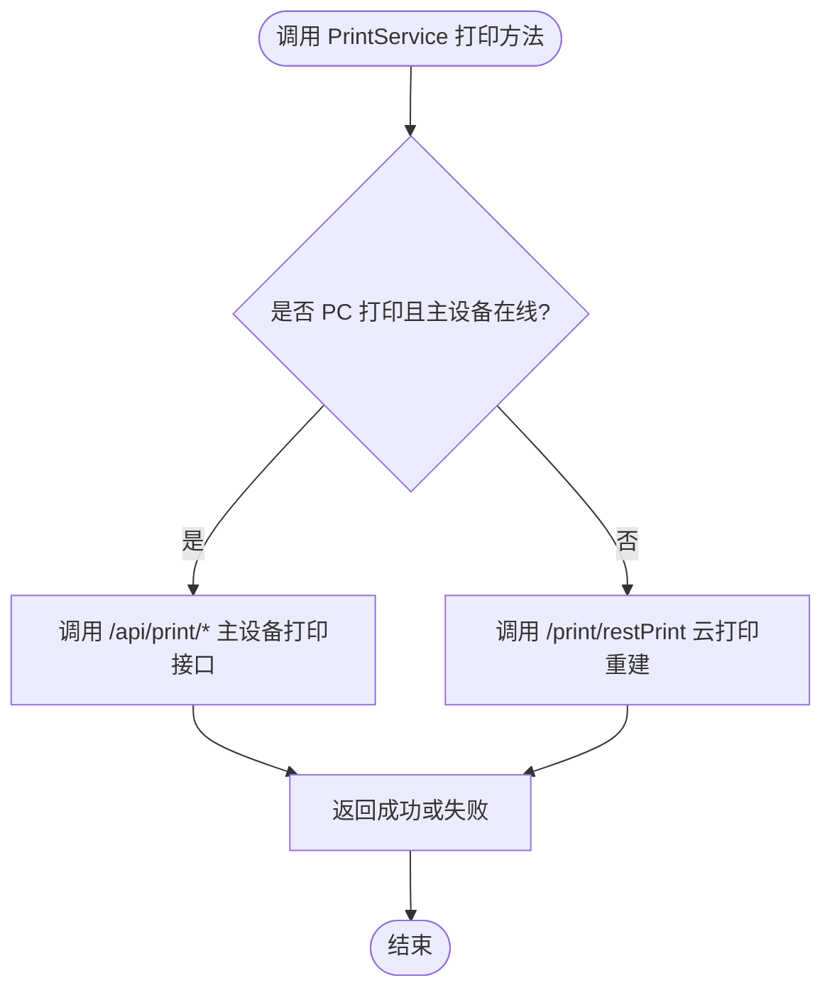
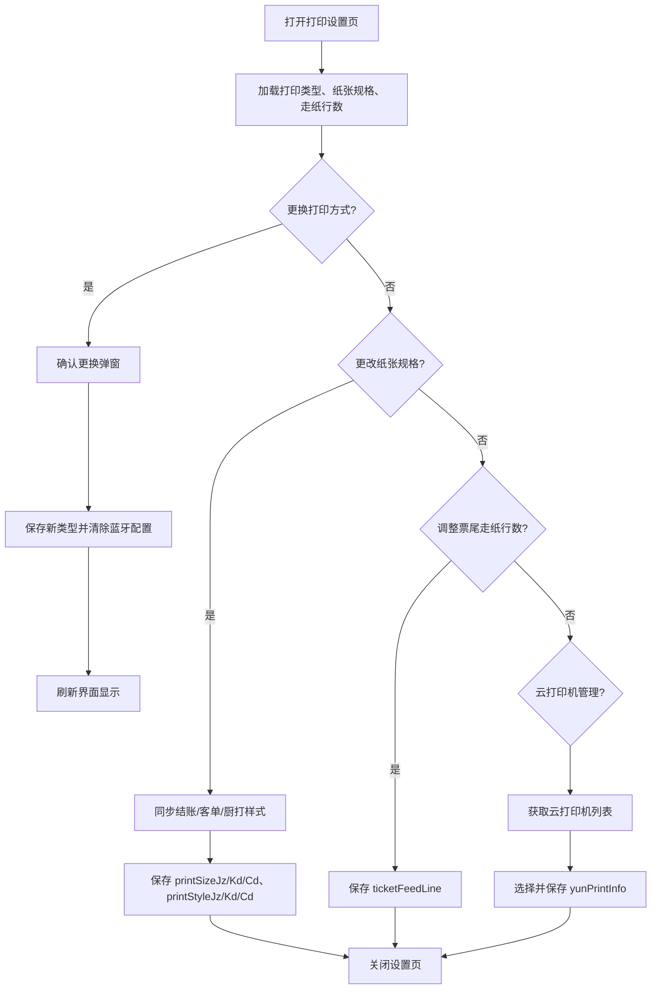
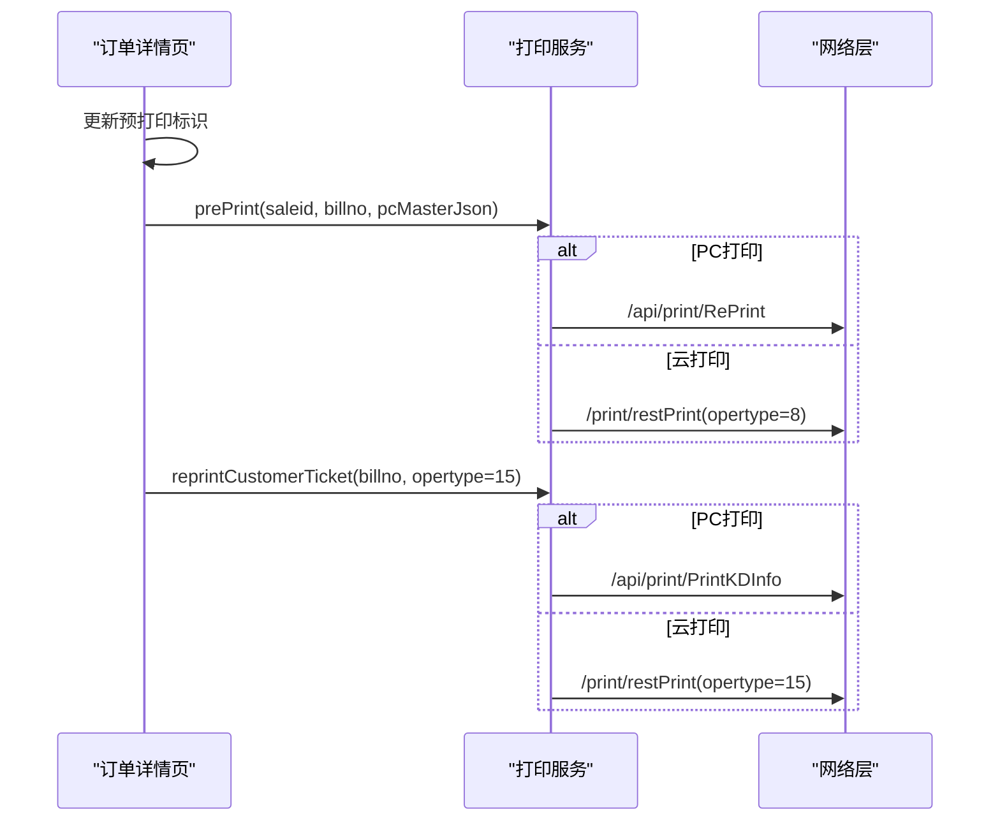
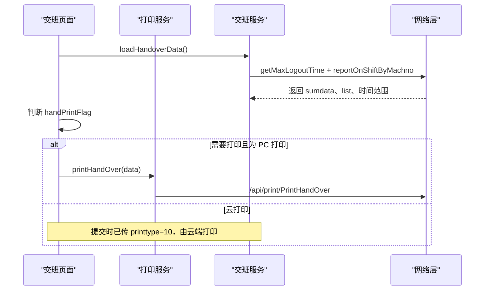
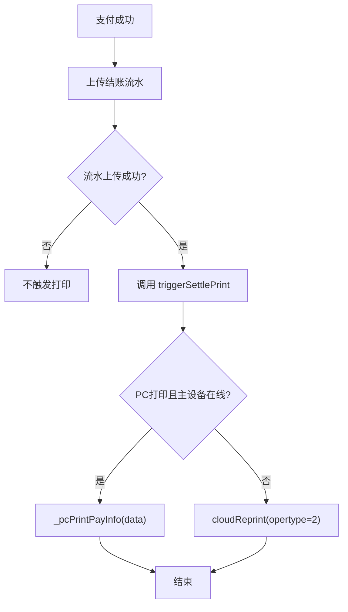
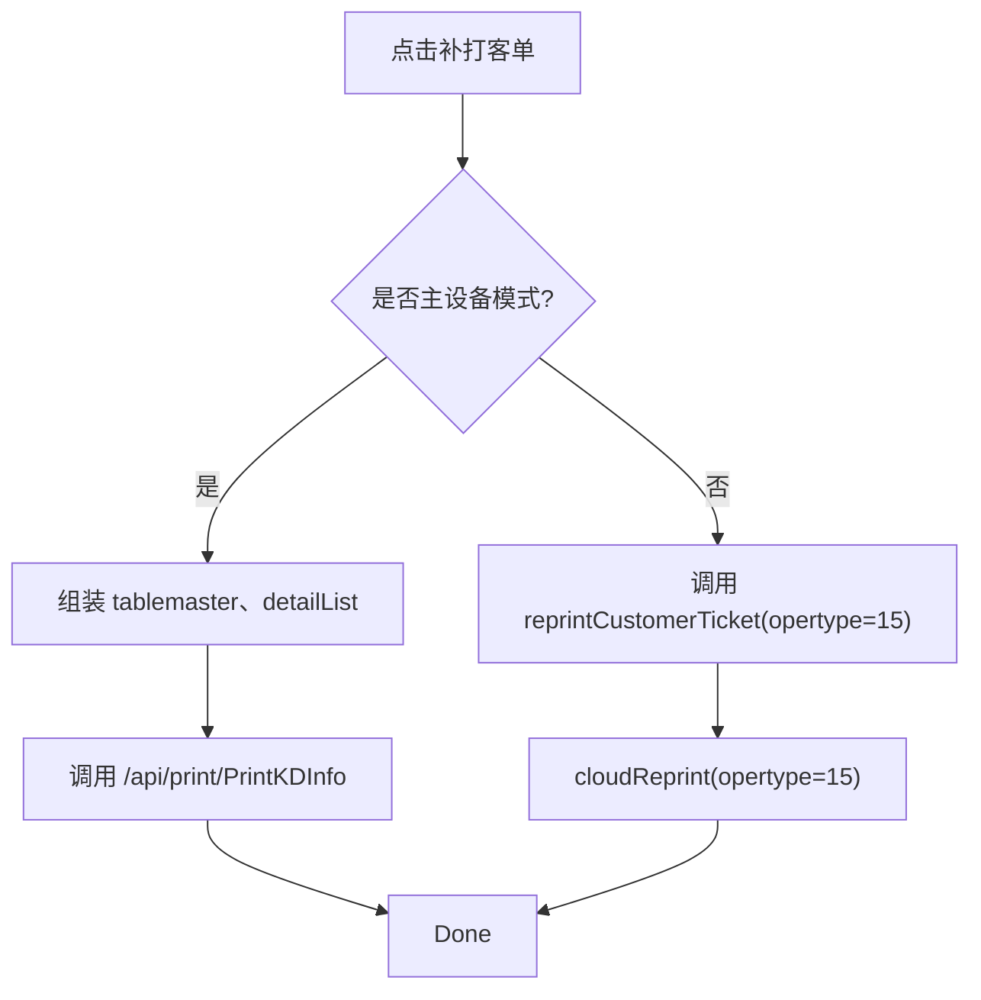
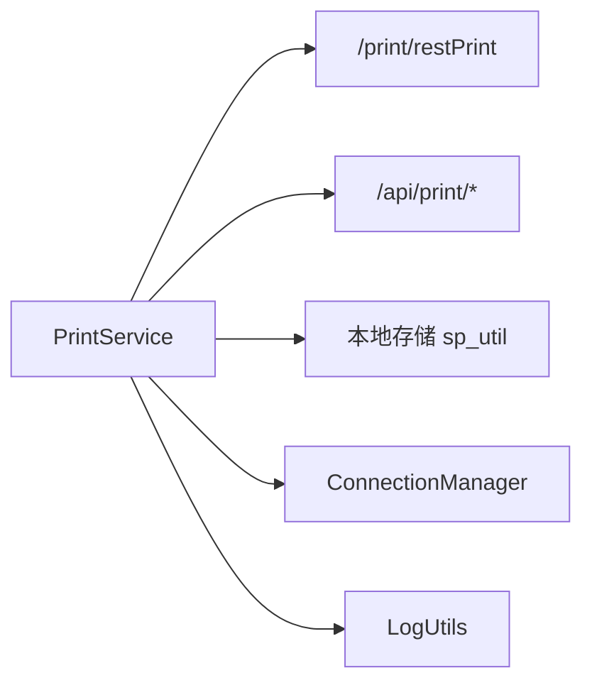

# 打印小票与服务集成

<cite>
**本文引用的文件**   
- [print_service.dart](file://lib/util/print_service.dart)
- [constant_print_key.dart](file://lib/res/constant_print_key.dart)
- [print_setting_page.dart](file://lib/setting/page/print_setting_page.dart)
- [settle_page.dart](file://lib/pages/order/settle_page.dart)
- [settle_finish_page.dart](file://lib/pages/order/settle_finish_page.dart)
- [order_detail_page.dart](file://lib/pages/order/order_detail_page.dart)
- [cash_recon_service.dart](file://lib/service/cash_recon_service.dart)
- [http_api.dart](file://lib/net/http_api.dart)
</cite>

## 目录
1. [引言](#引言)
2. [项目结构中的打印相关模块](#项目结构中的打印相关模块)
3. [核心组件总览](#核心组件总览)
4. [架构与调用关系](#架构与调用关系)
5. [详细组件分析](#详细组件分析)
6. [小票模板渲染与输出字段说明](#小票模板渲染与输出字段说明)
7. [自动打印与手动重打流程](#自动打印与手动重打流程)
8. [打印配置参数说明](#打印配置参数说明)
9. [依赖分析与扩展点](#依赖分析与扩展点)
10. [性能与可靠性考虑](#性能与可靠性考虑)
11. [故障排查指南](#故障排查指南)
12. [结论](#结论)

## 引言
本文聚焦于订单结账、补打、预打、交班等场景下的打印小票能力，围绕 `PrintService` 的封装、本地与云端打印通道、打印配置、以及与其他业务模块的集成进行系统化说明。该实现以 Flutter 前端为主，通过主设备接口或云打印接口触发实际硬件出票；小票内容格式和票据重建主要由后端根据单号与操作类型生成，移动端主要负责构建请求、选择打印机、处理成功失败状态，并维护本地打印配置。

## 项目结构中的打印相关模块
当前仓库中与打印相关的代码主要集中在以下位置：
- 打印服务封装：`lib/util/print_service.dart`
- 打印配置常量：`lib/res/constant_print_key.dart`
- 打印设置界面：`lib/setting/page/print_setting_page.dart`
- 结账流程与自动打印触发：`lib/pages/order/settle_page.dart`
- 结账完成展示页：`lib/pages/order/settle_finish_page.dart`
- 订单详情、预打、补打客单：`lib/pages/order/order_detail_page.dart`
- 交班对账与打印关联：`lib/service/cash_recon_service.dart`、`lib/setting/page/handover_page.dart`
- HTTP 接口常量：`lib/net/http_api.dart`



**图表来源**
- [print_service.dart:24-416](file://lib/util/print_service.dart#L24-L416)
- [constant_print_key.dart:1-147](file://lib/res/constant_print_key.dart#L1-L147)
- [print_setting_page.dart:1-319](file://lib/setting/page/print_setting_page.dart#L1-L319)
- [settle_page.dart:1360-1420](file://lib/pages/order/settle_page.dart#L1360-L1420)
- [order_detail_page.dart:3050-3175](file://lib/pages/order/order_detail_page.dart#L3050-L3175)
- [cash_recon_service.dart:1-200](file://lib/service/cash_recon_service.dart#L1-L200)

**章节来源**
- [print_service.dart:24-416](file://lib/util/print_service.dart#L24-L416)
- [constant_print_key.dart:1-147](file://lib/res/constant_print_key.dart#L1-L147)
- [print_setting_page.dart:1-319](file://lib/setting/page/print_setting_page.dart#L1-L319)
- [settle_page.dart:1360-1420](file://lib/pages/order/settle_page.dart#L1360-L1420)
- [order_detail_page.dart:3050-3175](file://lib/pages/order/order_detail_page.dart#L3050-L3175)
- [cash_recon_service.dart:1-200](file://lib/service/cash_recon_service.dart#L1-L200)

## 核心组件总览
`PrintService` 是打印能力的门面类，提供以下职责：
- 读取本地持久化的打印类型、纸张规格、份数、是否自动打印、云打印机信息等配置。
- 区分 PC 打印与云打印两种主要路径，统一暴露下单出品、结账结账单、预打、押金单、交班、客单补打等方法。
- 在云服务模式下，通过 `/print/restPrint` 按 `saleid` 和 `opertype` 重建票据。
- 在主设备模式且主设备在线时，通过 `/api/print/*` 将打印数据交给主设备处理。
- 提供云打印机列表获取、绑定、解绑、测试等管理接口。



**图表来源**
- [print_service.dart:24-416](file://lib/util/print_service.dart#L24-L416)
- [constant_print_key.dart:1-147](file://lib/res/constant_print_key.dart#L1-L147)
- [http_api.dart:261-268](file://lib/net/http_api.dart#L261-L268)

**章节来源**
- [print_service.dart:24-416](file://lib/util/print_service.dart#L24-L416)
- [constant_print_key.dart:1-147](file://lib/res/constant_print_key.dart#L1-L147)
- [http_api.dart:261-268](file://lib/net/http_api.dart#L261-L268)

## 架构与调用关系
整体打印架构可以理解为“前端业务层 → 打印服务 → 网络层 → 后端/主设备 → 打印机”。



**图表来源**
- [settle_page.dart:1360-1420](file://lib/pages/order/settle_page.dart#L1360-L1420)
- [print_service.dart:154-195](file://lib/util/print_service.dart#L154-L195)
- [order_detail_page.dart:3050-3175](file://lib/pages/order/order_detail_page.dart#L3050-L3175)
- [http_api.dart:261-268](file://lib/net/http_api.dart#L261-L268)

## 详细组件分析

### 打印服务封装：`PrintService`
`PrintService` 采用静态实例的单例模式，避免重复构造，同时集中管理打印配置与打印动作。其关键设计包括：
- **配置读取**：从本地存储读取打印类型、纸张规格、份数、自动打印开关、云打印机信息等。
- **路径分支**：通过 `isPcPrint` 和 `isCloudPrint` 判断走主设备还是云打印。
- **业务方法**：
  - `triggerCookPrint`：下单后触发出品单、杯贴等。
  - `triggerSettlePrint`：结账完成后触发结账单。
  - `reprintCustomerTicket`：补打客单。
  - `prePrint`：预打单。
  - `printDeposit`：押金单打印或补打。
  - `printHandOver`：交班打印。
- **内部方法**：
  - `cloudReprint`：调用 `/print/restPrint` 按 `saleid` 和 `opertype` 重建票据。
  - `_pcPrintPayInfo`、`_pcPrintTempPayInfo`：主设备结账信息和暂结信息打印。



**图表来源**
- [print_service.dart:154-222](file://lib/util/print_service.dart#L154-L222)
- [print_service.dart:352-366](file://lib/util/print_service.dart#L352-L366)

**章节来源**
- [print_service.dart:24-416](file://lib/util/print_service.dart#L24-L416)

### 打印配置常量：`ConstantPrintKey`
`ConstantPrintKey` 定义了所有打印相关配置的键名、枚举值和默认值，便于跨模块共享，并与 Android 端 `smdcapp` 对齐。重点包括：
- 打印类型：`printerType`，选项包含 `PC打印`、`云打印`、`蓝牙打印`、`接口打印`。
- 云打印信息：`yunPrintTemplate`、`yunPrintInfo`。
- 结账、客单、厨打配置：`printInquiryJz/Kd/Cd`、`printNumJz/Kd/Cd`、`printStyleJz/Kd/Cd`、`printSizeJz/Kd/Cd`。
- 票据行为：`ticketFeedLine`（票尾走纸行数）、`printCmdType`（指令类型）。
- 打印单据类型枚举：如 `printTypeJieZhang=2`、`printTypeChuPin=3`、`printTypeYuDa=8`、`printTypeKeDan=15` 等。
- 交班统计标志：`saleProSummaryFlag`、`saleClassSummaryFlag`、`handPrintFlag`。

**章节来源**
- [constant_print_key.dart:1-147](file://lib/res/constant_print_key.dart#L1-L147)

### 打印设置界面：`PrintSettingPage`
该页面负责让用户修改打印方式、打印设备、纸张规格、票尾走纸行数，并管理云打印机。核心逻辑：
- 初始化时加载当前打印类型、结账纸张规格、票尾走纸行数。
- 打印方式弹窗选择 `PC打印`、`云打印`、`蓝牙打印`、`接口打印`。
- 切换打印方式时清除蓝牙地址和名称，避免旧配置干扰。
- 当选择 `58mm` 或 `80mm` 时，同步更新结账、客单、厨打的 `printSize` 与 `printStyle`。
- 云打印机管理：拉取列表、选择并保存选中云打印机信息。
- 非云打印和非 PC 打印时给出提示，当前仅支持 PC 打印和云打印的实际使用入口。



**图表来源**
- [print_setting_page.dart:1-319](file://lib/setting/page/print_setting_page.dart#L1-L319)

**章节来源**
- [print_setting_page.dart:1-319](file://lib/setting/page/print_setting_page.dart#L1-L319)

### 结账自动打印触发：`settle_page.dart`
结账成功后，结算流水上传响应成功时，会调用 `PrintService.triggerSettlePrint`。其中：
- `printtype` 表示结账单打印，扫码点菜单且有特殊业务时 `newprinttype` 也参与控制。
- `printalltype` 表示是否打印该条记录。
- 成功落库后，调用 `triggerSettlePrint(saleid, billno, data)`，由 `PrintService` 决定走 PC 打印或云打印。
- 非 Web 环境还会尝试双写本地结账流水，但写入失败不阻断结账流程。

```mermaid
sequenceDiagram
    participant SettlePage as "结账页面"
    participant Network as "网络层"
    participant PrintService as "打印服务"

    SettlePage->>Network: 提交 saleflow(printtype=2, printalltype=1)
    Network-->>SettlePage: 返回成功
    SettlePage->>PrintService: triggerSettlePrint(saleid, billno, data)
    alt PC打印
        PrintService->_pcPrintPayInfo(data)
    else 云打印
        PrintService->>Network: restPrint(opertype=2)
    end
```

**图表来源**
- [settle_page.dart:1360-1420](file://lib/pages/order/settle_page.dart#L1360-L1420)
- [print_service.dart:154-164](file://lib/util/print_service.dart#L154-L164)

**章节来源**
- [settle_page.dart:1360-1420](file://lib/pages/order/settle_page.dart#L1360-L1420)
- [print_service.dart:154-164](file://lib/util/print_service.dart#L154-L164)

### 预打与补打客单：`order_detail_page.dart`
订单详情页提供预打与补打客单功能：
- 预打单：先更新预打印标识，再根据主设备或云服务模式分别调用 `/api/print/RePrint` 或 `restPrint(opertype=8)`。
- 补打客单：主设备模式组装 `PCMasterBean` 调用 `/api/print/PrintKDInfo`；云服务模式调用 `reprintCustomerTicket(opertype=15)`。
- 转菜等业务也会根据是否需要打印，调用 `cloudReprint(opertype=21)` 补发转菜单。



**图表来源**
- [order_detail_page.dart:3050-3175](file://lib/pages/order/order_detail_page.dart#L3050-L3175)
- [print_service.dart:201-222](file://lib/util/print_service.dart#L201-L222)
- [print_service.dart:169-195](file://lib/util/print_service.dart#L169-L195)

**章节来源**
- [order_detail_page.dart:3050-3175](file://lib/pages/order/order_detail_page.dart#L3050-L3175)
- [print_service.dart:201-222](file://lib/util/print_service.dart#L201-L222)
- [print_service.dart:169-195](file://lib/util/print_service.dart#L169-L195)

### 交班打印与对账关联
交班页面根据 `handPrintFlag` 决定是否打印交班单；若为 PC 打印且主设备在线，则调用 `PrintService.printHandOver`。云服务模式下，交班提交时已经传入 `printtype=10`，由服务端负责打印，避免重复提交。

`CashReconService` 负责交班数据加载，并在本地 SQLite 与云端之间做分流与回退，同时使用 `ConstantPrintKey.saleProSummaryFlag`、`saleClassSummaryFlag`、`handPrintFlag` 等配置参与报表汇总与打印开关。



**图表来源**
- [handover_page.dart:210-250](file://lib/setting/page/handover_page.dart#L210-L250)
- [cash_recon_service.dart:1-200](file://lib/service/cash_recon_service.dart#L1-L200)
- [print_service.dart:274-289](file://lib/util/print_service.dart#L274-L289)

**章节来源**
- [handover_page.dart:210-250](file://lib/setting/page/handover_page.dart#L210-L250)
- [cash_recon_service.dart:1-200](file://lib/service/cash_recon_service.dart#L1-L200)
- [print_service.dart:274-289](file://lib/util/print_service.dart#L274-L289)

## 小票模板渲染与输出字段说明
当前前端的 `PrintService` 并不直接生成小票的完整文本或图片模板，而是：
- 在 PC 打印模式下，把结构化数据（如结账信息 JSON、订单主单与明细 JSON）传给主设备，由主设备驱动打印机。
- 在云打印模式下，把 `saleid`、`billno`、`opertype` 传给后端 `/print/restPrint`，由后端根据单据重建小票内容并下发到云打印机。

因此，“小票模板渲染逻辑”在当前代码中体现为**业务数据拼装与票据重建参数传递**，而不是前端字符串拼接或小票位图绘制。以下是各场景中参与打印的关键数据字段：

| 场景 | 关键输入字段 | 说明 |
|---|---|---|
| 结账结账单 | `saleid`、`billno`、`data`(主单 JSON)、`printtype=2`、`printalltype=1` | 结账成功后由 `settle_page.dart` 触发；云打印时后端按 `saleid+opertype=2` 重建结账单。 |
| 出品单/厨打 | `saleid`、`billno`、`opertype=3`、`withCpdBranch`、`withLabel` | 下单确认后由 `triggerCookPrint` 触发；可选出品分单、杯贴。 |
| 客单补打 | `billno`、`opertype=15`、`jobcontent=saleid` | 主设备模式可传 `tablemaster`；云服务模式用 `restPrint` 重建客单。 |
| 预打单 | `saleid`、`billno`、`pcMasterJson`、`opertype=8` | 主设备模式传 `PCMasterBean`；云服务模式传 `restPrint(opertype=8)`。 |
| 押金单 | 押金单 JSON、`saleid` 或 `billno`、`opertype=13` | 优先走主设备，无主设备时回退云打印。 |
| 交班单 | 交班数据 JSON、`sumdata`、`title`、`isprintpro`、`isprinttype` | PC 打印时通过 `/api/print/PrintHandOver`；云服务模式由提交阶段 `printtype=10` 触发。 |
| 转菜单 | `newSaleid`、`billno`、`opertype=21` | 转菜成功后按需补发转菜单。 |

对于小票具体内容（商品明细、优惠明细、支付方式、收银员、二维码等），当前实现依赖后端或主设备侧的模板渲染。前端负责：
- 保证 `saleid`、`billno`、`opertype` 正确。
- 在 PC 模式下确保 `tablemaster`、`detailList`、`tmp` 等字段完整。
- 在云模式下确保 `jobcontent` 携带有效 `saleid`。

**章节来源**
- [settle_page.dart:1360-1420](file://lib/pages/order/settle_page.dart#L1360-L1420)
- [print_service.dart:110-164](file://lib/util/print_service.dart#L110-L164)
- [print_service.dart:169-222](file://lib/util/print_service.dart#L169-L222)
- [print_service.dart:251-289](file://lib/util/print_service.dart#L251-L289)
- [order_detail_page.dart:3050-3175](file://lib/pages/order/order_detail_page.dart#L3050-L3175)

## 自动打印与手动重打流程

### 结账完成后自动触发打印
结账流程在成功上传流水后，立即调用 `PrintService.triggerSettlePrint`。如果当前打印类型为 PC 打印且主设备在线，则调用 `_pcPrintPayInfo` 把结账信息发送给主设备；如果是云打印，则调用 `cloudReprint(opertype=2)` 让后端重建结账单。



**图表来源**
- [settle_page.dart:1360-1420](file://lib/pages/order/settle_page.dart#L1360-L1420)
- [print_service.dart:154-164](file://lib/util/print_service.dart#L154-L164)

**章节来源**
- [settle_page.dart:1360-1420](file://lib/pages/order/settle_page.dart#L1360-L1420)
- [print_service.dart:154-164](file://lib/util/print_service.dart#L154-L164)

### 手动重新打印客单
补打客单的入口位于订单详情页。主设备模式需要构造 `PCMasterBean` 并调用 `/api/print/PrintKDInfo`；云服务模式调用 `reprintCustomerTicket(billno, opertype=15)`。



**图表来源**
- [order_detail_page.dart:3050-3175](file://lib/pages/order/order_detail_page.dart#L3050-L3175)
- [print_service.dart:169-195](file://lib/util/print_service.dart#L169-L195)

**章节来源**
- [order_detail_page.dart:3050-3175](file://lib/pages/order/order_detail_page.dart#L3050-L3175)
- [print_service.dart:169-195](file://lib/util/print_service.dart#L169-L195)

## 打印配置参数说明

| 配置项 | 存储 Key | 默认值或含义 | 影响范围 |
|---|---|---|---|
| 打印类型 | `printerType` | `PC打印` | 决定走主设备还是云打印 |
| 云打印机模板类型 | `yunPrintTemplate` | `0` | 云打印模板选择 |
| 选中的云打印机信息 | `yunPrintInfo` | JSON | 用于显示云打印机名称和 ID |
| 结账打印是否提示 | `printInquiryJz` | `1` 表示自动 | 结账是否自动打印 |
| 结账打印份数 | `printNumJz` | `1` | 结账打印份数 |
| 结账打印样式 | `printStyleJz` | 对应 58mm/80mm | 影响结账小票样式 |
| 结账打印规格 | `printSizeJz` | `58mm` | 影响结账小票纸张尺寸 |
| 客单打印是否提示 | `printInquiryKd` | `1` | 客单是否自动打印 |
| 客单打印份数 | `printNumKd` | `1` | 客单打印份数 |
| 客单打印样式 | `printStyleKd` | 对应 58mm/80mm | 影响客单样式 |
| 客单打印规格 | `printSizeKd` | 跟随结账规格 | 影响客单纸张尺寸 |
| 厨打打印是否提示 | `printInquiryCd` | `1` | 厨打是否自动打印 |
| 厨打打印份数 | `printNumCd` | `1` | 厨打打印份数 |
| 厨打打印样式 | `printStyleCd` | 对应 58mm/80mm | 影响厨打样式 |
| 厨打打印规格 | `printSizeCd` | 跟随结账规格 | 影响厨打纸张尺寸 |
| 票尾走纸行数 | `ticketFeedLine` | `0` | 打印完毕后额外走纸行数 |
| 打印指令类型 | `printCmdType` | 未设默认值 | ESC/TSC 指令类型 |
| 菜品统计标志 | `saleProSummaryFlag` | 对齐 smdcapp | 交班统计菜品 |
| 分类统计标志 | `saleClassSummaryFlag` | 对齐 smdcapp | 交班统计分类 |
| 交班打印开关 | `handPrintFlag` | `0` | 交班是否打印 |

这些配置主要通过 `PrintService` 的 getter 读取，或通过 `PrintSettingPage` 修改后写入本地存储。

**章节来源**
- [constant_print_key.dart:1-147](file://lib/res/constant_print_key.dart#L1-L147)
- [print_service.dart:31-103](file://lib/util/print_service.dart#L31-L103)
- [print_setting_page.dart:201-319](file://lib/setting/page/print_setting_page.dart#L201-L319)

## 依赖分析与扩展点

### 对外部系统的依赖
- **主设备接口**：`/api/print/PrintPayInfo`、`/api/print/PrintKDInfo`、`/api/print/RePrint`、`/api/print/PrintDepositInfo`、`/api/print/PrintHandOver`。
- **云打印接口**：`/print/restPrint`、`/print/restPrintPc`、`/YttSvr/app/print/printMsgNotice`。
- **云打印机管理接口**：打印列表、绑定、解绑、测试。
- **本地存储**：通过 `sp_util` 持久化打印配置。
- **连接管理**：通过 `ConnectionManager.pcAlive` 判断主设备是否在线。



**图表来源**
- [print_service.dart:24-416](file://lib/util/print_service.dart#L24-L416)
- [http_api.dart:261-268](file://lib/net/http_api.dart#L261-L268)

**章节来源**
- [print_service.dart:24-416](file://lib/util/print_service.dart#L24-L416)
- [http_api.dart:261-268](file://lib/net/http_api.dart#L261-L268)

### 可能的扩展方向
- **队列与重试机制**：当前打印方法多为单次异步调用，失败后返回 `false` 或由上层 Toast 提示。如需生产级可靠性，可在 `PrintService` 内增加任务队列、指数退避重试、离线持久化待打印任务。
- **多打印机并发控制**：当前没有显式打印队列锁，建议在云打印或主设备打印前加入互斥锁，避免同一时刻多个打印任务竞争。
- **错误上报与诊断**：可在异常捕获处增加错误码分类、网络状态、打印机状态上报，辅助故障定位。
- **模板渲染前移**：如果需要在客户端预览小票，可扩展模板引擎，将后端模板或前端 HTML/图片模板结合，形成预览-确认-打印流程。

[本节为通用扩展建议，不直接分析具体文件]

## 性能与可靠性考虑
- **异步调用**：打印相关方法均为 `Future<bool>`，不会阻塞主线程。
- **失败日志**：多数异常情况通过 `Log.e` 记录，便于排查。
- **主设备在线判断**：通过 `ConnectionManager.pcAlive` 避免在无主设备时误走 PC 打印路径。
- **云打印重建策略**：通过 `saleid` 和 `opertype` 重建票据，减少前端拼装复杂票据内容的风险。
- **本地双写不阻断**：结账流程中本地流水写入失败不会阻断结账，提升用户体验。

[本节为通用性能讨论，不直接分析具体文件]

## 故障排查指南

| 问题现象 | 可能原因 | 排查步骤 | 处理建议 |
|---|---|---|---|
| 打印机离线 | 主设备未连接或云打印机不可达 | 检查 `ConnectionManager.pcAlive`；查看云打印机列表是否为空；确认云打印机是否已绑定 | PC 打印：重新连接主设备；云打印：重新绑定或更换云打印机 |
| 缺纸 | 物理打印机缺纸 | 检查打印机面板提示；查看打印结果 | 补充热敏纸；清空卡纸 |
| 卡纸 | 打印头或进纸通道堵塞 | 关机后清理滚轴；检查是否有异物 | 清洁打印机；必要时联系售后 |
| 网络连接失败 | 云打印接口超时或鉴权失败 | 查看网络日志；检查 `restPrint` 返回值；确认 HMAC 签名和公共参数 | 重试一次；检查网络权限和代理设置 |
| 结账后未打印 | 打印类型不是 PC 或云打印；自动打印被关闭 | 检查 `printerType`；检查 `printInquiryJz`；查看 `triggerSettlePrint` 是否被调用 | 设置为 PC 打印或云打印；开启自动打印 |
| 补打客单失败 | 主设备模式缺少 `tablemaster`；云服务模式 `billno` 为空 | 检查订单详情补打逻辑；确认 `localbillno` 是否存在 | 修正补打数据；重试补打 |
| 预打单重复打印 | 主设备和云服务都触发了预打 | 检查 `_postOrderUpdate(printtype=8)` 和 `prePrint` 的调用分支 | 避免重复调用；云服务模式由后端重建即可 |
| 交班单未打印 | `handPrintFlag=0`；PC 打印但未连接主设备 | 检查交班打印开关；检查主设备在线状态 | 开启交班打印；连接主设备或使用云打印 |

**章节来源**
- [print_service.dart:154-195](file://lib/util/print_service.dart#L154-L195)
- [print_service.dart:201-222](file://lib/util/print_service.dart#L201-L222)
- [print_service.dart:251-289](file://lib/util/print_service.dart#L251-L289)
- [print_setting_page.dart:241-319](file://lib/setting/page/print_setting_page.dart#L241-L319)
- [handover_page.dart:210-250](file://lib/setting/page/handover_page.dart#L210-L250)

## 结论
本项目的打印小票与服务集成以 `PrintService` 为核心，采用“主设备打印 + 云打印重建”的双通道设计，既适配传统 PC 主设备环境，也适配云端打印环境。前端主要负责打印配置管理、业务流程触发和数据组装，而小票模板的具体渲染由后端或主设备完成。当前实现已经覆盖结账自动打印、预打、押金单、交班打印、客单补打等关键场景，但在打印队列、重试机制、错误诊断方面仍有扩展空间。未来可在此基础上引入任务调度、重试策略、模板预览和更完善的错误上报，以提升打印稳定性和运维可观测性。