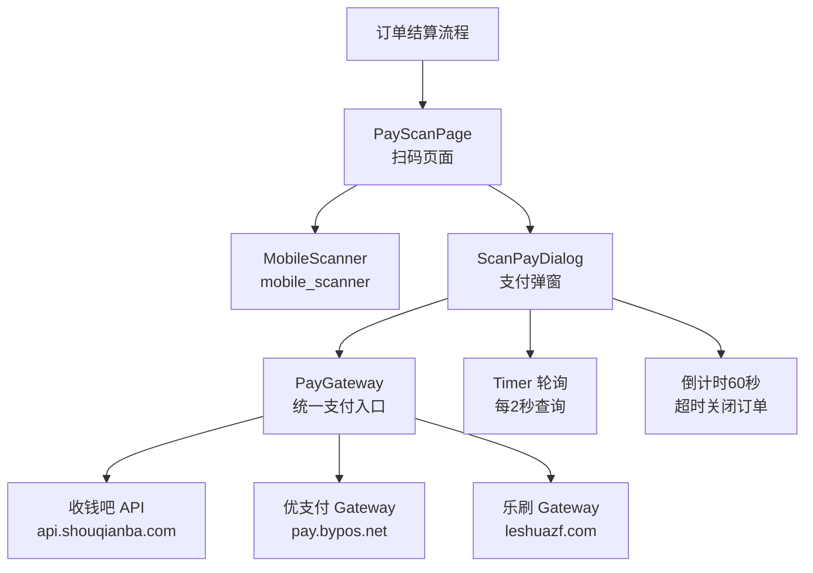
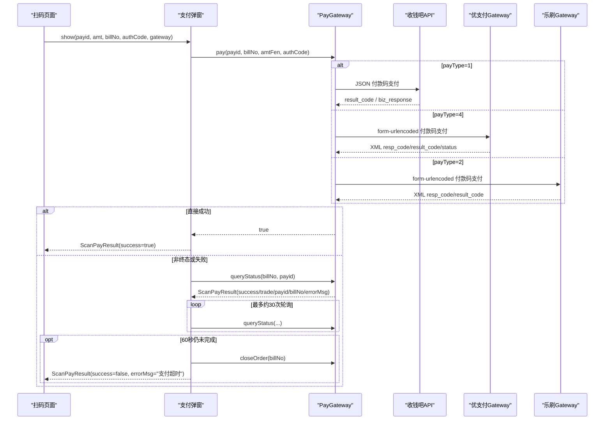
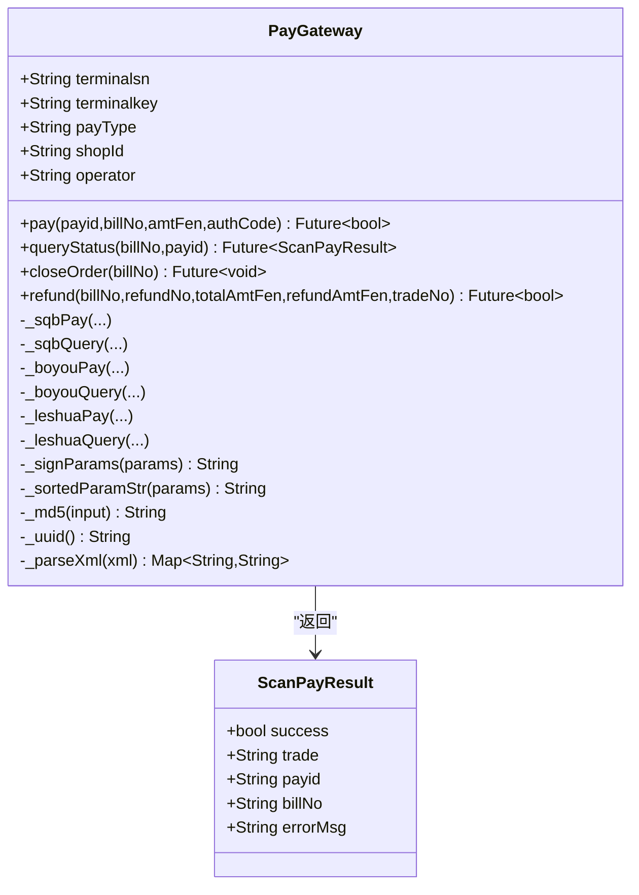
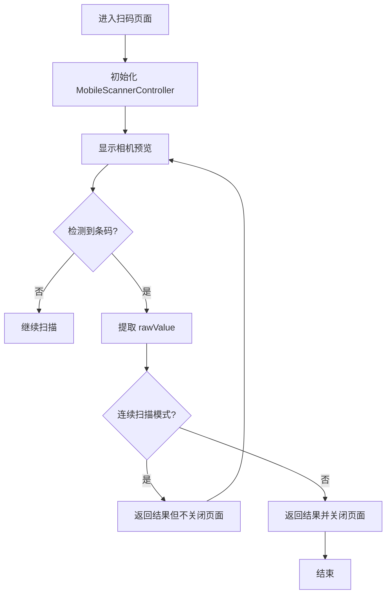
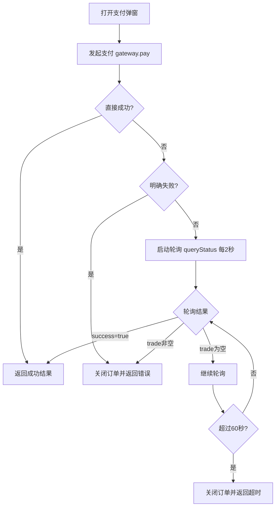
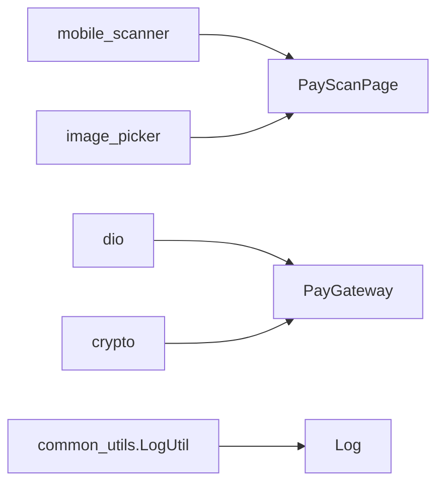

# 支付网关与多支付方式

<cite>
**本文引用的文件**   
- [lib/net/pay_gateway.dart](file://lib/net/pay_gateway.dart)
- [lib/pages/order/pay_scan_page.dart](file://lib/pages/order/pay_scan_page.dart)
- [lib/pages/order/scan_pay_dialog.dart](file://lib/pages/order/scan_pay_dialog.dart)
- [lib/widgets/barcode_scanner_page.dart](file://lib/widgets/barcode_scanner_page.dart)
- [lib/util/hardware_service.dart](file://lib/util/hardware_service.dart)
- [lib/util/log_utils.dart](file://lib/util/log_utils.dart)
- [pubspec.yaml](file://pubspec.yaml)
</cite>

## 目录
1. [简介](#简介)
2. [项目结构](#项目结构)
3. [核心组件](#核心组件)
4. [架构总览](#架构总览)
5. [详细组件分析](#详细组件分析)
6. [依赖关系分析](#依赖关系分析)
7. [性能与可靠性](#性能与可靠性)
8. [安全与合规](#安全与合规)
9. [故障排查指南](#故障排查指南)
10. [结论](#结论)

## 简介
本文面向“支付网关与多支付方式”子模块，聚焦以下目标：
- PayGateway 统一支付入口如何抽象收钱吧（payType=1）、优支付（payType=4）和乐刷（payType=2）。
- 付款码支付流程：接收 payid、billNo、amtFen、authCode，返回 ScanPayResult。
- PayScanPage 扫码页面：基于 MobileScanner 的连续扫描、相机权限、扫描动画。
- 支付结果异步轮询机制：直接成功 vs 需要轮询 trade_status；超时、异常、第三方不可用的处理策略。
- 实际集成示例：配置 PayGateway、签名验证、回调解析思路。
- 硬件设备（扫码枪、POS机）、权限管理、日志记录与安全考虑。
- 常见支付问题诊断方法。

## 项目结构
支付相关代码主要分布在网络层、订单页、扫码组件与工具类中：
- 支付网关：`lib/net/pay_gateway.dart`
- 扫码支付页面：`lib/pages/order/pay_scan_page.dart`
- 支付弹窗与轮询：`lib/pages/order/scan_pay_dialog.dart`
- 通用条码扫描页：`lib/widgets/barcode_scanner_page.dart`
- 硬件服务占位：`lib/util/hardware_service.dart`
- 日志工具：`lib/util/log_utils.dart`
- 扫码能力依赖：`pubspec.yaml`

**图表来源**
- [lib/pages/order/pay_scan_page.dart:1-200](file://lib/pages/order/pay_scan_page.dart#L1-L200)
- [lib/pages/order/scan_pay_dialog.dart:1-200](file://lib/pages/order/scan_pay_dialog.dart#L1-L200)
- [lib/net/pay_gateway.dart:1-200](file://lib/net/pay_gateway.dart#L1-L200)

**章节来源**
- [lib/net/pay_gateway.dart:1-782](file://lib/net/pay_gateway.dart#L1-L782)
- [lib/pages/order/pay_scan_page.dart:1-357](file://lib/pages/order/pay_scan_page.dart#L1-L357)
- [lib/pages/order/scan_pay_dialog.dart:1-378](file://lib/pages/order/scan_pay_dialog.dart#L1-L378)
- [lib/widgets/barcode_scanner_page.dart:1-177](file://lib/widgets/barcode_scanner_page.dart#L1-L177)
- [lib/util/hardware_service.dart:1-79](file://lib/util/hardware_service.dart#L1-L79)
- [lib/util/log_utils.dart:1-106](file://lib/util/log_utils.dart#L1-L106)
- [pubspec.yaml:1-111](file://pubspec.yaml#L1-L111)

## 核心组件
- ScanPayResult：统一的支付结果模型，包含 success、trade、payid、billNo、errorMsg。
- PayGateway：统一支付网关，按 payType 路由到具体平台，并提供 queryStatus、closeOrder、refund 等能力。
- PayScanPage：扫码页面，封装 MobileScanner、扫描遮罩、扫描线动画、相册识别。
- ScanPayDialog：支付弹窗，负责发起支付、倒计时、轮询查询、失败重试与手动查询。

关键职责划分：
- 页面层只负责输入采集与状态展示。
- 网关层负责参数组装、签名、HTTP 请求、响应解析与平台差异抽象。
- 弹窗层负责时间控制、轮询调度与用户体验。

**章节来源**
- [lib/net/pay_gateway.dart:1-120](file://lib/net/pay_gateway.dart#L1-L120)
- [lib/pages/order/pay_scan_page.dart:1-120](file://lib/pages/order/pay_scan_page.dart#L1-L120)
- [lib/pages/order/scan_pay_dialog.dart:1-120](file://lib/pages/order/scan_pay_dialog.dart#L1-L120)

## 架构总览
支付主流程如下：
1. 用户进入扫码页面，使用摄像头或相册获取付款码 authCode。
2. 调用 ScanPayDialog.show，传入 payid、amt、billNo、authCode、gateway。
3. 弹窗内部将金额元转分后调用 gateway.pay。
4. 若支付直接成功，弹窗立即返回成功结果。
5. 若非终态，弹窗启动定时器每2秒调用 gateway.queryStatus，直到成功、明确失败或超时。
6. 60秒未完成则关闭订单并提示超时。
7. 失败时可手动触发一次交易查询。

**图表来源**
- [lib/pages/order/scan_pay_dialog.dart:1-200](file://lib/pages/order/scan_pay_dialog.dart#L1-L200)
- [lib/net/pay_gateway.dart:120-450](file://lib/net/pay_gateway.dart#L120-L450)

**章节来源**
- [lib/pages/order/scan_pay_dialog.dart:1-378](file://lib/pages/order/scan_pay_dialog.dart#L1-L378)
- [lib/net/pay_gateway.dart:1-782](file://lib/net/pay_gateway.dart#L1-L782)

## 详细组件分析

### 支付结果模型 ScanPayResult
ScanPayResult 是支付结果的标准载体：
- success：是否最终成功。
- trade：第三方交易号，不同平台取值不同。
- payid：支付方式ID，08=支付宝、09=微信、10=云闪付。
- billNo：商户订单号。
- errorMsg：错误信息，用于失败场景展示。

该模型屏蔽了平台差异，上层只需消费它。

**章节来源**
- [lib/net/pay_gateway.dart:1-40](file://lib/net/pay_gateway.dart#L1-L40)

### 支付网关 PayGateway
PayGateway 的职责包括：
- 根据 payType 选择收钱吧、乐刷或优支付实现。
- 统一付款码支付接口 pay。
- 统一支付状态查询接口 queryStatus。
- 关闭订单 closeOrder。
- 退款 refund（虽不在本次付款码主流程中，但属于同一网关能力）。

平台差异点：
- 收钱吧：JSON 请求体，Authorization 头携带 terminalsn + MD5(body+key)，result_code=200 且 biz_response.result_code=PAY_SUCCESS 表示直接成功。
- 优支付：form-urlencoded 请求体，XML 响应，sign 为字典序拼接后 MD5 大写；status=2 为成功，status=6/8 为失败。
- 乐刷：form-urlencoded 请求体，XML 响应，sign 规则类似优支付；status=2 为成功。

查询结果语义：
- success=true：明确成功，trade 为交易号。
- success=false 且 trade 非空：明确失败，trade 常为错误消息。
- success=false 且 trade 为空：非终态，应继续轮询。

**图表来源**
- [lib/net/pay_gateway.dart:1-200](file://lib/net/pay_gateway.dart#L1-L200)
- [lib/net/pay_gateway.dart:451-782](file://lib/net/pay_gateway.dart#L451-L782)

**章节来源**
- [lib/net/pay_gateway.dart:1-782](file://lib/net/pay_gateway.dart#L1-L782)

#### 收钱吧（payType=1）
- 付款码支付：
  - 将 payid=08 映射为 payway=1，其他映射为 payway=3。
  - 构造 JSON body，使用 MD5(body+terminalkey) 作为签名。
  - Authorization 头格式为 “terminalsn sign”。
  - 成功条件：外层 result_code=200 且 biz_response.result_code=PAY_SUCCESS。
- 查询状态：
  - 通过 client_sn=billNo 查询。
  - SUCCESS+order_status=PAID 表示成功。
  - PAY_CANCELED 或 FAIL 表示失败。
- 错误信息与交易号：
  - 缓存最后一次响应，便于提取 error_message 与 trade_no/sn。

#### 优支付（payType=4）
- 付款码支付：
  - pay_way：08→ZFBZF，其他→WXZF。
  - 字段按字典序拼接成 key=value&... 形式，末尾追加 &key=terminalkey 后 MD5 大写作为 sign。
  - 响应为 XML，需解析 resp_code、result_code、status。
  - status=2 表示成功，否则需要轮询。
- 查询状态：
  - service=query_status，status=2 成功，status=6/8 失败，其他继续轮询。
- 关闭订单：
  - service=close_order，失败不抛错，保证主流程稳定。

#### 乐刷（payType=2）
- 付款码支付：
  - pay_way：08→ALIPAY，其他→WECHAT。
  - sign 规则同优支付，MD5 大写。
  - 成功条件：resp_code=0 且 result_code=0。
- 查询状态：
  - status=2 成功，status=0/1 为非终态。

#### 签名与参数工具
- _signParams：字典序拼接 + &key=密钥 → MD5 → 大写。
- _sortedParamStr：仅字典序拼接，不含 key。
- _parseXml：简单正则解析 XML 字段，兼容 CDATA。
- _uuid：生成32位随机字符串。

**章节来源**
- [lib/net/pay_gateway.dart:120-450](file://lib/net/pay_gateway.dart#L120-L450)
- [lib/net/pay_gateway.dart:451-782](file://lib/net/pay_gateway.dart#L451-L782)

### 扫码支付页面 PayScanPage
PayScanPage 负责采集客户付款码：
- 使用 MobileScannerController 初始化后置摄像头、闪光灯默认关闭、检测速度 normal。
- 支持连续扫描开关与非连续模式：
  - 非连续模式下通过 _hasScanned 防止重复触发。
  - 连续模式下每次扫描都返回结果但不关闭页面。
- 提供相册图片识别：调用 analyzeImage 从图片中提取条码。
- 提供扫描框遮罩与蓝色扫描线动画，提升视觉引导。
- 顶部标题栏为红色，带返回按钮与闪光灯切换。

权限与相机行为：
- 相机权限由 MobileScanner 在运行时申请，应用需确保 AndroidManifest 与 Info.plist 已声明相机权限。
- 若扫描结果为空或图片无法识别，给出 Toast 提示。

**图表来源**
- [lib/pages/order/pay_scan_page.dart:1-200](file://lib/pages/order/pay_scan_page.dart#L1-L200)
- [lib/pages/order/pay_scan_page.dart:201-357](file://lib/pages/order/pay_scan_page.dart#L201-L357)

**章节来源**
- [lib/pages/order/pay_scan_page.dart:1-357](file://lib/pages/order/pay_scan_page.dart#L1-L357)
- [lib/widgets/barcode_scanner_page.dart:1-177](file://lib/widgets/barcode_scanner_page.dart#L1-L177)

### 支付弹窗与轮询机制 ScanPayDialog
ScanPayDialog 负责：
- 展示支付金额与平台标题（支付宝、微信、云闪付）。
- 发起支付：将金额元转为分，调用 gateway.pay。
- 直接成功：立即返回 ScanPayResult(success=true)。
- 明确失败：根据平台提供的 definitelyFailed 标志判断是否明确失败，失败时关闭订单并返回错误信息。
- 非终态：启动每2秒一次的轮询 queryStatus，直到成功、明确失败或超时。
- 超时处理：60秒倒计时，最后阶段提示即将超时，超时后调用 closeOrder 并返回失败。
- 失败后可手动触发一次交易查询。

**图表来源**
- [lib/pages/order/scan_pay_dialog.dart:1-200](file://lib/pages/order/scan_pay_dialog.dart#L1-L200)
- [lib/pages/order/scan_pay_dialog.dart:201-378](file://lib/pages/order/scan_pay_dialog.dart#L201-L378)

**章节来源**
- [lib/pages/order/scan_pay_dialog.dart:1-378](file://lib/pages/order/scan_pay_dialog.dart#L1-L378)

## 依赖关系分析
- 扫码能力来自 mobile_scanner 插件。
- 网络请求基于 dio，PayGateway 使用独立 Dio 实例避免被公共拦截器干扰。
- 加密使用 crypto 库进行 MD5。
- 日志输出使用 common_utils 的 LogUtil，并通过项目 Log 工具控制生产环境输出。

**图表来源**
- [pubspec.yaml:1-111](file://pubspec.yaml#L1-L111)
- [lib/net/pay_gateway.dart:1-40](file://lib/net/pay_gateway.dart#L1-L40)
- [lib/util/log_utils.dart:1-106](file://lib/util/log_utils.dart#L1-L106)

**章节来源**
- [pubspec.yaml:1-111](file://pubspec.yaml#L1-L111)
- [lib/net/pay_gateway.dart:1-40](file://lib/net/pay_gateway.dart#L1-L40)
- [lib/util/log_utils.dart:1-106](file://lib/util/log_utils.dart#L1-L106)

## 性能与可靠性
- 网络层：
  - 连接超时5秒，发送超时5秒，接收超时10秒；优支付与乐刷查询关闭订单设置更短超时，减少阻塞。
  - validateStatus 始终为 true，由业务逻辑判断响应码，便于统一处理通信异常。
- 轮询：
  - 固定间隔2秒，最多约30次轮询，配合60秒倒计时，避免无限轮询。
  - 轮询期间若已支付完成或页面销毁，及时取消定时器。
- 资源释放：
  - 弹窗 dispose 中取消倒计时与轮询定时器。
  - 扫码页面 dispose 中释放 MobileScannerController 与动画控制器。
- 容错：
  - 网络异常不会导致崩溃，而是进入轮询或返回非终态结果。
  - 关闭订单失败不影响主流程。

[本节为一般性指导，无需源码引用]

## 安全与合规
- 密钥管理：
  - terminalkey 作为敏感参数参与签名，不应硬编码在代码中，建议从后端或安全存储注入。
  - 不要在日志中打印 terminalkey、authCode、完整订单详情。
- 敏感信息脱敏：
  - 日志工具在生产环境默认关闭调试输出，避免泄露敏感数据。
  - 建议在网关层对日志进行脱敏后再输出。
- 防重放攻击：
  - 优支付与乐刷使用 nonce_str 作为随机数，降低重放风险。
  - 建议在服务端校验 nonce 唯一性与时间窗口。
- 签名校验：
  - 客户端签名必须与服务端一致，包括参数排序、拼接方式、大小写。
  - 建议服务端对回调进行二次验签，防止篡改。
- 回调解析：
  - XML 解析采用简单正则，建议接入正式回调时使用健壮 XML 解析库。
  - 对回调中的 status、result_code、resp_code 做严格白名单校验。

[本节为一般性指导，无需源码引用]

## 故障排查指南
常见问题与诊断步骤：

1. 支付成功但未到账
   - 检查 queryStatus 是否返回 success=true 且 trade 有值。
   - 核对 billNo 与第三方 tradeNo 是否一致。
   - 确认订单号后缀与商户号是否正确。
   - 查看网关缓存的 tradeNo 是否与第三方一致。

2. 轮询超时
   - 确认倒计时是否达到60秒。
   - 检查网络是否正常，Dio 是否抛出异常。
   - 查看网关是否调用 closeOrder。
   - 若第三方返回非终态但长时间不变，可能是第三方延迟，可延长轮询次数或增加退避策略。

3. 签名错误
   - 核对 payType 与对应平台的签名规则。
   - 检查参数是否按字典序排序。
   - 检查 terminalkey 是否正确。
   - 对比服务端签名算法，确保大小写与分隔符一致。

4. 第三方服务不可用
   - 观察 Dio 是否超时或连接失败。
   - 网关在网络异常时返回 false 或空 trade，进入轮询或失败分支。
   - 建议增加重试与熔断策略，避免频繁请求。

5. 扫码无结果
   - 检查相机权限是否授予。
   - 确认付款码是否为条形码或二维码，且在扫描框内。
   - 尝试相册图片识别功能。
   - 检查 MobileScannerController 是否已正确初始化与释放。

6. 支付弹窗卡住
   - 检查定时器是否在页面销毁时取消。
   - 检查是否有重复触发支付或轮询。
   - 确认弹窗状态机是否正确更新。

**章节来源**
- [lib/pages/order/scan_pay_dialog.dart:1-378](file://lib/pages/order/scan_pay_dialog.dart#L1-L378)
- [lib/net/pay_gateway.dart:120-450](file://lib/net/pay_gateway.dart#L120-L450)
- [lib/pages/order/pay_scan_page.dart:1-357](file://lib/pages/order/pay_scan_page.dart#L1-L357)

## 结论
PayGateway 以 payType 为路由键，统一抽象收钱吧、优支付与乐刷三种支付平台，对外暴露一致的付款码支付、查询与关闭订单接口。ScanPayPage 基于 MobileScanner 提供流畅的扫码体验，ScanPayDialog 负责支付状态管理与轮询机制，形成稳定的支付闭环。结合日志、权限与硬件服务，该模块具备较好的可扩展性与可维护性。未来可进一步增强回调验签、重试退避、密钥注入与日志脱敏，以提升安全性与稳定性。

[本节为总结性内容，无需源码引用]