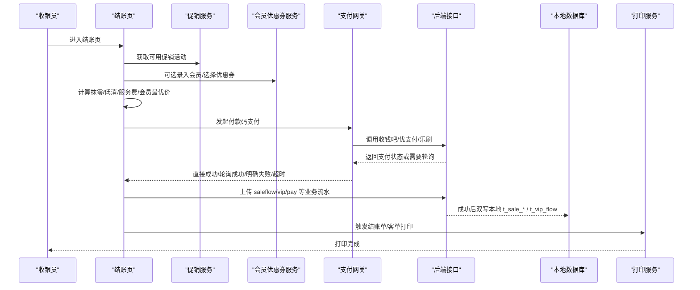
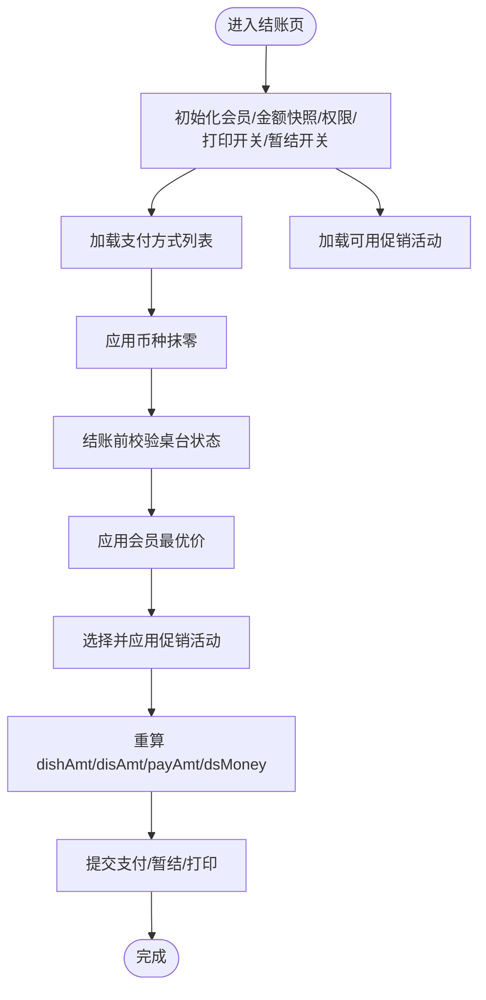
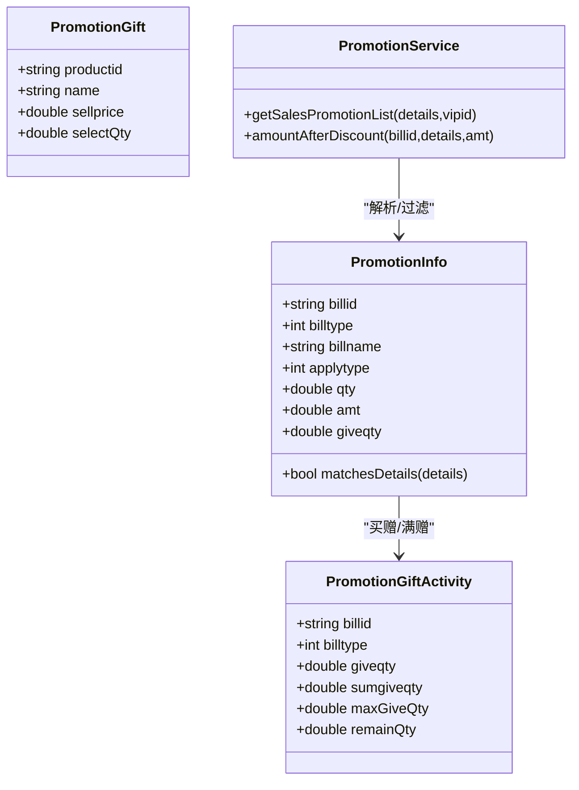
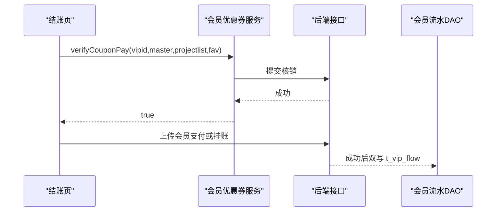
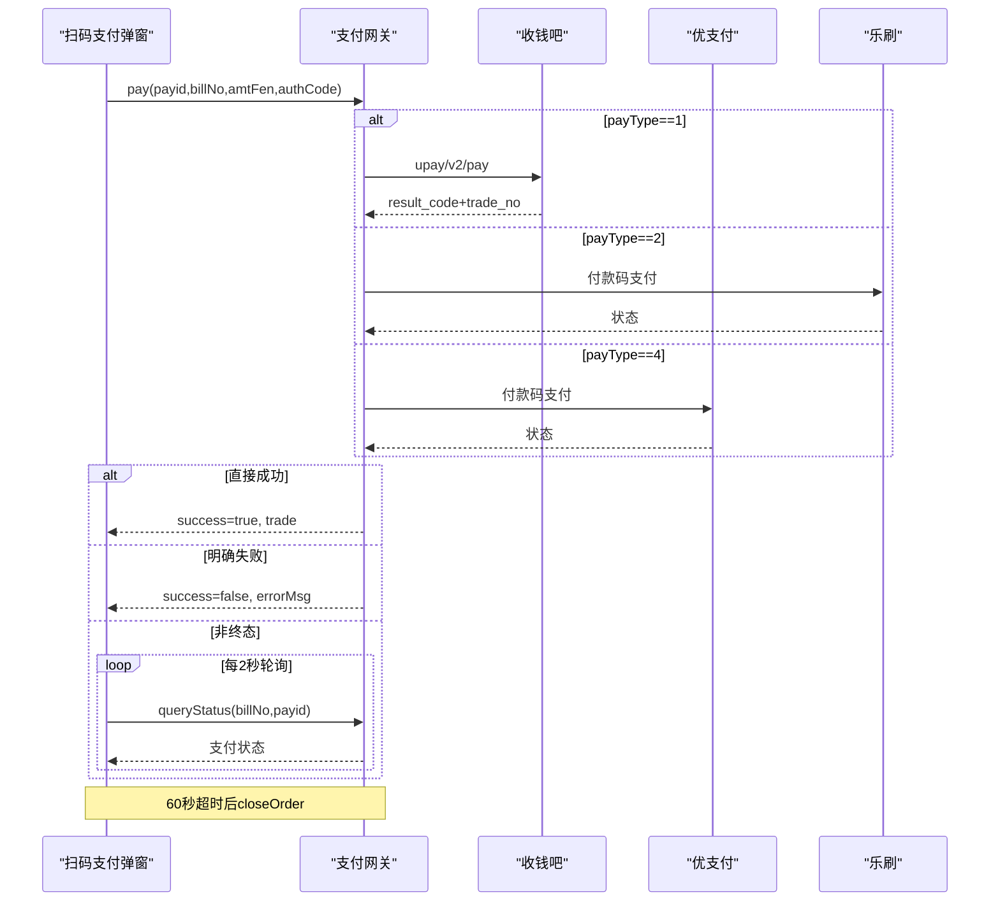
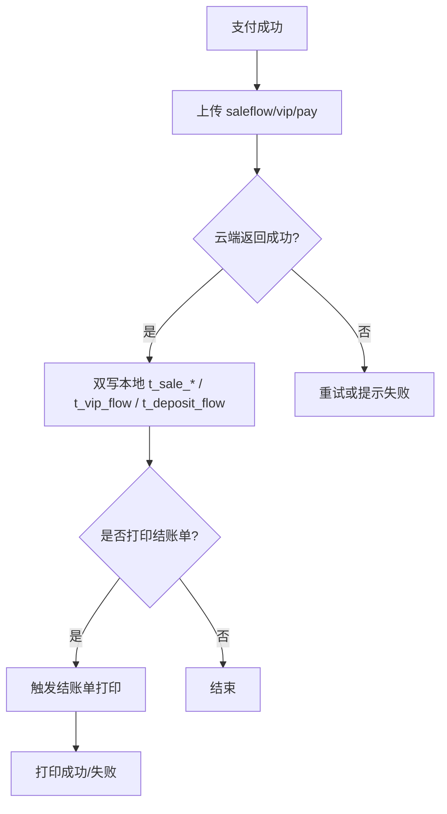
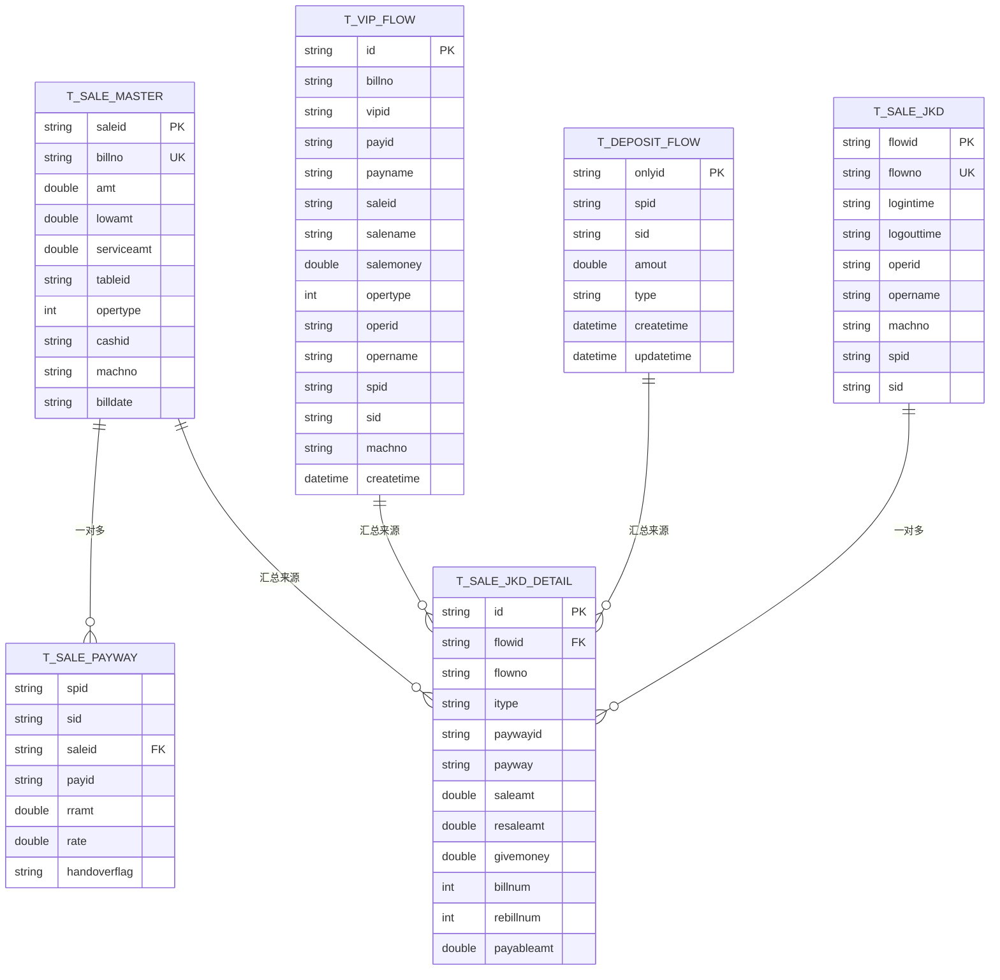
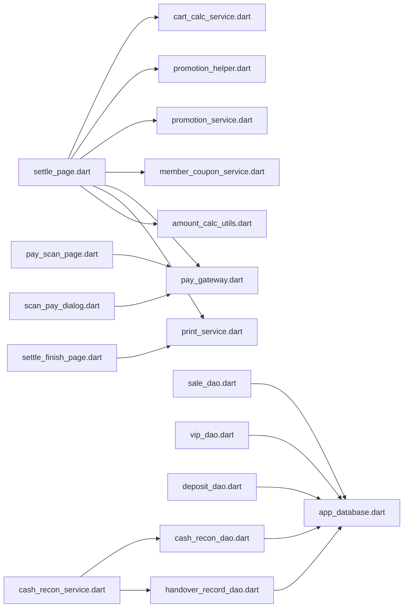

# 结账收银模块

<cite>
**本文引用的文件**   
- [lib/pages/order/settle_page.dart](file://lib/pages/order/settle_page.dart)
- [lib/pages/order/pay_scan_page.dart](file://lib/pages/order/pay_scan_page.dart)
- [lib/pages/order/scan_pay_dialog.dart](file://lib/pages/order/scan_pay_dialog.dart)
- [lib/pages/order/settle_finish_page.dart](file://lib/pages/order/settle_finish_page.dart)
- [lib/util/cart_calc_service.dart](file://lib/util/cart_calc_service.dart)
- [lib/util/promotion_helper.dart](file://lib/util/promotion_helper.dart)
- [lib/util/promotion_service.dart](file://lib/util/promotion_service.dart)
- [lib/util/member_coupon_service.dart](file://lib/util/member_coupon_service.dart)
- [lib/net/pay_gateway.dart](file://lib/net/pay_gateway.dart)
- [lib/db/sale_dao.dart](file://lib/db/sale_dao.dart)
- [lib/db/vip_dao.dart](file://lib/db/vip_dao.dart)
- [lib/db/cash_recon_dao.dart](file://lib/db/cash_recon_dao.dart)
- [lib/db/deposit_dao.dart](file://lib/db/deposit_dao.dart)
- [lib/db/handover_record_dao.dart](file://lib/db/handover_record_dao.dart)
- [lib/service/cash_recon_service.dart](file://lib/service/cash_recon_service.dart)
- [lib/util/amount_calc_utils.dart](file://lib/util/amount_calc_utils.dart)
- [lib/util/print_service.dart](file://lib/util/print_service.dart)
- [lib/util/hardware_service.dart](file://lib/util/hardware_service.dart)
- [lib/res/constant_print_key.dart](file://lib/res/constant_print_key.dart)
</cite>

## 目录
1. [简介](#简介)
2. [项目结构](#项目结构)
3. [核心组件](#核心组件)
4. [架构总览](#架构总览)
5. [详细组件分析](#详细组件分析)
6. [依赖关系分析](#依赖关系分析)
7. [性能与可靠性考虑](#性能与可靠性考虑)
8. [故障排查指南](#故障排查指南)
9. [结论](#结论)
10. [附录：配置、规则与模板示例索引](#附录配置规则与模板示例索引)

## 简介
本文件为聚客美滋滋应用“结账收银模块”的技术文档，聚焦以下范围：
- 账单金额计算：商品计价、折扣、服务费、低消、抹零、会员价最优策略。
- 促销优惠叠加：分类折扣、菜品折扣、特价菜、买赠、满量、满减、满折等规则匹配与分摊。
- 优惠券核销：会员券、团购券的核销与撤销流程。
- 支付方式集成：现金、刷卡、扫码（支付宝/微信/云闪付）、会员卡、挂账等。
- 支付网关对接：收钱吧、优支付、乐刷的统一入口、轮询、超时关闭订单。
- 交易流水生成：云端上传成功后双写本地 t_sale_master/t_sale_payway/t_sale_detail/t_sale_cook。
- 打印小票服务：PC 打印与云打印模式、结账单/客单/厨打触发时机与模板配置键。
- 会员积分与储值：消费流水记录、挂账接口。
- 押金收退：t_deposit_flow 双写与更新。
- 交班对账：销售汇总、按支付方式分段 UNION 统计、交班单号生成与明细批量写入。
- 异常处理与退款：支付明确失败、轮询超时、桌台状态校验、优惠券撤销。

该模块整体对齐 Android 端 smdcapp 结算流程，并通过 Flutter 页面与服务层重新实现；支付、促销、会员、打印、交班等能力通过独立工具类或服务类暴露。

## 项目结构
结账收银相关代码主要分布在以下层次：
- 页面层：结账页、扫码页、扫码支付弹窗、结算完成页。
- 业务服务层：购物车计算、促销服务、会员优惠券服务、支付网关、打印服务、硬件服务。
- 数据访问层：销售流水 DAO、会员流水 DAO、押金流水 DAO、交班查询 DAO、交班记录 DAO。
- 基础设施层：金额计算工具、打印配置常量、网络请求封装（由服务类间接使用）。

```mermaid
graph TB
    subgraph "页面层"
        Settle["settle_page.dart<br/>结账页"]
        PayScan["pay_scan_page.dart<br/>扫码收款界面"]
        ScanPayDialog["scan_pay_dialog.dart<br/>扫码支付弹窗"]
        Finish["settle_finish_page.dart<br/>结算完成页"]
    end

    subgraph "业务服务层"
        CartCalc["cart_calc_service.dart<br/>购物车计算"]
        PromoHelper["promotion_helper.dart<br/>促销模型与辅助"]
        PromoService["promotion_service.dart<br/>促销服务"]
        MemberCoupon["member_coupon_service.dart<br/>会员优惠券服务"]
        PayGateway["pay_gateway.dart<br/>支付网关"]
        PrintSvc["print_service.dart<br/>打印服务"]
        Hardware["hardware_service.dart<br/>硬件服务"]
        Amount["amount_calc_utils.dart<br/>金额计算工具"]
    end

    subgraph "数据访问层"
        SaleDao["sale_dao.dart<br/>销售流水DAO"]
        VipDao["vip_dao.dart<br/>会员流水DAO"]
        DepositDao["deposit_dao.dart<br/>押金流水DAO"]
        CashReconDao["cash_recon_dao.dart<br/>交班查询DAO"]
        HandoverDao["handover_record_dao.dart<br/>交班记录DAO"]
        ReconSvc["cash_recon_service.dart<br/>交班服务门面"]
    end

    Settle --> CartCalc
    Settle --> PromoHelper
    Settle --> MemberCoupon
    Settle --> PayGateway
    Settle --> PrintSvc
    Settle --> Amount

    PayScan --> PayGateway
    ScanPayDialog --> PayGateway

    Finish --> PrintSvc

    ReconSvc --> CashReconDao
    ReconSvc --> HandoverDao

    SaleDao -.-> "云端 saleflow 后双写"
    VipDao -.-> "云端 vip/pay 后双写"
    DepositDao -.-> "云端 deposit/save 后双写"
```

**图表来源**
- [lib/pages/order/settle_page.dart:1-200](file://lib/pages/order/settle_page.dart#L1-L200)
- [lib/pages/order/pay_scan_page.dart:1-200](file://lib/pages/order/pay_scan_page.dart#L1-L200)
- [lib/pages/order/scan_pay_dialog.dart:1-200](file://lib/pages/order/scan_pay_dialog.dart#L1-L200)
- [lib/pages/order/settle_finish_page.dart:1-200](file://lib/pages/order/settle_finish_page.dart#L1-L200)
- [lib/util/cart_calc_service.dart:1-200](file://lib/util/cart_calc_service.dart#L1-L200)
- [lib/util/promotion_helper.dart:1-200](file://lib/util/promotion_helper.dart#L1-L200)
- [lib/util/promotion_service.dart:1-200](file://lib/util/promotion_service.dart#L1-L200)
- [lib/util/member_coupon_service.dart:1-126](file://lib/util/member_coupon_service.dart#L1-L126)
- [lib/net/pay_gateway.dart:1-200](file://lib/net/pay_gateway.dart#L1-L200)
- [lib/util/print_service.dart:1-200](file://lib/util/print_service.dart#L1-L200)
- [lib/util/hardware_service.dart:1-79](file://lib/util/hardware_service.dart#L1-L79)
- [lib/db/sale_dao.dart:1-49](file://lib/db/sale_dao.dart#L1-L49)
- [lib/db/vip_dao.dart:1-62](file://lib/db/vip_dao.dart#L1-L62)
- [lib/db/deposit_dao.dart:1-40](file://lib/db/deposit_dao.dart#L1-L40)
- [lib/db/cash_recon_dao.dart:1-200](file://lib/db/cash_recon_dao.dart#L1-L200)
- [lib/db/handover_record_dao.dart:1-163](file://lib/db/handover_record_dao.dart#L1-L163)
- [lib/service/cash_recon_service.dart:1-200](file://lib/service/cash_recon_service.dart#L1-L200)

**章节来源**
- [lib/pages/order/settle_page.dart:1-200](file://lib/pages/order/settle_page.dart#L1-L200)
- [lib/pages/order/pay_scan_page.dart:1-200](file://lib/pages/order/pay_scan_page.dart#L1-L200)
- [lib/pages/order/scan_pay_dialog.dart:1-200](file://lib/pages/order/scan_pay_dialog.dart#L1-L200)
- [lib/pages/order/settle_finish_page.dart:1-200](file://lib/pages/order/settle_finish_page.dart#L1-L200)
- [lib/util/cart_calc_service.dart:1-200](file://lib/util/cart_calc_service.dart#L1-L200)
- [lib/util/promotion_helper.dart:1-200](file://lib/util/promotion_helper.dart#L1-L200)
- [lib/util/promotion_service.dart:1-200](file://lib/util/promotion_service.dart#L1-L200)
- [lib/util/member_coupon_service.dart:1-126](file://lib/util/member_coupon_service.dart#L1-L126)
- [lib/net/pay_gateway.dart:1-200](file://lib/net/pay_gateway.dart#L1-L200)
- [lib/util/print_service.dart:1-200](file://lib/util/print_service.dart#L1-L200)
- [lib/util/hardware_service.dart:1-79](file://lib/util/hardware_service.dart#L1-L79)
- [lib/db/sale_dao.dart:1-49](file://lib/db/sale_dao.dart#L1-L49)
- [lib/db/vip_dao.dart:1-62](file://lib/db/vip_dao.dart#L1-L62)
- [lib/db/deposit_dao.dart:1-40](file://lib/db/deposit_dao.dart#L1-L40)
- [lib/db/cash_recon_dao.dart:1-200](file://lib/db/cash_recon_dao.dart#L1-L200)
- [lib/db/handover_record_dao.dart:1-163](file://lib/db/handover_record_dao.dart#L1-L163)
- [lib/service/cash_recon_service.dart:1-200](file://lib/service/cash_recon_service.dart#L1-L200)

## 核心组件
本节从“结账主流程”视角梳理关键组件职责：

| 组件 | 职责 | 关联字段/行为 |
|---|---|---|
| 结账页 | 加载支付方式、选择促销、录入会员、构建支付记录、提交结账 | dishAmt/disAmt/payAmt/serviceAmt/lowAmt、_salePayWayList、_isPrint/_isZanjie |
| 购物车计算 | 单品价格、会员价、改价/称重/赠送、折扣、低消计入 | effectiveQty、calcProductPrice、calcCartTotal、calcMinSaleAmt |
| 促销服务 | 拉取可用活动、调用服务端计算折扣并返回明细分摊结果 | PromotionInfo/PromotionDiscountResult、getSalesPromotionList、amountAfterDiscount |
| 会员优惠券服务 | 优惠券核销、团购券撤销、会员挂账 | verifyCouponPay、unVerifyCoupon、cancelPrepare、vipOverPay |
| 支付网关 | 统一付款码支付、查询状态、关闭订单 | pay/queryStatus/closeOrder、sqb/boyou/leshua 分流 |
| 打印服务 | PC/云打印、触发出品单和结账单、重打客单 | triggerCookPrint/triggerSettlePrint/reprintCustomerTicket |
| 交班服务 | 本地/云端交班数据加载、汇总、明细 UNION 报表 | loadHandoverData/_loadHandoverLocal/_loadHandoverCloud |
| 金额工具 | 精确加减乘除、抹零、低消差、服务费 | add/sub/mul/div/eraseAmount/getEraseAmt/getMinSalemoneyDiff |
| 硬件服务 | NFC/扫码枪/电子秤/钱箱抽象接口 | readNfcCard/readScaleWeight/openCashDrawer |

**章节来源**
- [lib/pages/order/settle_page.dart:1-200](file://lib/pages/order/settle_page.dart#L1-L200)
- [lib/util/cart_calc_service.dart:1-200](file://lib/util/cart_calc_service.dart#L1-L200)
- [lib/util/promotion_service.dart:1-200](file://lib/util/promotion_service.dart#L1-L200)
- [lib/util/member_coupon_service.dart:1-126](file://lib/util/member_coupon_service.dart#L1-L126)
- [lib/net/pay_gateway.dart:1-200](file://lib/net/pay_gateway.dart#L1-L200)
- [lib/util/print_service.dart:1-200](file://lib/util/print_service.dart#L1-L200)
- [lib/service/cash_recon_service.dart:1-200](file://lib/service/cash_recon_service.dart#L1-L200)
- [lib/util/amount_calc_utils.dart:1-200](file://lib/util/amount_calc_utils.dart#L1-L200)
- [lib/util/hardware_service.dart:1-79](file://lib/util/hardware_service.dart#L1-L79)

## 架构总览
结账收银的核心交互路径如下：



**图表来源**
- [lib/pages/order/settle_page.dart:201-611](file://lib/pages/order/settle_page.dart#L201-L611)
- [lib/util/promotion_service.dart:1-200](file://lib/util/promotion_service.dart#L1-L200)
- [lib/util/member_coupon_service.dart:1-126](file://lib/util/member_coupon_service.dart#L1-L126)
- [lib/net/pay_gateway.dart:1-200](file://lib/net/pay_gateway.dart#L1-L200)
- [lib/db/sale_dao.dart:1-49](file://lib/db/sale_dao.dart#L1-L49)
- [lib/db/vip_dao.dart:1-62](file://lib/db/vip_dao.dart#L1-L62)
- [lib/util/print_service.dart:1-200](file://lib/util/print_service.dart#L1-L200)

## 详细组件分析

### 结账主流程与账单计算逻辑
结账页负责将订单详情转化为可支付的账单，并维护多种金额维度：
- dishAmt：菜品应收总额。
- disAmt：已生效折扣总额。
- serviceAmt：服务费。
- lowAmt：低消差额。
- payAmt：最终应付金额。
- hasMoney：已收金额（含现金、抹零减免等）。
- dsMoney：待收金额=payAmt-hasMoney。

关键计算与规则：
1. **单品计价**  
   - 普通商品：单价×数量。  
   - 改价商品：改价×数量，会员价同步参考 mprice1。  
   - 称重商品：单价×重量。  
   - 赠送商品：售价记 0，原价保留用于统计。  
   - 做法/规格/套餐加价单独累加到售价和原价。  
   - 可打折商品应用折扣率（dscflag==1 且 discount∈(0,100)），赠送商品不打折。

2. **购物车总计**  
   - 分别累计售价、会员价、原价。  
   - 统计数量时排除赠送商品。  
   - 低消计入金额排除赠送商品、数量为 0、不计低消标志、套餐子商品。

3. **会员最优价**  
   - 根据会员 prefetype 计算会员折扣价、会员价1/2/3。  
   - 仅当会员价更优时才覆盖 rrprice/rramt/discount/specpriceflag。  
   - 已在会员支付场景下锁定会员时，禁止随意切换会员。

4. **促销优惠**  
   - 仅展示整单级活动（满量折扣、满减、满折）；商品级活动已在下单阶段处理。  
   - 同一时间只允许一个整单促销；若已有满赠活动则禁止再享受整单优惠。  
   - 服务器返回分摊后的明细行，客户端将 rrprice/rramt/discount 应用到目标明细行。  
   - 无明细返回但 totalDiscount>0 时作为整单优惠累加到 _orderReduction。

5. **抹零**  
   - 仅在“币种抹零”模式下于结账环节处理。  
   - 抹零金额以“06 减免”支付方式入账，同时减少 hasMoney 与 dsMoney。

6. **低消与服务费**  
   - 低消标准分餐桌低消和人均低消。  
   - 服务费是否计入低消由 minsalesamtflag 控制。  
   - 低消差额 lowAmt 会参与 payAmt 计算。



**图表来源**
- [lib/pages/order/settle_page.dart:201-611](file://lib/pages/order/settle_page.dart#L201-L611)
- [lib/util/cart_calc_service.dart:1-200](file://lib/util/cart_calc_service.dart#L1-L200)
- [lib/util/amount_calc_utils.dart:1-200](file://lib/util/amount_calc_utils.dart#L1-L200)

**章节来源**
- [lib/pages/order/settle_page.dart:201-611](file://lib/pages/order/settle_page.dart#L201-L611)
- [lib/util/cart_calc_service.dart:1-200](file://lib/util/cart_calc_service.dart#L1-L200)
- [lib/util/amount_calc_utils.dart:1-200](file://lib/util/amount_calc_utils.dart#L1-L200)

### 促销优惠叠加与金额分摊
促销体系分为两类：
- 促销模型与匹配：promotion_helper.dart 中的 PromotionInfo/PromotionGift/PromotionGiftActivity 用于解析活动参数、判断适用商品/分类、管理赠品选择。
- 促销计算服务：promotion_service.dart 提供 getSalesPromotionList 与 amountAfterDiscount，实际规则匹配和明细分摊在服务端完成，客户端传入 details 与 amt 后取得分摊结果。

核心规则：
- billtype：1=分类折扣、2=菜品折扣、3=特价菜、4=买赠、5=满量折扣、6=满减、7=满赠、8=满折。
- applytype：0=全部、1=按分类、2=按商品。
- 买赠/满赠活动包含 prolsit 赠品列表；买赠 sumgiveqty 表示本单可赠总数，满赠 giveqty 表示每档可赠数量。
- 结账页优先加载 promoflag=3 的活动（仅整单级），避免重复应用商品级活动。
- 促销分摊后，客户端根据 onlyid/productid 定位明细行，将 rrprice/rramt/discount/specpriceflag/jcmbillid 回写。
- 若服务端返回明细为空但 totalDiscount>0，则视为整单优惠，不再叠加会员价导致的重复优惠。



**图表来源**
- [lib/util/promotion_helper.dart:1-200](file://lib/util/promotion_helper.dart#L1-L200)
- [lib/util/promotion_service.dart:1-200](file://lib/util/promotion_service.dart#L1-L200)

**章节来源**
- [lib/util/promotion_helper.dart:1-200](file://lib/util/promotion_helper.dart#L1-L200)
- [lib/util/promotion_service.dart:1-200](file://lib/util/promotion_service.dart#L1-L200)
- [lib/pages/order/settle_page.dart:201-611](file://lib/pages/order/settle_page.dart#L201-L611)

### 优惠券核销与会员挂账
会员优惠券服务封装了以下能力：
- unVerifyCoupon：撤销已核销的会员优惠券。
- cancelPrepare：撤销已验的团购券（抖音/美团/快手）。
- verifyCouponPay：会员优惠券支付核销，传入 vipid/master/projectlist/fav。
- vipOverPay：会员挂账，传入 billno/billid/vipid/vipno/payid/payname/saleid/salename/amt。

核销流程要点：
- 在结账页选择会员券后，先调用 verifyCouponPay。
- 若后续结账失败或主动撤销，应调用 unVerifyCoupon 恢复券状态。
- 团购券撤销通过 cancelPrepare，需传入 saleid/businesstype/signinfo。
- 会员挂账走 vipOverPay，完成后由 VipDao 双写本地 t_vip_flow（opertype=1 消费）。



**图表来源**
- [lib/util/member_coupon_service.dart:1-126](file://lib/util/member_coupon_service.dart#L1-L126)
- [lib/db/vip_dao.dart:1-62](file://lib/db/vip_dao.dart#L1-L62)

**章节来源**
- [lib/util/member_coupon_service.dart:1-126](file://lib/util/member_coupon_service.dart#L1-L126)
- [lib/pages/order/settle_page.dart:201-611](file://lib/pages/order/settle_page.dart#L201-L611)
- [lib/db/vip_dao.dart:1-62](file://lib/db/vip_dao.dart#L1-L62)

### 支付方式集成与支付网关对接
支持的支付方式包括：
- 现金、刷卡、扫码（支付宝/微信/云闪付）、会员卡、挂账、抹零减免。
- 扫码支付通过 pay_scan_page.dart 采集付款码，scan_pay_dialog.dart 发起支付并轮询结果。
- pay_gateway.dart 统一接入收钱吧、优支付、乐刷，按 terminalsn/terminalkey/payType 路由。

支付流程：
1. 用户在扫码页扫描客户付款码。
2. 弹出扫码支付弹窗，构造商户订单号 billNo，将金额转换为“分”。
3. 调用 gateway.pay(payid,billNo,amtFen,authCode)。
4. 若直接成功，返回 trade；否则检查是否明确失败。
5. 非终态则每 2 秒轮询 queryStatus，最多 60 秒。
6. 超时或明确失败时调用 closeOrder 关闭订单。



**图表来源**
- [lib/pages/order/pay_scan_page.dart:1-200](file://lib/pages/order/pay_scan_page.dart#L1-L200)
- [lib/pages/order/scan_pay_dialog.dart:1-200](file://lib/pages/order/scan_pay_dialog.dart#L1-L200)
- [lib/net/pay_gateway.dart:1-200](file://lib/net/pay_gateway.dart#L1-L200)

**章节来源**
- [lib/pages/order/pay_scan_page.dart:1-200](file://lib/pages/order/pay_scan_page.dart#L1-L200)
- [lib/pages/order/scan_pay_dialog.dart:1-200](file://lib/pages/order/scan_pay_dialog.dart#L1-L200)
- [lib/net/pay_gateway.dart:1-200](file://lib/net/pay_gateway.dart#L1-L200)

### 交易流水生成与打印小票服务
交易流水：
- 云端 saleflow 上传成功后，SaleDao.saveSaleFlow 双写本地 t_sale_master/t_sale_detail/t_sale_payway/t_sale_cook。
- 会员支付成功后，VipDao.saveVipFlow 双写 t_vip_flow，补齐 operid/opername/spid/sid/machno/createtime/opertype=1。
- 押金 save/update 后，DepositDao 双写 t_deposit_flow，自动补 createtime/updatetime。

打印小票：
- PrintService.triggerCookPrint：下单后触发出品单/厨打，支持杯贴。
- PrintService.triggerSettlePrint：结账后触发结账单，PC 模式走主设备接口，云打印模式调用 restPrint。
- PrintService.reprintCustomerTicket：重打客单，PC 模式调用 pcPrintKDInfo，云打印模式调用 restPrint。
- 打印类型与模板通过 ConstantPrintKey 配置，支持 58mm/80mm、自动/询问、份数、样式等。



**图表来源**
- [lib/db/sale_dao.dart:1-49](file://lib/db/sale_dao.dart#L1-L49)
- [lib/db/vip_dao.dart:1-62](file://lib/db/vip_dao.dart#L1-L62)
- [lib/db/deposit_dao.dart:1-40](file://lib/db/deposit_dao.dart#L1-L40)
- [lib/util/print_service.dart:1-200](file://lib/util/print_service.dart#L1-L200)
- [lib/res/constant_print_key.dart:1-147](file://lib/res/constant_print_key.dart#L1-L147)

**章节来源**
- [lib/db/sale_dao.dart:1-49](file://lib/db/sale_dao.dart#L1-L49)
- [lib/db/vip_dao.dart:1-62](file://lib/db/vip_dao.dart#L1-L62)
- [lib/db/deposit_dao.dart:1-40](file://lib/db/deposit_dao.dart#L1-L40)
- [lib/util/print_service.dart:1-200](file://lib/util/print_service.dart#L1-L200)
- [lib/res/constant_print_key.dart:1-147](file://lib/res/constant_print_key.dart#L1-L147)

### 会员积分累计、押金收退与交班对账
会员积分累计：
- 当前代码中未直接看到积分累计字段；会员消费流水通过 VipDao 写入 t_vip_flow，opertype=1，可作为积分累计的数据源。
- 若需积分累计，可在 t_vip_flow 基础上扩展积分规则或在服务端聚合。

押金收退：
- DepositDao.saveDeposit：云端 deposit/save 成功后双写 t_deposit_flow，自动补 createtime/updatetime。
- DepositDao.updateDeposit：按 onlyid 更新押金流水，用于退回后本地同步。

交班对账：
- CashReconService.loadHandoverData：移动端优先尝试本地 t_sale_* 数据，若为空则回退云端 reportOnShift；Web 端直接云端。
- CashReconDao.getSummaryData：销售汇总（billnum/amt/lowamt/serviceamt/personnum/perpersonprice）。
- CashReconDao.reportOnShiftByMachno：4 段 UNION 汇总，涵盖 t_sale_master+t_sale_payway+t_bi_payway、t_vip_money_detail、t_vip_flow、t_reserve_master。
- HandoverRecordDao.getMaxFlowno：生成交班单号 CC+store+machno+yyMMdd+4位流水。
- HandoverRecordDao.saveHandover：保存 t_sale_jkd 主表与 t_sale_jkd_detail 明细，80条一批批量插入。



**图表来源**
- [lib/db/cash_recon_dao.dart:1-200](file://lib/db/cash_recon_dao.dart#L1-L200)
- [lib/db/deposit_dao.dart:1-40](file://lib/db/deposit_dao.dart#L1-L40)
- [lib/db/handover_record_dao.dart:1-163](file://lib/db/handover_record_dao.dart#L1-L163)
- [lib/service/cash_recon_service.dart:1-200](file://lib/service/cash_recon_service.dart#L1-L200)

**章节来源**
- [lib/db/vip_dao.dart:1-62](file://lib/db/vip_dao.dart#L1-L62)
- [lib/db/deposit_dao.dart:1-40](file://lib/db/deposit_dao.dart#L1-L40)
- [lib/db/cash_recon_dao.dart:1-200](file://lib/db/cash_recon_dao.dart#L1-L200)
- [lib/db/handover_record_dao.dart:1-163](file://lib/db/handover_record_dao.dart#L1-L163)
- [lib/service/cash_recon_service.dart:1-200](file://lib/service/cash_recon_service.dart#L1-L200)

### 硬件设备交互
HardwareService 提供 NFC、扫码枪、电子秤、钱箱的统一接口定义：
- NFC：预留 readNfcCard/stopNfc，便于未来接入会员卡读卡。
- 扫码枪：当前扫码功能已由 mobile_scanner 插件实现，见 pay_scan_page.dart。
- 电子秤：预留 readScaleWeight，配合称重菜 weighflag=1。
- 钱箱：预留 openCashDrawer，通过打印机 ESC/POS p 指令触发。

该模块目前以占位实现为主，实际硬件插件引入后替换 TODO 分支即可。

**章节来源**
- [lib/util/hardware_service.dart:1-79](file://lib/util/hardware_service.dart#L1-L79)
- [lib/pages/order/pay_scan_page.dart:1-200](file://lib/pages/order/pay_scan_page.dart#L1-L200)

## 依赖关系分析
结账收银模块内部依赖关系如下：



**图表来源**
- [lib/pages/order/settle_page.dart:1-200](file://lib/pages/order/settle_page.dart#L1-L200)
- [lib/pages/order/pay_scan_page.dart:1-200](file://lib/pages/order/pay_scan_page.dart#L1-L200)
- [lib/pages/order/scan_pay_dialog.dart:1-200](file://lib/pages/order/scan_pay_dialog.dart#L1-L200)
- [lib/pages/order/settle_finish_page.dart:1-200](file://lib/pages/order/settle_finish_page.dart#L1-L200)
- [lib/db/sale_dao.dart:1-49](file://lib/db/sale_dao.dart#L1-L49)
- [lib/db/vip_dao.dart:1-62](file://lib/db/vip_dao.dart#L1-L62)
- [lib/db/deposit_dao.dart:1-40](file://lib/db/deposit_dao.dart#L1-L40)
- [lib/db/cash_recon_dao.dart:1-200](file://lib/db/cash_recon_dao.dart#L1-L200)
- [lib/db/handover_record_dao.dart:1-163](file://lib/db/handover_record_dao.dart#L1-L163)
- [lib/service/cash_recon_service.dart:1-200](file://lib/service/cash_recon_service.dart#L1-L200)

**章节来源**
- [lib/pages/order/settle_page.dart:1-200](file://lib/pages/order/settle_page.dart#L1-L200)
- [lib/pages/order/pay_scan_page.dart:1-200](file://lib/pages/order/pay_scan_page.dart#L1-L200)
- [lib/pages/order/scan_pay_dialog.dart:1-200](file://lib/pages/order/scan_pay_dialog.dart#L1-L200)
- [lib/pages/order/settle_finish_page.dart:1-200](file://lib/pages/order/settle_finish_page.dart#L1-L200)
- [lib/db/sale_dao.dart:1-49](file://lib/db/sale_dao.dart#L1-L49)
- [lib/db/vip_dao.dart:1-62](file://lib/db/vip_dao.dart#L1-L62)
- [lib/db/deposit_dao.dart:1-40](file://lib/db/deposit_dao.dart#L1-L40)
- [lib/db/cash_recon_dao.dart:1-200](file://lib/db/cash_recon_dao.dart#L1-L200)
- [lib/db/handover_record_dao.dart:1-163](file://lib/db/handover_record_dao.dart#L1-L163)
- [lib/service/cash_recon_service.dart:1-200](file://lib/service/cash_recon_service.dart#L1-L200)

## 性能与可靠性考虑
- 金额精度：AmountCalcUtils 统一使用保留两位小数四舍五入，避免浮点误差。
- 促销分摊：服务端计算分摊，客户端仅做映射与显示，降低客户端复杂度。
- 支付轮询：固定 2 秒轮询，60 秒超时，明确失败时立即关闭订单，避免资源泄漏。
- 桌台状态校验：结账前短时间复用最近一次校验结果，减少频繁网络请求。
- 交班数据加载：本地优先、云端回退，保证离线/主设备场景仍可生成报表。
- 批量写入：交班明细 80 条一批写入，减少 SQLite 事务开销。
- 打印配置持久化：所有打印相关开关/份数/样式/规格均通过本地存储，支持快速切换。

[本节为通用指导，不直接分析具体文件]

## 故障排查指南
常见问题与定位建议：

| 问题现象 | 可能原因 | 排查步骤 |
|---|---|---|
| 结账金额异常 | 会员最优价/促销分摊/抹零叠加 | 检查 _applyMemberBest/_applyPromotion/_applyRounding 的执行顺序与基准快照恢复 |
| 促销未生效 | 活动不适用/已参加满赠/活动未计算优惠 | 查看 PromotionInfo.matchesDetails 与服务端 amountAfterDiscount 返回值 |
| 扫码支付一直轮询 | 支付网关未返回终态/网络异常 | 检查 PayGateway.queryStatus 返回 trade 是否为空，确认 closeOrder 是否被调用 |
| 支付明确失败但未提示 | 网关错误信息未正确提取 | 检查 sqbPayDefinitelyFailed/boyouPayDefinitelyFailed 及 errorMsg |
| 结账后未打印 | 打印类型配置错误或主设备未连接 | 检查 printerType/isPcPrint/isCloudPrint、ConnectionManager.pcAlive、restPrint 调用 |
| 交班金额为 0 | 本地 t_sale_* 为空或云端无数据 | 确认 loadHandoverData 的 preferLocal 分支与云端回退逻辑 |
| 会员券无法撤销 | 撤销接口失败 | 检查 unVerifyCoupon/cancelPrepare 的异常日志 |
| 押金流水缺失 | 云端 deposit/save 失败或未双写 | 检查 DepositDao.saveDeposit/updateDeposit 执行时机 |

**章节来源**
- [lib/pages/order/settle_page.dart:201-611](file://lib/pages/order/settle_page.dart#L201-L611)
- [lib/pages/order/scan_pay_dialog.dart:1-200](file://lib/pages/order/scan_pay_dialog.dart#L1-L200)
- [lib/net/pay_gateway.dart:1-200](file://lib/net/pay_gateway.dart#L1-L200)
- [lib/util/print_service.dart:1-200](file://lib/util/print_service.dart#L1-L200)
- [lib/service/cash_recon_service.dart:1-200](file://lib/service/cash_recon_service.dart#L1-L200)
- [lib/util/member_coupon_service.dart:1-126](file://lib/util/member_coupon_service.dart#L1-L126)
- [lib/db/deposit_dao.dart:1-40](file://lib/db/deposit_dao.dart#L1-L40)

## 结论
结账收银模块围绕“结账页”展开，整合购物车计算、促销分摊、会员优惠券、支付网关、打印服务与交班对账。其设计特点包括：
- 服务端承担复杂促销规则计算，客户端专注适配与展示。
- 支付网关统一封装收钱吧/优支付/乐刷，提供一致的轮询与超时关闭机制。
- 交易流水采用“云端成功后双写本地”的策略，保障交班对账数据可用性。
- 打印服务区分 PC 与云打印模式，提供结账单/客单/厨打完整生命周期支持。
- 交班对账通过 SQL 原生移植与 UNION 分段汇总，兼顾移动端本地与云端数据一致性。

未来可扩展方向：
- 接入 NFC 会员卡读取与电子秤真实插件。
- 在 t_vip_flow 基础上实现会员积分累计规则。
- 完善退款机制与部分退款分摊。
- 增加更多打印模板与自定义字段。

[本节为总结性内容，不直接分析具体文件]

## 附录：配置、规则与模板示例索引
以下为与支付方式配置、优惠规则设置、打印模板定制相关的代码位置索引（不包含具体代码内容）：

- 支付方式配置
  - 支付方式列表加载与选择：[lib/pages/order/settle_page.dart:1-200](file://lib/pages/order/settle_page.dart#L1-L200)
  - 扫码支付参数与轮询：[lib/pages/order/scan_pay_dialog.dart:1-200](file://lib/pages/order/scan_pay_dialog.dart#L1-L200)
  - 支付网关路由与签名：[lib/net/pay_gateway.dart:1-200](file://lib/net/pay_gateway.dart#L1-L200)

- 优惠规则设置
  - 促销模型与适用性判断：[lib/util/promotion_helper.dart:1-200](file://lib/util/promotion_helper.dart#L1-L200)
  - 促销服务接口与分摊结果：[lib/util/promotion_service.dart:1-200](file://lib/util/promotion_service.dart#L1-L200)
  - 结账页促销应用与分摊映射：[lib/pages/order/settle_page.dart:201-611](file://lib/pages/order/settle_page.dart#L201-L611)

- 打印模板定制
  - 打印类型/份数/样式/规格配置键：[lib/res/constant_print_key.dart:1-147](file://lib/res/constant_print_key.dart#L1-L147)
  - 打印服务触发与模板选择：[lib/util/print_service.dart:1-200](file://lib/util/print_service.dart#L1-L200)

- 数据模型与实体
  - 购物车项与计算：[lib/util/cart_calc_service.dart:1-200](file://lib/util/cart_calc_service.dart#L1-L200)
  - 金额计算与抹零：[lib/util/amount_calc_utils.dart:1-200](file://lib/util/amount_calc_utils.dart#L1-L200)
  - 会员优惠券服务：[lib/util/member_coupon_service.dart:1-126](file://lib/util/member_coupon_service.dart#L1-L126)
  - 销售/会员/押金/交班 DAO：[lib/db/sale_dao.dart:1-49](file://lib/db/sale_dao.dart#L1-L49)、[lib/db/vip_dao.dart:1-62](file://lib/db/vip_dao.dart#L1-L62)、[lib/db/deposit_dao.dart:1-40](file://lib/db/deposit_dao.dart#L1-L40)、[lib/db/cash_recon_dao.dart:1-200](file://lib/db/cash_recon_dao.dart#L1-L200)、[lib/db/handover_record_dao.dart:1-163](file://lib/db/handover_record_dao.dart#L1-L163)