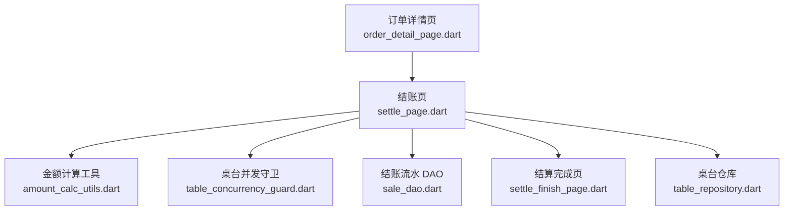
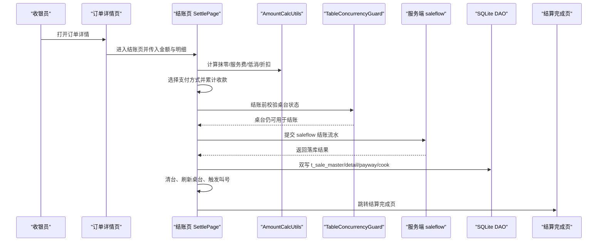
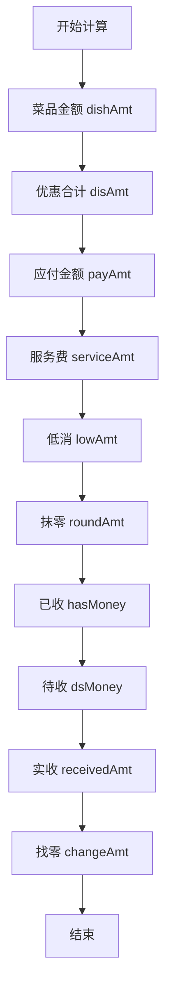
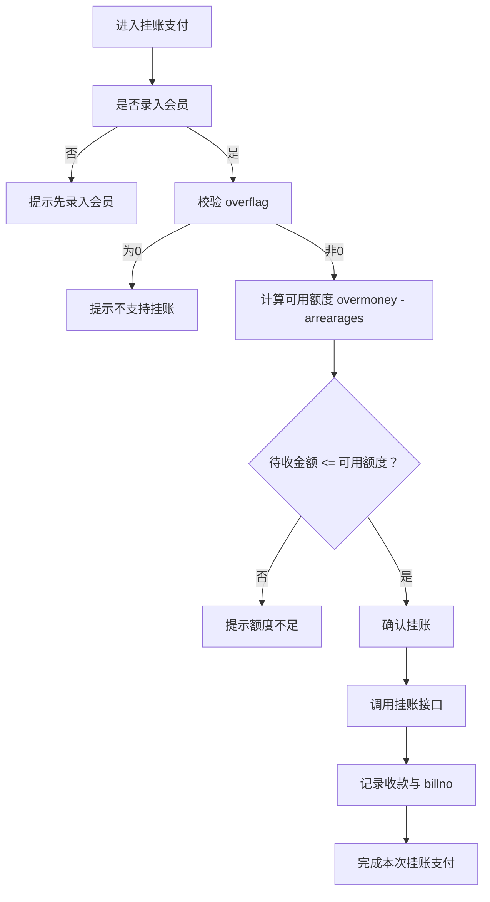
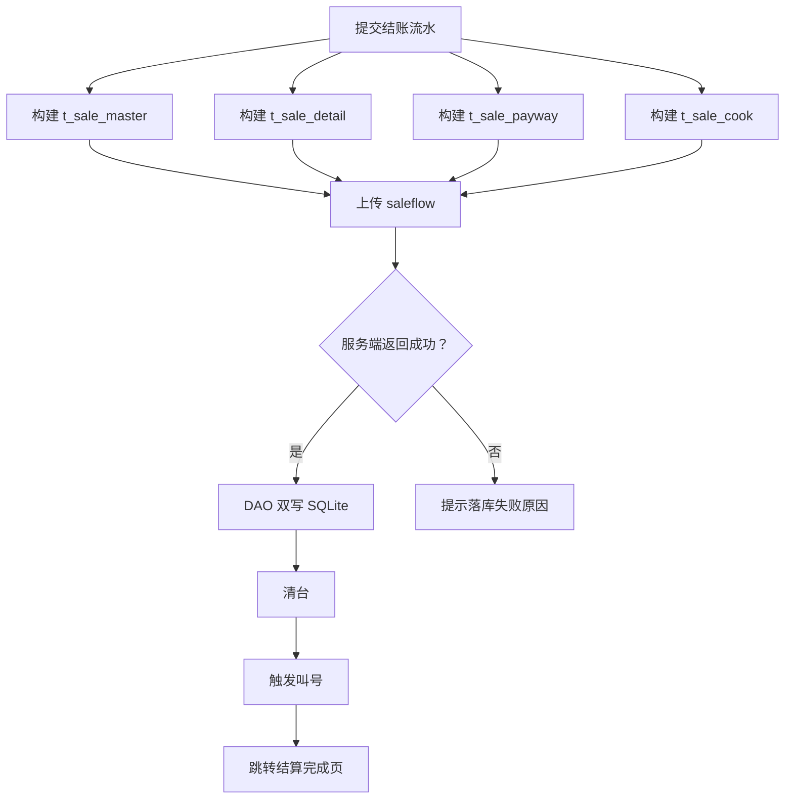
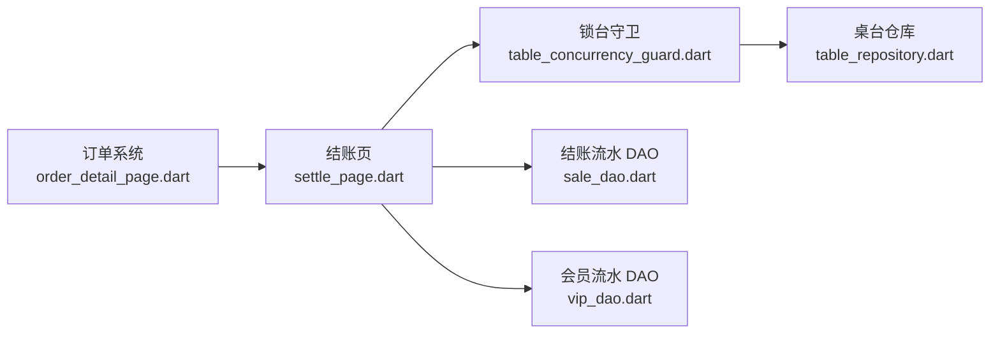
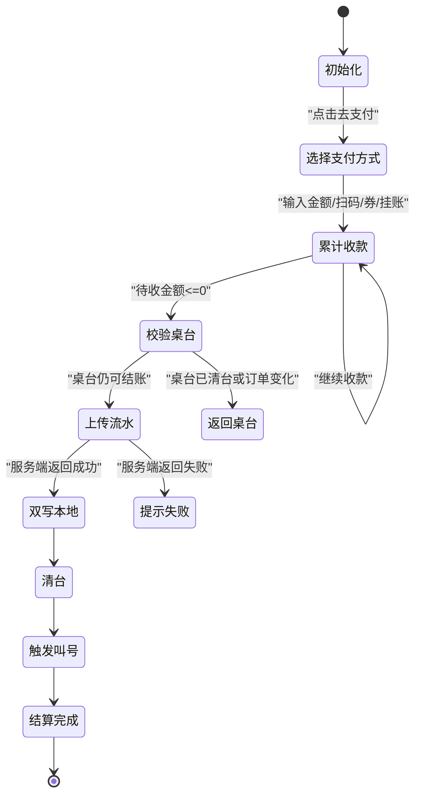

# 结账流程与账单计算

<cite>
**本文引用的文件**   
- [lib/pages/order/settle_page.dart](file://lib/pages/order/settle_page.dart)
- [lib/pages/order/settle_finish_page.dart](file://lib/pages/order/settle_finish_page.dart)
- [lib/util/amount_calc_utils.dart](file://lib/util/amount_calc_utils.dart)
- [lib/db/sale_dao.dart](file://lib/db/sale_dao.dart)
- [lib/util/table_concurrency_guard.dart](file://lib/util/table_concurrency_guard.dart)
- [lib/pages/order/order_detail_page.dart](file://lib/pages/order/order_detail_page.dart)
- [lib/pages/home/table/table_repository.dart](file://lib/pages/home/table/table_repository.dart)
</cite>

## 目录
1. [引言](#引言)
2. [项目结构与职责边界](#项目结构与职责边界)
3. [结账完整流程](#结账完整流程)
4. [金额计算规则与精度处理](#金额计算规则与精度处理)
5. [会员挂账信息在结账中的使用](#会员挂账信息在结账中的使用)
6. [交易流水生成与数据库持久化](#交易流水生成与数据库持久化)
7. [桌台状态、订单系统与 DAO 层交互](#桌台状态订单系统与-dao-层交互)
8. [异常处理、重复提交防护与并发锁](#异常处理重复提交防护与并发锁)
9. [常见问题排查](#常见问题排查)
10. [结论](#结论)

## 引言
本文件面向收银端 Flutter 代码，围绕“结账流程与账单计算”子模块进行系统化说明。重点包括：

- `SettlePage` 的完整结账路径：从订单详情页进入，展示菜品金额、服务费、低消、优惠、抹零、应收、实收、找零，再到支付方式选择、交易流水提交、结算完成页跳转。
- 金额字段 `dishAmt`、`serviceAmt`、`lowAmt`、`disAmt`、`payAmt`、`receivedAmt`、`changeAmt` 的计算口径与精度约束。
- 会员挂账参数 `overflag`、`overmoney`、`arrearages`、`nowmoney`、`prefetype` 在结账中的校验和使用方式。
- 交接班数据、取餐号、收银员信息的生成规则。
- 与桌台状态、订单系统、SQLite DAO 层的交互关系。
- 结账异常、重复提交防护与锁台并发控制机制。
- 常见故障排查建议，如金额不一致、支付后未更新桌台状态等。

## 项目结构与职责边界
结账相关代码分布在页面层、工具层和数据库层三个维度：

| 层次 | 主要文件 | 职责 |
|---|---|---|
| 页面层 | `lib/pages/order/settle_page.dart` | 结账主界面、金额重算、支付方式选择、扫码/券/挂账/减免逻辑、结账流水构建与提交、清台、取餐号触发、完成页跳转 |
| 页面层 | `lib/pages/order/settle_finish_page.dart` | 结算完成结果展示、返回桌台或快餐点菜页 |
| 工具层 | `lib/util/amount_calc_utils.dart` | 精确四则运算、抹零、低消差、服务费、折扣计算 |
| 工具层 | `lib/util/table_concurrency_guard.dart` | 锁台开关、拉取最新桌台状态、锁台/解锁接口封装、其他设备操作提示 |
| 页面层 | `lib/pages/order/order_detail_page.dart` | 订单详情加载、价格汇总、促销与会员价处理、跳转到结账页 |
| 仓库层 | `lib/pages/home/table/table_repository.dart` | 桌台区域与桌台列表查询，云服务与主设备模式分发 |
| 数据层 | `lib/db/sale_dao.dart` | 本地 SQLite 批量写入 `t_sale_master`、`t_sale_detail`、`t_sale_payway`、`t_sale_cook` |

**图表来源**
- [lib/pages/order/order_detail_page.dart:1-120](file://lib/pages/order/order_detail_page.dart#L1-L120)
- [lib/pages/order/settle_page.dart:1-120](file://lib/pages/order/settle_page.dart#L1-L120)
- [lib/util/amount_calc_utils.dart:1-60](file://lib/util/amount_calc_utils.dart#L1-L60)
- [lib/util/table_concurrency_guard.dart:1-60](file://lib/util/table_concurrency_guard.dart#L1-L60)
- [lib/pages/home/table/table_repository.dart:1-40](file://lib/pages/home/table/table_repository.dart#L1-L40)
- [lib/db/sale_dao.dart:1-20](file://lib/db/sale_dao.dart#L1-L20)
- [lib/pages/order/settle_finish_page.dart:1-40](file://lib/pages/order/settle_finish_page.dart#L1-L40)

**章节来源**
- [lib/pages/order/order_detail_page.dart:1-120](file://lib/pages/order/order_detail_page.dart#L1-L120)
- [lib/pages/order/settle_page.dart:1-120](file://lib/pages/order/settle_page.dart#L1-L120)
- [lib/util/amount_calc_utils.dart:1-60](file://lib/util/amount_calc_utils.dart#L1-L60)
- [lib/util/table_concurrency_guard.dart:1-60](file://lib/util/table_concurrency_guard.dart#L1-L60)
- [lib/pages/home/table/table_repository.dart:1-40](file://lib/pages/home/table/table_repository.dart#L1-L40)
- [lib/db/sale_dao.dart:1-20](file://lib/db/sale_dao.dart#L1-L20)
- [lib/pages/order/settle_finish_page.dart:1-40](file://lib/pages/order/settle_finish_page.dart#L1-L40)

## 结账完整流程
`SettlePage` 是结账主控制器，入口来自订单详情页的“去结账”。其核心流程如下：

1. **权限检查与初始化**
   - 若无结账权限，自动返回。
   - 初始化会员挂账信息、基准金额、抹零、支付方式列表、促销活动、暂结开关、打印单据记忆。
   - 订阅锁台事件，防止其他设备在同一桌台结账时产生冲突。

2. **展示应收与明细**
   - 展示菜品费、服务费、低消、优惠合计、抹零、应收金额。
   - 支持会员录入、优惠券选择、促销活动应用、团购核销。

3. **选择支付方式并累计收款**
   - 支持现金、会员卡、支付宝、微信、云闪付、会员挂账、减免、面额支付、优惠券。
   - 每次收款更新已收金额 `_hasMoney` 与待收金额 `_dsMoney`。
   - 当待收金额小于等于极小阈值时，视为全部付清。

4. **提交结账流水**
   - 再次校验桌台状态是否仍可结账。
   - 获取服务器时间作为账单时间。
   - 整单暂结走暂结分支；正常结账逐笔处理会员支付记录。
   - 构建 `SaleMaster`、`SaleDetail`、`SalePayway`、`Cook` 数据。
   - 上传 `saleflow`，成功后打印结账单、双写本地流水、清台、刷新桌台、触发叫号、跳转完成页。

5. **结算完成页**
   - 显示订单明细份数、应收、实收、找零、订单号、收银员、支付方式、支付时间。
   - 点击完成后刷新桌台并返回桌台首页；快餐模式重新进入点菜页。

**图表来源**
- [lib/pages/order/settle_page.dart:201-320](file://lib/pages/order/settle_page.dart#L201-L320)
- [lib/pages/order/settle_page.dart:601-780](file://lib/pages/order/settle_page.dart#L601-L780)
- [lib/pages/order/settle_page.dart:1101-1466](file://lib/pages/order/settle_page.dart#L1101-L1466)
- [lib/util/amount_calc_utils.dart:1-60](file://lib/util/amount_calc_utils.dart#L1-L60)
- [lib/util/table_concurrency_guard.dart:1-60](file://lib/util/table_concurrency_guard.dart#L1-L60)
- [lib/db/sale_dao.dart:1-49](file://lib/db/sale_dao.dart#L1-L49)
- [lib/pages/order/settle_finish_page.dart:1-80](file://lib/pages/order/settle_finish_page.dart#L1-L80)

**章节来源**
- [lib/pages/order/settle_page.dart:201-320](file://lib/pages/order/settle_page.dart#L201-L320)
- [lib/pages/order/settle_page.dart:601-780](file://lib/pages/order/settle_page.dart#L601-L780)
- [lib/pages/order/settle_page.dart:1101-1466](file://lib/pages/order/settle_page.dart#L1101-L1466)
- [lib/pages/order/settle_finish_page.dart:1-80](file://lib/pages/order/settle_finish_page.dart#L1-L80)

## 金额计算规则与精度处理
结账金额由多个字段组成，各字段含义与计算规则如下：

| 字段 | 含义 | 计算规则 | 精度处理 |
|---|---|---|---|
| `dishAmt` | 菜品金额 | 订单详情页与结账页共同维护，按明细 `rramt` 基准叠加促销与会员最优价变动 | 保留两位小数 |
| `serviceAmt` | 服务费 | 正餐模式下根据桌台类型与服务费配置计算；百分比、固定金额、按时段、按人数均可 | 保留两位小数 |
| `lowAmt` | 低消 | 餐桌低消或人均低消标准；若当前消费低于低消标准，可产生低消差 | 保留两位小数 |
| `disAmt` | 优惠合计 | 包含会员价更优差额、促销活动优惠、满减整单优惠 | 保留两位小数 |
| `payAmt` | 应付金额 | 由订单详情页传入，结账页以基准值为基础随促销/会员调整 | 保留两位小数 |
| `receivedAmt` | 实收金额 | 结算完成页取自服务端返回的主表字段 `payment`，回退到已收金额 `_hasMoney` | 保留两位小数 |
| `changeAmt` | 找零 | 支付金额超过待收金额时产生，多条支付方式下累加每条记录的 `changeamt` | 保留两位小数 |

### 抹零与币种抹零
- 抹零金额通过 `AmountCalcUtils.getEraseAmt` 计算，默认读取配置的小额抹零标志。
- 支持九种抹零策略：四舍五入到角、四舍五入到元、四舍五入到十元、去分、去角、抹零到五角、四舍五入到五角、进角、进元。
- 币种抹零开启时，抹零金额作为“06 减免”支付方式记录，同时增加已收金额、减少待收金额。

### 低消差
- 低消标准由餐桌低消或人均低消决定。
- 若服务费计入低消，则用商品总金额加上服务费后再比较低消标准。
- 返回需要补齐的低消差金额；已达到低消时返回 0。

### 服务费
- 正餐模式才计费。
- 支持按消费金额百分比、指定金额、按小时、按人数四种模式。
- 起步递增与时段区间配置由服务端兜底，本地不直接计算。

### 折扣
- 折扣率大于 0 且小于 100 时才生效。
- 折扣价 = 原价 × 折扣率 / 100。
- 折扣金额 = 原价 − 折扣价。

### 精度统一
- 所有金额加减乘除都通过 `AmountCalcUtils.add/sub/mul/div` 处理，内部统一保留两位小数。
- 结账页内部 `_rd2` 也强制将 double 转为两位字符串再解析，避免浮点尾差导致服务端字段超长。

**图表来源**
- [lib/util/amount_calc_utils.dart:1-200](file://lib/util/amount_calc_utils.dart#L1-L200)
- [lib/util/amount_calc_utils.dart:201-371](file://lib/util/amount_calc_utils.dart#L201-L371)
- [lib/pages/order/settle_page.dart:201-320](file://lib/pages/order/settle_page.dart#L201-L320)

**章节来源**
- [lib/util/amount_calc_utils.dart:1-200](file://lib/util/amount_calc_utils.dart#L1-L200)
- [lib/util/amount_calc_utils.dart:201-371](file://lib/util/amount_calc_utils.dart#L201-L371)
- [lib/pages/order/settle_page.dart:201-320](file://lib/pages/order/settle_page.dart#L201-L320)

## 会员挂账信息在结账中的使用
会员挂账信息与会员优惠类型在结账中有明确用途：

| 会员字段 | 含义 | 结账使用方式 |
|---|---|---|
| `overflag` | 是否启用挂账 | 挂账支付前校验，为 0 时不允许挂账 |
| `overmoney` | 挂账额度上限 | 与 `arrearages` 一起计算剩余额度 |
| `arrearages` | 已有欠款 | 从额度中扣除，得到可用挂账额度 |
| `nowmoney` | 会员余额 | 会员卡支付时校验余额是否足够 |
| `prefetype` | 会员优惠类型 | 决定会员价计算方式：按折扣、按固定价、按多档价 |

### 挂账校验流程
1. 选择会员挂账支付方式时，必须先录入会员。
2. 校验 `overflag` 是否为 0，为 0 则提示不支持挂账。
3. 计算可用额度：`overmoney - arrearages`。
4. 若待收金额大于可用额度，提示额度不足。
5. 确认后调用挂账接口，记录挂账流水号，并在收款记录中保存 `billno`，用于撤销时反向记账。

### 会员卡余额校验
- 选择会员卡支付时，若 `nowmoney > 0` 且待收金额大于余额，则拒绝支付。
- 成功提交结账流水后，会遍历收款记录中 `payid == '02'` 的会员支付项，逐笔调用会员扣款接口，并按自身 `payamt` 扣款，避免混合支付时多扣。

### 会员价最优策略
- 会员价与活动价不能简单叠加；结账页先恢复基准明细，再应用会员最优价，最后应用促销活动。
- 若会员价更优，则覆盖当前单价；若促销活动更优，才进一步覆盖会员价。

**图表来源**
- [lib/pages/order/settle_page.dart:601-780](file://lib/pages/order/settle_page.dart#L601-L780)
- [lib/pages/order/settle_page.dart:1101-1466](file://lib/pages/order/settle_page.dart#L1101-L1466)

**章节来源**
- [lib/pages/order/settle_page.dart:601-780](file://lib/pages/order/settle_page.dart#L601-L780)
- [lib/pages/order/settle_page.dart:1101-1466](file://lib/pages/order/settle_page.dart#L1101-L1466)

## 交易流水生成与数据库持久化
结账成功后，`SettlePage` 会构建完整的交易流水数据结构，并交由服务端与本地数据库分别处理。

### 流水数据结构
| 表名 | 数据来源 | 关键作用 |
|---|---|---|
| `t_sale_master` | `_buildSaleMaster` | 主单信息：订单号、金额、时间、服务员、收银员等 |
| `t_sale_detail` | `_buildSaleDetail` | 菜品明细、做法、数量、单价、优惠标记 |
| `t_sale_payway` | `_buildSalePayway` | 支付方式明细：现金、会员卡、扫码、优惠券、挂账、减免等 |
| `t_sale_cook` | `_buildSaleCook` | 菜品做法集合 |

### 本地持久化
`SaleDao.saveSaleFlow` 接收服务端 `saleflow` 中的单条数据，将其拆分为四个表的行数据，并通过 `AppDatabase.batchInsert` 批量写入 SQLite。注释明确说明：云端上传成功后双写本地 4 表，供交班页本地统计使用。

### 字段精度与交接班数据
- 支付方式金额字段 `payamt`、`rramt`、`changeamt`、`faceamt`、`actulamt`、`virtualamt`、`vipnowmoney` 都会统一保留两位小数。
- `actulamt`（实付）与 `virtualamt`（虚付）根据支付方式配置判断：
  - 减免支付方式记为 0 实付、0 虚付。
  - 其他支付方式根据 `handoverflag` 决定实付或虚付，用于交班对账。

### 收银员信息
- 有桌台时优先取桌台 `tmp.servername`。
- 无桌台时取传入的 `serverName`。
- 两者都为空时取当前登录用户名。

### 取餐号
- 仅快餐模式且叫号开关开启时生成。
- 通过 `getTakeSnackCodeBySet` 接口获取 `takecode`。
- 桌台结账不产生取餐号，避免与叫号混淆。

**图表来源**
- [lib/pages/order/settle_page.dart:1701-2103](file://lib/pages/order/settle_page.dart#L1701-L2103)
- [lib/db/sale_dao.dart:1-49](file://lib/db/sale_dao.dart#L1-L49)

**章节来源**
- [lib/pages/order/settle_page.dart:1701-2103](file://lib/pages/order/settle_page.dart#L1701-L2103)
- [lib/db/sale_dao.dart:1-49](file://lib/db/sale_dao.dart#L1-L49)

## 桌台状态、订单系统与 DAO 层交互
结账不是孤立流程，它依赖桌台状态、订单系统、支付方式、会员服务和数据库 DAO。

### 桌台状态校验
- `_ensureTableStillCheckoutable` 在支付前和上传流水前两次校验桌台状态。
- 若桌台被清台、状态变为空闲或已结束，或订单 `saleid` 发生变化，则阻止继续结账。
- 使用 `TableConcurrencyGuard.fetchLatest` 拉取最新桌台数据，并复用 5 秒内结果以减少频繁请求。

### 桌台仓库
`TableRepository` 负责根据主设备模式或云服务模式查询桌台区域与桌台列表。结账流程中主要用于锁台守卫拉取最新桌台信息，而不是直接参与业务状态变更。

### 订单系统
- 订单详情页负责加载订单明细、价格汇总、促销与会员价。
- 结账页继承订单详情页传入的金额与明细快照，并在此基础上进行抹零、促销、会员价调整。
- 会员同步通过 `OrderRepository.updateMasterTmpVip` 更新桌台临时信息中的会员标识。

### DAO 层
- `SaleDao` 负责本地流水双写。
- 会员流水在 Web 环境外尝试写入本地会员流水表，失败静默不阻断结账。
- 桌台状态变更最终通过桌台事件总线通知 UI 刷新。

**图表来源**
- [lib/pages/order/order_detail_page.dart:1-120](file://lib/pages/order/order_detail_page.dart#L1-L120)
- [lib/pages/order/settle_page.dart:201-320](file://lib/pages/order/settle_page.dart#L201-L320)
- [lib/util/table_concurrency_guard.dart:1-120](file://lib/util/table_concurrency_guard.dart#L1-L120)
- [lib/pages/home/table/table_repository.dart:1-137](file://lib/pages/home/table/table_repository.dart#L1-L137)
- [lib/db/sale_dao.dart:1-49](file://lib/db/sale_dao.dart#L1-L49)

**章节来源**
- [lib/pages/order/order_detail_page.dart:1-120](file://lib/pages/order/order_detail_page.dart#L1-L120)
- [lib/pages/order/settle_page.dart:201-320](file://lib/pages/order/settle_page.dart#L201-L320)
- [lib/util/table_concurrency_guard.dart:1-120](file://lib/util/table_concurrency_guard.dart#L1-L120)
- [lib/pages/home/table/table_repository.dart:1-137](file://lib/pages/home/table/table_repository.dart#L1-L137)
- [lib/db/sale_dao.dart:1-49](file://lib/db/sale_dao.dart#L1-L49)

## 异常处理、重复提交防护与并发锁
结账流程有多层防护，避免重复提交、并发冲突和数据不一致。

### 重复提交防护
- `_submitting` 标记防止重复提交。
- 0 元结账时检查是否已有 0 元现金记录，避免重复添加。
- 支付方式选择后多次支付，直到待收金额小于等于极小阈值才触发提交。

### 并发锁机制
- 结账页订阅锁台事件，当其他设备解锁同一桌台时弹窗提示并返回桌台首页。
- `TableConcurrencyGuard.listenLockEvent` 仅在锁台功能启用时生效。
- 锁台提示对话框倒计时 3 秒后自动关闭并执行退出回调。

### 桌台状态一致性
- 支付前校验一次桌台状态。
- 上传流水前强制再校验一次。
- 清台失败不阻断结账成功流程，但会触发桌台刷新事件，以便下次操作能发现真实状态。

### 登录态失效处理
- 上传流水前获取服务器时间，若返回码表示登录过期，则提示重新登录，不再继续结账。

### 支付方式撤销
- 手动减免、优惠券、会员挂账支持撤销。
- 撤销时会调用反向接口：挂账反记账、优惠券反核销。
- 自动抹零记录不可撤销。

**图表来源**
- [lib/pages/order/settle_page.dart:601-780](file://lib/pages/order/settle_page.dart#L601-L780)
- [lib/pages/order/settle_page.dart:1101-1466](file://lib/pages/order/settle_page.dart#L1101-L1466)
- [lib/util/table_concurrency_guard.dart:1-200](file://lib/util/table_concurrency_guard.dart#L1-L200)

**章节来源**
- [lib/pages/order/settle_page.dart:601-780](file://lib/pages/order/settle_page.dart#L601-L780)
- [lib/pages/order/settle_page.dart:1101-1466](file://lib/pages/order/settle_page.dart#L1101-L1466)
- [lib/util/table_concurrency_guard.dart:1-200](file://lib/util/table_concurrency_guard.dart#L1-L200)

## 常见问题排查
### 问题一：应收金额与实际收款不一致
**可能原因：**
- 促销与会员价重复计算。
- 抹零未正确计入“06 减免”。
- 优惠券或团购核销金额未扣减待收金额。
- 浮点精度导致 `payamt` 出现尾差。

**排查建议：**
- 检查是否同时应用了会员价与促销活动；结账页应先恢复基准明细，再应用会员最优价，最后应用活动。
- 检查币种抹零是否开启，以及 `_roundAmt` 是否正确加入 `_salePayWayList`。
- 检查优惠券核销后 `_dsMoney` 是否减少。
- 确认金额计算是否经过 `AmountCalcUtils` 和 `_rd2`。

**章节来源**
- [lib/pages/order/settle_page.dart:201-320](file://lib/pages/order/settle_page.dart#L201-L320)
- [lib/pages/order/settle_page.dart:601-780](file://lib/pages/order/settle_page.dart#L601-L780)
- [lib/util/amount_calc_utils.dart:1-200](file://lib/util/amount_calc_utils.dart#L1-L200)

### 问题二：支付成功后桌台状态未更新
**可能原因：**
- 服务端 `saleflow` 返回成功，但本地清台接口失败。
- 客户端未触发桌台刷新事件。
- 锁台事件导致结账中途被中断。

**排查建议：**
- 查看服务端 `data[0].retcode` 是否确实为 0，不要只看顶层响应。
- 检查清台接口调用是否抛异常。
- 确认 `TableEventBus.fireTableChanged()` 是否执行。
- 检查是否因其他设备解锁桌台而提前返回。

**章节来源**
- [lib/pages/order/settle_page.dart:1701-2103](file://lib/pages/order/settle_page.dart#L1701-L2103)
- [lib/util/table_concurrency_guard.dart:1-200](file://lib/util/table_concurrency_guard.dart#L1-L200)

### 问题三：会员挂账失败或额度计算错误
**可能原因：**
- `overflag` 未启用。
- `overmoney - arrearages` 计算后额度不足。
- 撤销挂账时反向记账金额符号错误。

**排查建议：**
- 确认会员是否支持挂账。
- 核对 `overmoney` 与 `arrearages` 的实际值。
- 检查撤销挂账时传入的 `amt` 是否为负数。

**章节来源**
- [lib/pages/order/settle_page.dart:601-780](file://lib/pages/order/settle_page.dart#L601-L780)
- [lib/pages/order/settle_page.dart:1101-1466](file://lib/pages/order/settle_page.dart#L1101-L1466)

### 问题四：本地流水缺失
**可能原因：**
- 非 Web 环境下 DAO 写入失败。
- 服务端 `saleflow` 未成功返回，流程未进入双写分支。

**排查建议：**
- 检查服务端返回结构是否包含 `data[0].retcode == 0`。
- 检查 `SaleDao.saveSaleFlow` 是否被调用。
- 查看 SQLite 中 `t_sale_master`、`t_sale_detail`、`t_sale_payway`、`t_sale_cook` 是否写入成功。

**章节来源**
- [lib/pages/order/settle_page.dart:1701-2103](file://lib/pages/order/settle_page.dart#L1701-L2103)
- [lib/db/sale_dao.dart:1-49](file://lib/db/sale_dao.dart#L1-L49)

### 问题五：取餐号未生成
**可能原因：**
- 非快餐模式。
- 叫号开关未开启。
- 桌台结账不需要取餐号。
- 接口返回结构中取餐号字段为空。

**排查建议：**
- 确认商业模式为快餐。
- 检查 `ParamsSpUtils.getPickupCallSwitch()`。
- 确认无桌台结账场景。
- 检查接口返回 `takecode` 或 `takeSnackcode`。

**章节来源**
- [lib/pages/order/settle_page.dart:1701-2103](file://lib/pages/order/settle_page.dart#L1701-L2103)

## 结论
结账流程是一个连接订单、支付、会员、桌台、数据库和服务端的综合业务闭环。`SettlePage` 承担主控制职责，`AmountCalcUtils` 提供金额计算基础能力，`TableConcurrencyGuard` 保障桌台并发安全，`SaleDao` 保证本地流水可追溯。

在实际维护和扩展时，应重点关注以下原则：

1. 所有金额计算必须经过统一精度处理，避免浮点误差。
2. 会员价与活动价采用最优策略，不得简单叠加。
3. 结账前和上传前都必须校验桌台状态，防止清台后生成虚假流水。
4. 会员支付、挂账、优惠券、减免等支付方式必须逐笔处理，确保后台报表准确。
5. 本地流水双写失败不应阻断结账流程，但必须记录日志便于排查。
6. 取餐号、收银员、支付方式拼接、实收找零等展示字段应与服务端返回一致。