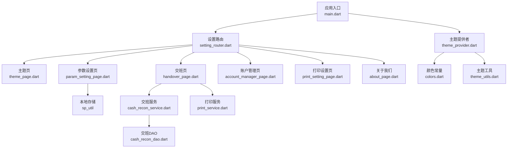
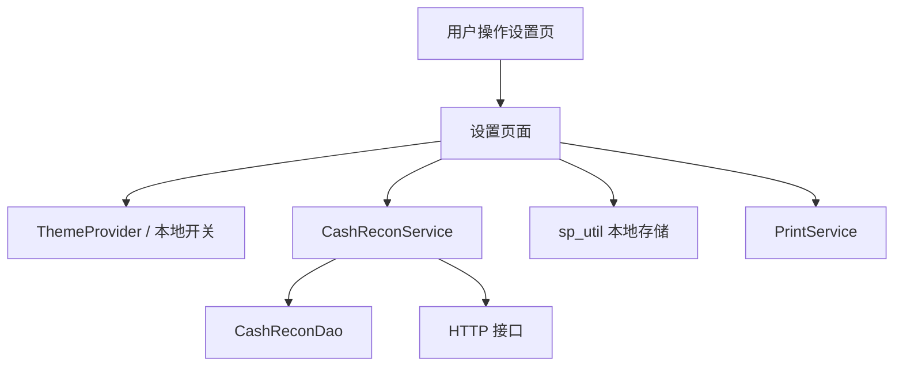
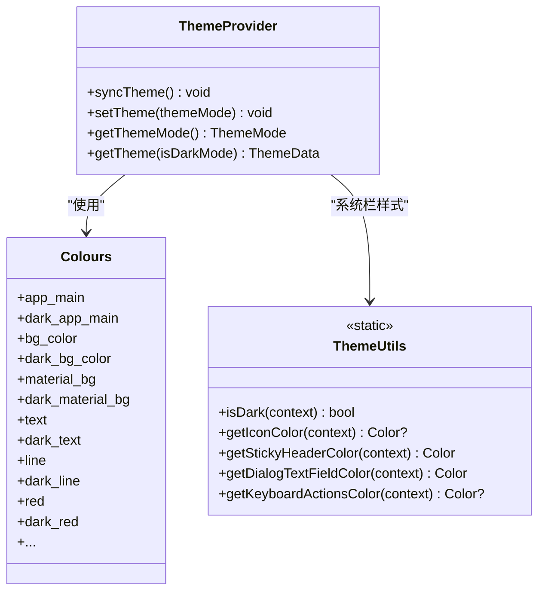
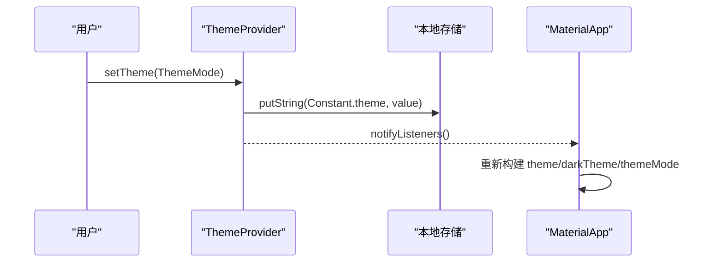
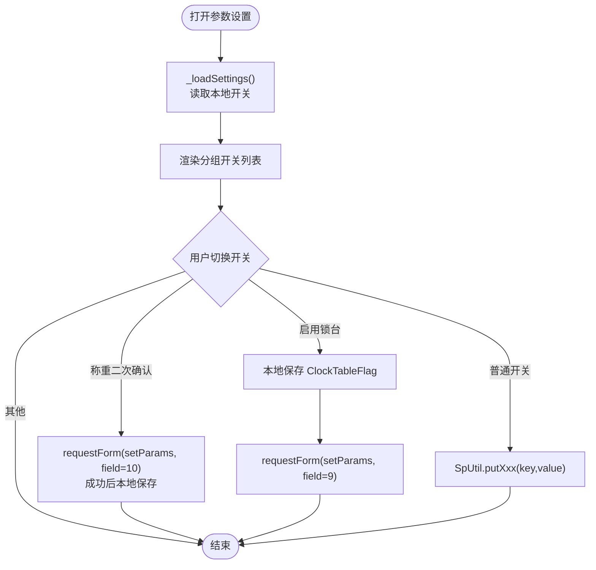
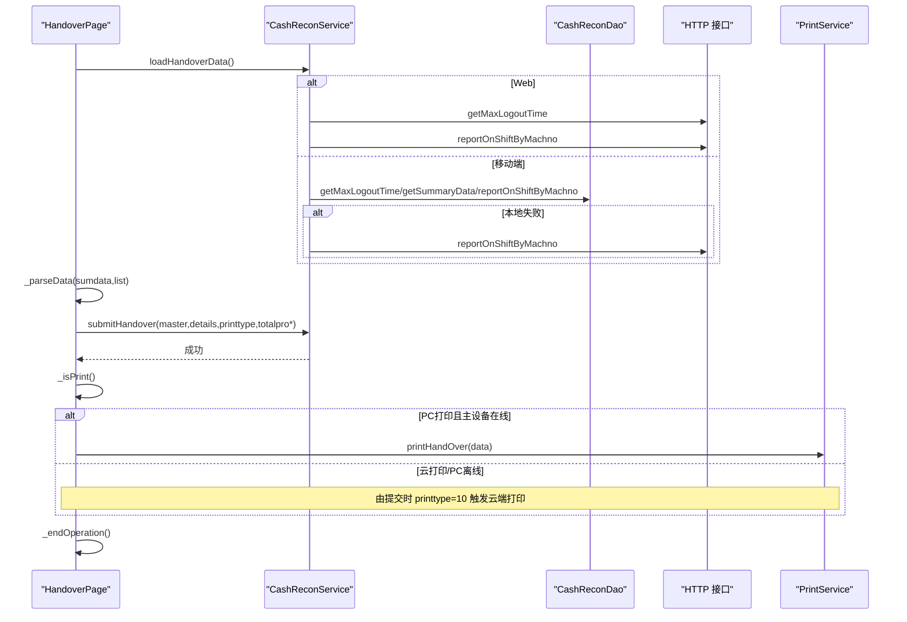
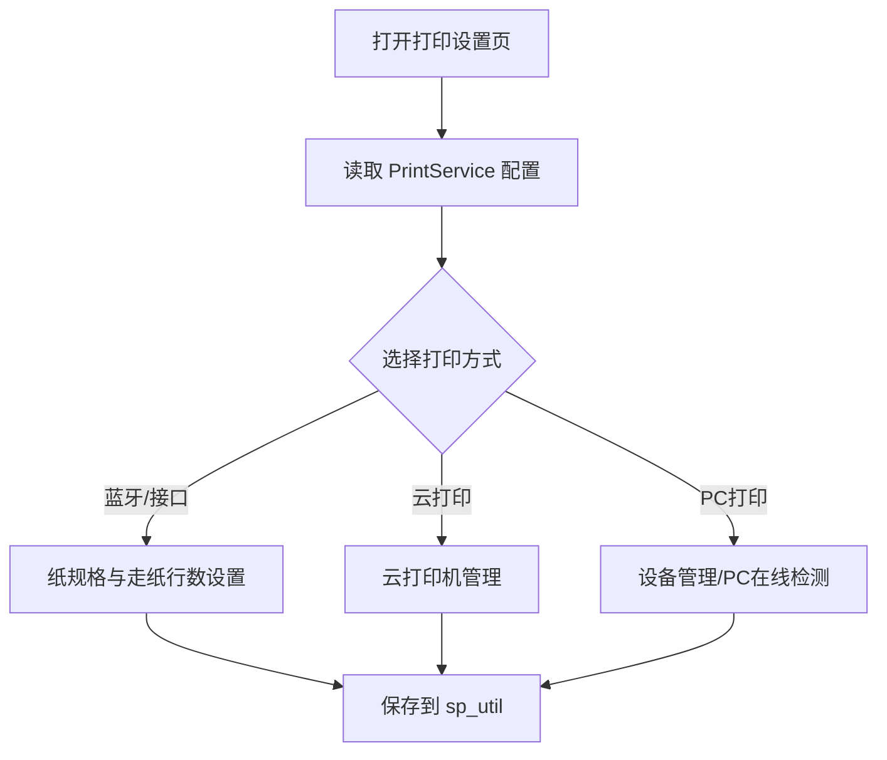
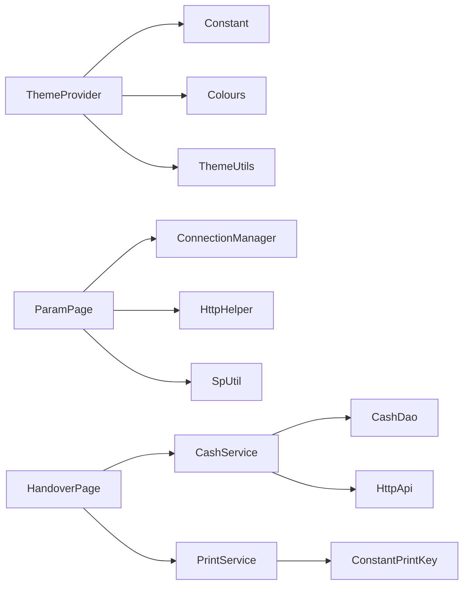

# 设置管理模块

<cite>
**本文引用的文件 **   
- [lib/main.dart](file://lib/main.dart)
- [lib/setting/provider/theme_provider.dart](file://lib/setting/provider/theme_provider.dart)
- [lib/util/theme_utils.dart](file://lib/util/theme_utils.dart)
- [lib/res/colors.dart](file://lib/res/colors.dart)
- [lib/res/constant.dart](file://lib/res/constant.dart)
- [lib/setting/page/theme_page.dart](file://lib/setting/page/theme_page.dart)
- [lib/setting/page/param_setting_page.dart](file://lib/setting/page/param_setting_page.dart)
- [lib/setting/page/handover_page.dart](file://lib/setting/page/handover_page.dart)
- [lib/service/cash_recon_service.dart](file://lib/service/cash_recon_service.dart)
- [lib/db/cash_recon_dao.dart](file://lib/db/cash_recon_dao.dart)
- [lib/util/print_service.dart](file://lib/util/print_service.dart)
- [lib/res/constant_print_key.dart](file://lib/res/constant_print_key.dart)
- [lib/setting/page/account_manager_page.dart](file://lib/setting/page/account_manager_page.dart)
- [lib/setting/page/print_setting_page.dart](file://lib/setting/page/print_setting_page.dart)
- [lib/setting/page/about_page.dart](file://lib/setting/page/about_page.dart)
- [lib/setting/setting_router.dart](file://lib/setting/setting_router.dart)
</cite>

## 目录
1. [引言](#引言)
2. [项目结构](#项目结构)
3. [核心组件](#核心组件)
4. [架构总览](#架构总览)
5. [详细组件分析](#详细组件分析)
6. [依赖关系分析](#依赖关系分析)
7. [性能与可靠性](#性能与可靠性)
8. [故障排查指南](#故障排查指南)
9. [最佳实践](#最佳实践)
10. [结论](#结论)

## 引言
本文件面向聚客美滋滋应用的“设置管理模块”，围绕以下目标展开：
- 主题切换系统（跟随系统、亮色、暗色）的架构设计与 Provider 状态管理。
- 参数配置管理：业务开关的本地持久化与部分服务端的同步策略。
- 交班对账功能：数据加载、统计汇总、报表展示、打印与上报流程。
- 账户管理、打印机配置、应用信息展示等设置项的使用说明。
- 设置数据与业务模块解耦设计、配置热更新机制及常见问题排查方法。

该模块以 Flutter + Provider 为主，使用 sp_util 做本地存储，结合网络层 DAO 与服务类完成云端和本地数据的统一抽象。

## 项目结构
设置模块位于 lib/setting 下，采用“页面 + Provider + 工具/常量”的分层组织方式：
- setting_router.dart：集中注册所有设置路由。
- page/：各设置子页面（主题、参数、交班、账户、打印、关于等）。
- provider/theme_provider.dart：主题状态提供者。
- res/constant*.dart：全局常量与本地存储键名。
- util/print_service.dart、util/theme_utils.dart：跨模块共享能力。

**图表来源**
- [lib/main.dart:76-120](file://lib/main.dart#L76-L120)
- [lib/setting/setting_router.dart:1-39](file://lib/setting/setting_router.dart#L1-L39)
- [lib/setting/provider/theme_provider.dart:1-92](file://lib/setting/provider/theme_provider.dart#L1-L92)
- [lib/setting/page/param_setting_page.dart:1-200](file://lib/setting/page/param_setting_page.dart#L1-L200)
- [lib/setting/page/handover_page.dart:1-200](file://lib/setting/page/handover_page.dart#L1-L200)
- [lib/service/cash_recon_service.dart:1-200](file://lib/service/cash_recon_service.dart#L1-L200)
- [lib/db/cash_recon_dao.dart:1-200](file://lib/db/cash_recon_dao.dart#L1-L200)
- [lib/util/print_service.dart:1-200](file://lib/util/print_service.dart#L1-L200)
- [lib/res/colors.dart:1-46](file://lib/res/colors.dart#L1-L46)
- [lib/util/theme_utils.dart:1-52](file://lib/util/theme_utils.dart#L1-L52)

**章节来源**
- [lib/setting/setting_router.dart:1-39](file://lib/setting/setting_router.dart#L1-L39)
- [lib/main.dart:76-120](file://lib/main.dart#L76-L120)

## 核心组件
- 主题提供者 ThemeProvider：封装主题模式读写、Material/Cupertino 主题构建、系统栏样式选择。
- 参数设置 ParamSettingPage：聚合连接、结账、点菜、桌台、显示等多组开关；部分开关需调用服务端接口同步。
- 交班服务 CashReconService：平台分流（Web 走云接口，移动端优先本地或云端），组装 sumdata/list/logintime/logouttime。
- 交班 DAO CashReconDao：将 Java/Kotlin SQL 迁移为 Dart 参数化查询，提供时间窗口、汇总与 UNION 明细。
- 打印服务 PrintService：统一管理 PC/云/蓝牙/接口打印类型及相关配置。
- 常量与资源：Constant 与 ConstantPrintKey 集中定义存储键、打印枚举值；Colours 定义明暗主题配色。

**章节来源**
- [lib/setting/provider/theme_provider.dart:1-92](file://lib/setting/provider/theme_provider.dart#L1-L92)
- [lib/setting/page/param_setting_page.dart:1-200](file://lib/setting/page/param_setting_page.dart#L1-L200)
- [lib/service/cash_recon_service.dart:1-200](file://lib/service/cash_recon_service.dart#L1-L200)
- [lib/db/cash_recon_dao.dart:1-200](file://lib/db/cash_recon_dao.dart#L1-L200)
- [lib/util/print_service.dart:1-200](file://lib/util/print_service.dart#L1-L200)
- [lib/res/constant.dart:1-93](file://lib/res/constant.dart#L1-L93)
- [lib/res/constant_print_key.dart:1-147](file://lib/res/constant_print_key.dart#L1-L147)
- [lib/res/colors.dart:1-46](file://lib/res/colors.dart#L1-L46)

## 架构总览
设置模块遵循“UI 页面 -> 领域服务 -> 数据访问 -> 存储/网络”的分层模型：
- UI 层仅负责用户交互与展示，不直接操作数据库或网络。
- 领域服务（如 CashReconService）屏蔽平台差异与数据来源优先级。
- DAO 层封装 SQL 与表结构，保持业务逻辑与数据实现解耦。
- 存储层通过 sp_util 统一读取/写入本地键值；网络层通过 http_helper/requestForm 发送请求。

**图表来源**
- [lib/setting/page/theme_page.dart:1-72](file://lib/setting/page/theme_page.dart#L1-L72)
- [lib/setting/page/param_setting_page.dart:1-200](file://lib/setting/page/param_setting_page.dart#L1-L200)
- [lib/setting/page/handover_page.dart:1-200](file://lib/setting/page/handover_page.dart#L1-L200)
- [lib/service/cash_recon_service.dart:1-200](file://lib/service/cash_recon_service.dart#L1-L200)
- [lib/db/cash_recon_dao.dart:1-200](file://lib/db/cash_recon_dao.dart#L1-L200)
- [lib/util/print_service.dart:1-200](file://lib/util/print_service.dart#L1-L200)

## 详细组件分析

### 主题系统与 Provider 状态管理
- 入口装配：MyApp 通过 MultiProvider 注入 ThemeProvider，并通过 Consumer 包裹 MaterialApp，根据 provider.getThemeMode() 决定 theme/darkTheme 与 themeMode。
- 状态读写：
  - getThemeMode：从本地读取主题字符串并映射到 ThemeMode.system/light/dark。
  - setTheme：写入本地并通知监听者刷新。
  - syncTheme：启动时检查本地主题是否非系统模式，必要时触发刷新。
- 主题构建：getTheme 构造 ThemeData，区分亮/暗配色，设置 primaryColor、colorScheme、scaffoldBackgroundColor、canvasColor、textSelectionTheme、TextTheme、InputDecorationTheme、AppBarTheme、DividerTheme、CupertinoOverrideTheme、pageTransitionsTheme、visualDensity 等。
- 辅助工具：ThemeUtils 提供 isDark、SystemUiOverlayStyle.light/dark 等静态能力；Context 扩展提供 isDark、backgroundColor、dialogBackgroundColor。

**图表来源**
- [lib/setting/provider/theme_provider.dart:1-92](file://lib/setting/provider/theme_provider.dart#L1-L92)
- [lib/util/theme_utils.dart:1-52](file://lib/util/theme_utils.dart#L1-L52)
- [lib/res/colors.dart:1-46](file://lib/res/colors.dart#L1-L46)

#### 主题切换流程（序列图）

**图表来源**
- [lib/setting/provider/theme_provider.dart:12-40](file://lib/setting/provider/theme_provider.dart#L12-L40)
- [lib/main.dart:92-120](file://lib/main.dart#L92-L120)

**章节来源**
- [lib/main.dart:76-120](file://lib/main.dart#L76-L120)
- [lib/setting/provider/theme_provider.dart:1-92](file://lib/setting/provider/theme_provider.dart#L1-L92)
- [lib/util/theme_utils.dart:1-52](file://lib/util/theme_utils.dart#L1-L52)
- [lib/res/colors.dart:1-46](file://lib/res/colors.dart#L1-L46)
- [lib/setting/page/theme_page.dart:1-72](file://lib/setting/page/theme_page.dart#L1-L72)
- [lib/res/constant.dart:1-93](file://lib/res/constant.dart#L1-L93)

### 参数配置管理
- 页面职责：ParamSettingPage 集中管理多组业务开关，包括连接设置、结账设置、点菜设置、桌台设置、显示设置与其他开关。
- 本地持久化：使用 sp_util 将开关值写入对应 key（如 print_bill、SETTLE_DY、full_payment、ENABLE_NFC、ENABLE_KD、ENABLE_PRODUCT_NUM、WeightTwoConfirm、KQ_ZJ、ClockTableFlag、qy_print、setting_ShowWaiter、setting_product_is_scans、setting_show_display_waiter、setting_show_public_cook、setting_check_down_goods、setting_single_cook）。
- 服务端同步：
  - 称重二次确认：先调用 setParams(field=10)，成功后再落本地 WeightTwoConfirm。
  - 启用锁台：先落本地 ClockTableFlag，再调用 setParams(field=9)。
- 连接模式：ConnectionManager.setServerType 返回受控标志，若后台统一管理则禁止修改并提示。

**图表来源**
- [lib/setting/page/param_setting_page.dart:1-200](file://lib/setting/page/param_setting_page.dart#L1-L200)
- [lib/setting/page/param_setting_page.dart:201-353](file://lib/setting/page/param_setting_page.dart#L201-L353)

**章节来源**
- [lib/setting/page/param_setting_page.dart:1-353](file://lib/setting/page/param_setting_page.dart#L1-L353)
- [lib/res/constant.dart:1-93](file://lib/res/constant.dart#L1-L93)

### 交班对账功能
- 数据加载流程：
  - Web：调用 getMaxLogoutTime 获取上次交班时间，再调用 reportOnShiftByMachno 获取汇总与明细。
  - iOS/Android：优先尝试本地 t_sale_* 数据（主设备在线时），失败或为空回退云端；若云端无数据再回退本地汇总。
- 数据解析：HandoverPage._parseData 过滤支付方式明细（itype==1 && handoverflag==1）、解析押金列表、菜品与分类统计列表。
- 交班提交：
  - 校验 sumdata 与 logintime 有效性。
  - 构造 master（salecnt/returnamt/rechargeamt/allpayableamt/rechargesubmitamt/reservepayamt/saleamt/payableamt/presentqty/presentamt/logintime/logouttime 等），totalreceipts = rechargesubmitamt + payableamt。
  - 调用 CashReconService.submitHandover，传入 master、details、printtype（10/-1）、totalpro* 等参数。
- 打印处理：
  - 若手选交班打印关闭，直接结束。
  - PC 打印：若主设备在线，构造 PCHandTitle 并调用 PrintService.printHandOver；若不在线，提示未连接 PC 主设备（Flutter 云模式下由提交时的 printtype=10 触发云端打印）。
  - 云打印/蓝牙/接口打印：由云端兜底打印交班单。
- 退出流程：弹出完成对话框，支持注销/退出登录/退出应用三种行为，清理记住账号密码等本地缓存并跳转登录页。

**图表来源**
- [lib/setting/page/handover_page.dart:1-200](file://lib/setting/page/handover_page.dart#L1-L200)
- [lib/setting/page/handover_page.dart:201-400](file://lib/setting/page/handover_page.dart#L201-L400)
- [lib/setting/page/handover_page.dart:401-600](file://lib/setting/page/handover_page.dart#L401-L600)
- [lib/service/cash_recon_service.dart:1-200](file://lib/service/cash_recon_service.dart#L1-L200)
- [lib/db/cash_recon_dao.dart:1-200](file://lib/db/cash_recon_dao.dart#L1-L200)
- [lib/util/print_service.dart:1-200](file://lib/util/print_service.dart#L1-L200)

**章节来源**
- [lib/setting/page/handover_page.dart:1-600](file://lib/setting/page/handover_page.dart#L1-L600)
- [lib/service/cash_recon_service.dart:1-200](file://lib/service/cash_recon_service.dart#L1-L200)
- [lib/db/cash_recon_dao.dart:1-200](file://lib/db/cash_recon_dao.dart#L1-L200)
- [lib/util/print_service.dart:1-200](file://lib/util/print_service.dart#L1-L200)

### 账户管理与应用信息展示
- 账户管理：AccountManagerPage 提供店铺 logo、修改密码、绑定账号等条目，其中修改密码跳转到登录路由中的密码更新页。
- 关于我们：AboutPage 展示 FlutterLogo 动态样式与作者博客/Github 链接，适配移动端 WebView 与桌面端浏览器打开。

**章节来源**
- [lib/setting/page/account_manager_page.dart:1-54](file://lib/setting/page/account_manager_page.dart#L1-L54)
- [lib/setting/page/about_page.dart:1-105](file://lib/setting/page/about_page.dart#L1-L105)

### 打印机配置
- 打印设置页 PrintSettingPage：
  - 打印方式选择：PC打印/云打印/蓝牙打印/接口打印。
  - 打印设备：根据当前打印方式显示不同设备管理入口。
  - 纸规格：仅在蓝牙/接口打印时显示 58mm/80mm 选择。
  - 票尾走纸行数：0~30 可调。
  - 云打印机管理：显示已选云打印机名称或未选择。
- 打印服务 PrintService：
  - 提供 printerType、printSize、feedLineCount、yunPrintName 等配置读取。
  - 支持 triggerCookPrint、triggerSettlePrint、reprintCustomerTicket、printHandOver 等方法，按 PC/云模式分别调用接口或通知主设备。

**图表来源**
- [lib/setting/page/print_setting_page.dart:1-200](file://lib/setting/page/print_setting_page.dart#L1-L200)
- [lib/util/print_service.dart:1-200](file://lib/util/print_service.dart#L1-L200)
- [lib/res/constant_print_key.dart:1-147](file://lib/res/constant_print_key.dart#L1-L147)

**章节来源**
- [lib/setting/page/print_setting_page.dart:1-319](file://lib/setting/page/print_setting_page.dart#L1-L319)
- [lib/util/print_service.dart:1-416](file://lib/util/print_service.dart#L1-L416)
- [lib/res/constant_print_key.dart:1-147](file://lib/res/constant_print_key.dart#L1-L147)

## 依赖关系分析
- 主题系统依赖：
  - main.dart 注入 ThemeProvider 并消费其主题模式。
  - ThemeProvider 依赖 Constant 中 theme 键、Colours 配色、ThemeUtils 系统栏样式。
- 参数设置依赖：
  - param_setting_page.dart 依赖 ConnectionManager（连接模式控制）、http_helper（服务端参数同步）、sp_util（本地开关）。
- 交班对账依赖：
  - handover_page.dart 依赖 CashReconService（平台分流与数据组装）、PrintService（PC/云打印）、sp_util（打印与统计开关）。
  - cash_recon_service.dart 依赖 CashReconDao（本地 SQL）、HTTP 接口（reportOnShift、getMaxLogoutTime）。
  - cash_recon_dao.dart 依赖 AppDatabase 执行参数化 SQL。
- 打印服务依赖：
  - print_service.dart 依赖 ConstantPrintKey（打印相关键与枚举）、ConnectionManager（PC 在线判断）、http_helper（接口调用）。

**图表来源**
- [lib/main.dart:76-120](file://lib/main.dart#L76-L120)
- [lib/setting/provider/theme_provider.dart:1-92](file://lib/setting/provider/theme_provider.dart#L1-L92)
- [lib/setting/page/param_setting_page.dart:1-200](file://lib/setting/page/param_setting_page.dart#L1-L200)
- [lib/setting/page/handover_page.dart:1-200](file://lib/setting/page/handover_page.dart#L1-L200)
- [lib/service/cash_recon_service.dart:1-200](file://lib/service/cash_recon_service.dart#L1-L200)
- [lib/db/cash_recon_dao.dart:1-200](file://lib/db/cash_recon_dao.dart#L1-L200)
- [lib/util/print_service.dart:1-200](file://lib/util/print_service.dart#L1-L200)
- [lib/res/constant.dart:1-93](file://lib/res/constant.dart#L1-L93)
- [lib/res/constant_print_key.dart:1-147](file://lib/res/constant_print_key.dart#L1-L147)

**章节来源**
- [lib/setting/setting_router.dart:1-39](file://lib/setting/setting_router.dart#L1-L39)
- [lib/main.dart:76-120](file://lib/main.dart#L76-L120)
- [lib/setting/provider/theme_provider.dart:1-92](file://lib/setting/provider/theme_provider.dart#L1-L92)
- [lib/setting/page/param_setting_page.dart:1-353](file://lib/setting/page/param_setting_page.dart#L1-L353)
- [lib/setting/page/handover_page.dart:1-600](file://lib/setting/page/handover_page.dart#L1-L600)
- [lib/service/cash_recon_service.dart:1-200](file://lib/service/cash_recon_service.dart#L1-L200)
- [lib/db/cash_recon_dao.dart:1-200](file://lib/db/cash_recon_dao.dart#L1-L200)
- [lib/util/print_service.dart:1-200](file://lib/util/print_service.dart#L1-L200)
- [lib/res/constant.dart:1-93](file://lib/res/constant.dart#L1-L93)
- [lib/res/constant_print_key.dart:1-147](file://lib/res/constant_print_key.dart#L1-L147)

## 性能与可靠性
- 主题切换：
  - 使用 ChangeNotifierProvider 与 Consumer 进行细粒度重建，避免整棵 Widget 树重建。
  - 首次启动通过 syncTheme 减少不必要的刷新。
- 参数设置：
  - 本地开关即时落盘，保证配置热更新；需要服务端同步的开关在成功后才落盘，确保一致性。
  - 连接模式受后台统一管理时禁用修改，降低误配风险。
- 交班对账：
  - 平台分流避免重复 IO：移动端优先本地汇总，失败回退云端；Web 直接云端。
  - SQL 参数化查询防止注入并提升稳定性。
  - 打印流程区分 PC/云模式，避免重复提交导致重复交班记录。
- 打印服务：
  - 统一配置读取，减少散落常量；PC 在线判断避免无效打印。

[本节为通用性能建议，无需特定文件引用]

## 故障排查指南
- 主题不生效：
  - 检查本地存储键 AppTheme 是否存在且值为 Light/Dark/System。
  - 确认 MyApp 的 themeMode 是否正确读取 provider.getThemeMode()。
  - 查看 ThemeProvider.getTheme 中 isDarkMode 分支是否正确设置 brightness、primaryColor 等。
- 参数无法保存：
  - 核对 sp_util 的 key 是否与代码一致（例如 SETTLE_DY、ENABLE_KD、WeightTwoConfirm、ClockTableFlag）。
  - 对于需要同步服务端的开关，检查 requestForm 返回值与错误提示。
- 交班数据全零：
  - 移动端云服务模式下，本地 t_sale_* 可能为空，应优先取云端报表；检查 CashReconService.loadHandoverData 的平台分流逻辑。
  - 检查 getMaxLogoutTime 与 reportOnShiftByMachno 的网络响应 data 是否为空。
- 打印失败：
  - PC 打印：确认 ConnectionManager.pcAlive 为真；否则提示未连接 PC 主设备。
  - 云打印：确认 PrintService.isCloudPrint 为真且 yunPrintInfo 有效。
  - 蓝牙/接口打印：确认 printSize 与 feedLineCount 配置正确。
- 账户与关于页异常：
  - 修改密码跳转路径是否正确（LoginRouter.updatePasswordPage）。
  - 关于页链接在不同平台是否使用正确的打开方式（移动端 WebView，桌面端浏览器）。

**章节来源**
- [lib/setting/provider/theme_provider.dart:12-40](file://lib/setting/provider/theme_provider.dart#L12-L40)
- [lib/main.dart:92-120](file://lib/main.dart#L92-L120)
- [lib/setting/page/param_setting_page.dart:1-200](file://lib/setting/page/param_setting_page.dart#L1-L200)
- [lib/service/cash_recon_service.dart:1-200](file://lib/service/cash_recon_service.dart#L1-L200)
- [lib/setting/page/handover_page.dart:201-400](file://lib/setting/page/handover_page.dart#L201-L400)
- [lib/util/print_service.dart:1-200](file://lib/util/print_service.dart#L1-L200)
- [lib/setting/page/account_manager_page.dart:1-54](file://lib/setting/page/account_manager_page.dart#L1-L54)
- [lib/setting/page/about_page.dart:1-105](file://lib/setting/page/about_page.dart#L1-L105)

## 最佳实践
- 主题自定义：
  - 新增颜色请统一维护在 Colours，并在 ThemeProvider.getTheme 中按 isDarkMode 分支引用。
  - 系统栏样式通过 ThemeUtils.light/dark 保持一致性。
- 参数配置验证：
  - 将易变开关的 key 集中到 Constant 或专用常量类，避免硬编码字符串。
  - 对需要服务端同步的开关，严格区分“先本地后服务端”和“先服务端后本地”的顺序。
- 交班报表导出：
  - 如需导出，可复用 HandoverPage 中已解析的 sumdata、_paywayList、_tableYjList、_proList、_protypeList，结合外部库生成 PDF/Excel。
  - 注意 totalpro/totalprotype 开关控制显示范围，导出时应保持一致。
- 设置数据与业务解耦：
  - 业务模块通过 Provider 或 Service 读取配置，不直接访问 sp_util。
  - 使用 Provider 的 notifyListeners 实现热更新，避免重启应用。
- 配置热更新机制：
  - 主题：Provider.notifyListeners 触发 MaterialApp 重建。
  - 参数/打印：局部 setState 或 Provider 刷新相应区域，避免全量重建。

[本节为通用最佳实践，无需特定文件引用]

## 结论
设置管理模块通过 Provider 与分层服务/DAO 的设计，实现了主题系统、参数配置、交班对账与打印配置的清晰解耦。主题切换具备稳定的状态管理与本地持久化；参数设置兼顾本地热更新与必要服务端的同步；交班对账在平台分流下保证数据准确性与完整性；打印服务统一了多模式打印的配置与触发。整体方案便于扩展与维护，适合餐饮收银场景的多角色、多终端需求。