# 项目概述

<cite>
**本文引用的文件**   
- [README.md](file://README.md)
- [pubspec.yaml](file://pubspec.yaml)
- [lib/main.dart](file://lib/main.dart)
- [lib/routers/routers.dart](file://lib/routers/routers.dart)
- [lib/pages/home/home_page.dart](file://lib/pages/home/home_page.dart)
- [lib/pages/home/table/table_page.dart](file://lib/pages/home/table/table_page.dart)
- [lib/pages/order/order_page.dart](file://lib/pages/order/order_page.dart)
- [lib/pages/order/settle_page.dart](file://lib/pages/order/settle_page.dart)
- [lib/setting/page/handover_page.dart](file://lib/setting/page/handover_page.dart)
- [lib/pages/login/page/login_page.dart](file://lib/pages/login/page/login_page.dart)
- [lib/net/dio_utils.dart](file://lib/net/dio_utils.dart)
- [lib/net/mq_service.dart](file://lib/net/mq_service.dart)
- [lib/db/app_database.dart](file://lib/db/app_database.dart)
</cite>

## 目录
1. [简介](#简介)
2. [项目结构](#项目结构)
3. [核心功能](#核心功能)
4. [架构总览](#架构总览)
5. [关键组件分析](#关键组件分析)
6. [依赖关系分析](#依赖关系分析)
7. [性能与可靠性特征](#性能与可靠性特征)
8. [快速开始指南](#快速开始指南)
9. [故障排查](#故障排查)
10. [结论](#结论)

## 简介
聚客美滋滋（ytt-smdc-flutter）是一款面向餐饮门店的 Flutter POS 点餐应用，覆盖堂食、外卖和预约等常见业务场景。应用基于 Flutter 3.19+ 与 Dart 3.4+ 开发，目标平台包括 Android 与 iOS；同时保留 Web 入口用于联调与部分云端能力。应用的目标用户主要包括：
- 前厅服务员：负责桌台管理、点菜下单、扫码接单和结账收银。
- 门店运营人员：负责交班对账、结算汇总、设备与参数配置。
- 门店管理者：关注订单数据、支付方式统计、会员与促销使用情况。
- 系统管理员：负责商户、门店、员工账号和设备接入。

项目文档中反复对齐原生 smdcapp / YttPhone 行为，说明该项目是在既有成熟业务逻辑基础上进行 Flutter 重构与多端适配。

**章节来源**
- [README.md:1-40](file://README.md#L1-L40)

## 项目结构
从仓库根目录到核心代码组织，整体采用“按业务模块 + 基础设施分层”的结构：
- lib/main.dart：应用启动、全局异常处理、Dio 初始化、路由注册、主题与语言设置。
- lib/routers：Fluro 路由统一入口，各模块实现 IRouterProvider 自行注册。
- lib/pages：业务页面，包含首页、登录、点餐、结账、预订、外卖、设置等。
- lib/components：跨页面复用弹窗与底部抽屉，如确认弹窗、菜品选择、押金、会员优惠券等。
- lib/net：网络层封装，包括 Dio 工具、拦截器、RabbitMQ 推送、支付网关、事件总线等。
- lib/db：sqflite 本地数据库、实体模型、DAO 和数据表名定义。
- lib/setting：设置中心，含交接班、打印、主题、账户管理等。
- lib/util：通用工具，如金额计算、权限、打印、设备信息、日志等。
- android / ios：平台工程，Android 包含 MainActivity、MyApp、插件等；iOS 包含 Runner、Podfile 等。
- assets / web / docs / design：资源、Web 入口、问题文档与设计资料。

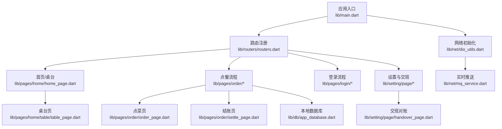

**图表来源**
- [lib/main.dart:1-159](file://lib/main.dart#L1-L159)
- [lib/routers/routers.dart:1-71](file://lib/routers/routers.dart#L1-L71)
- [lib/pages/home/home_page.dart:1-15](file://lib/pages/home/home_page.dart#L1-L15)
- [lib/pages/home/table/table_page.dart:1-200](file://lib/pages/home/table/table_page.dart#L1-L200)
- [lib/pages/order/order_page.dart:1-200](file://lib/pages/order/order_page.dart#L1-L200)
- [lib/pages/order/settle_page.dart:1-200](file://lib/pages/order/settle_page.dart#L1-L200)
- [lib/setting/page/handover_page.dart:1-200](file://lib/setting/page/handover_page.dart#L1-L200)
- [lib/net/dio_utils.dart:1-200](file://lib/net/dio_utils.dart#L1-L200)
- [lib/net/mq_service.dart:1-112](file://lib/net/mq_service.dart#L1-L112)
- [lib/db/app_database.dart:1-200](file://lib/db/app_database.dart#L1-L200)

**章节来源**
- [README.md:21-50](file://README.md#L21-L50)
- [pubspec.yaml:1-111](file://pubspec.yaml#L1-L111)

## 核心功能
本项目围绕餐饮 POS 点餐的典型业务流程展开，重点覆盖以下五大核心功能：

### 桌台管理
桌台管理是前台点餐业务的入口。桌台页负责展示区域与桌台状态，支持开台、锁台、消台、查看桌台详情、连接模式切换、主设备可达性检测、以及通过 RabbitMQ 或轮询刷新桌台状态。其设计强调：
- 首次进入时先探测连接模式，再加载数据。
- 后台恢复时立即刷新并恢复轮询。
- 订阅 MQ 推送和本地事件总线，操作后立即触发静默刷新。
- 主设备不可达时弹出检查对话框，引导切换云服务或重新连接。

该模块在代码中与 smdcapp 的行为对齐程度很高，体现了线下门店对桌台实时性和一致性的强需求。

**章节来源**
- [lib/pages/home/table/table_page.dart:1-200](file://lib/pages/home/table/table_page.dart#L1-L200)
- [lib/pages/home/home_page.dart:1-15](file://lib/pages/home/home_page.dart#L1-L15)

### 点菜下单
点菜页承担商品浏览、分类联动、购物车管理、规格/做法/临时菜、必点菜、套餐、时间价、沽清校验、促销规则、扫码等功能。其关键点包括：
- 一次性加载商品并按分类分组，滚动联动左侧分类高亮。
- 使用 Map 缓存商品数量、所属分类、分类角标，减少 O(n) 遍历。
- 对商品实时快照做短时效缓存，避免频繁请求导致价格/库存抖动。
- 结合桌台锁台事件与并发守卫，防止重复提交或重复加购。
- 支持快餐模式和正餐模式，兼容不同门店经营模式。

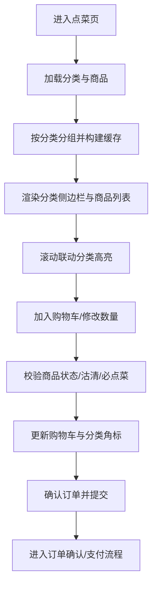

**图表来源**
- [lib/pages/order/order_page.dart:1-200](file://lib/pages/order/order_page.dart#L1-L200)

**章节来源**
- [lib/pages/order/order_page.dart:1-200](file://lib/pages/order/order_page.dart#L1-L200)

### 结账收银
结账页从订单详情页进入，负责金额汇总、支付方式选择、会员与优惠券、促销活动、抹零、暂结、打印和支付提交。其核心特性包括：
- 加载支付方式列表，支持现金、扫码、会员余额等多种方式。
- 记录已收金额与待收金额，支持多次支付组合。
- 支持整单暂结，并在正餐模式下根据开关控制。
- 支持促销活动与会员优惠重算，但限制同一时间只允许一个场景促销。
- 提交前校验桌台状态，避免结账时桌台被其他设备操作。
- 对接支付网关和打印服务，完成收银闭环。

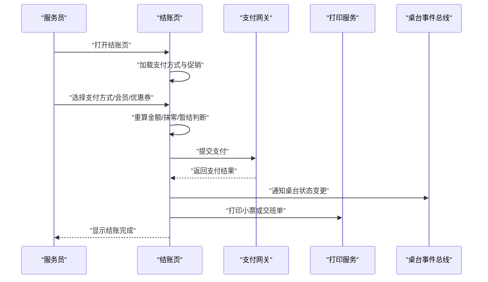

**图表来源**
- [lib/pages/order/settle_page.dart:1-200](file://lib/pages/order/settle_page.dart#L1-L200)

**章节来源**
- [lib/pages/order/settle_page.dart:1-200](file://lib/pages/order/settle_page.dart#L1-L200)

### 交班对账
交班对账用于门店交接班时的销售汇总、支付方式明细、押金统计、菜品与分类统计、以及交班单打印。其流程包括：
- 加载登录时间与当前时间，获取门店名称。
- 解析服务器返回或本地数据库中的交班数据。
- 过滤参与交班的支付方式与统计数据。
- 提交交班记录，支持本地双写与云端接口分流。
- 根据开关决定是否打印交班单。

该模块在 Web 与移动端存在平台分流：Web 走云端接口，iOS/Android 可写本地 t_sale_jkd/t_sale_jkd_detail 后再云端双写。

**章节来源**
- [lib/setting/page/handover_page.dart:1-200](file://lib/setting/page/handover_page.dart#L1-L200)

### 用户认证
用户认证模块支持普通登录与快捷登录两种模式：
- 普通登录：输入商户号、员工工号、密码。
- 快捷登录：输入手机号、密码。
- 登录前先拉取商户列表，支持多商户选择。
- 登录成功后保存 store/spid、token、设备信息等。
- 应用启动时根据 token 决定初始页面：未登录进登录页，已登录进首页。

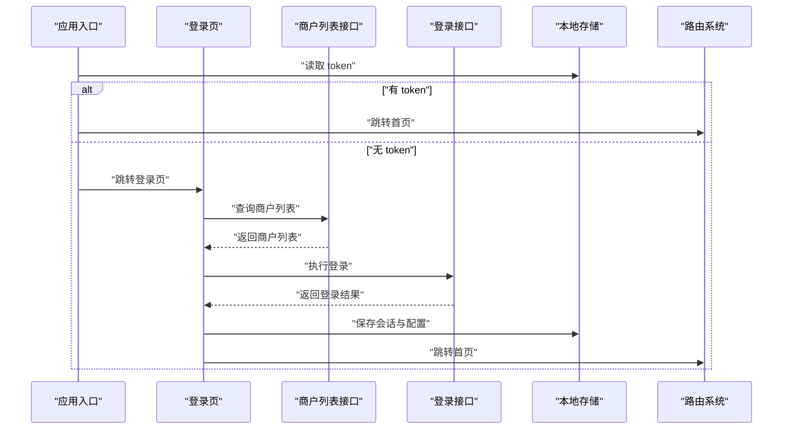

**图表来源**
- [lib/main.dart:1-159](file://lib/main.dart#L1-L159)
- [lib/pages/login/page/login_page.dart:1-200](file://lib/pages/login/page/login_page.dart#L1-L200)

**章节来源**
- [lib/main.dart:1-159](file://lib/main.dart#L1-L159)
- [lib/pages/login/page/login_page.dart:1-200](file://lib/pages/login/page/login_page.dart#L1-L200)

## 架构总览
项目整体采用“Flutter UI + Provider 状态 + Fluro 路由 + Dio 网络 + sqflite 本地库 + RabbitMQ 实时推送”的分层架构。UI 层由 pages 与 widgets 组成；业务逻辑分布在 page 与其对应的 repository、util 中；网络与实时通信集中在 net；数据持久化集中在 db；设置与公共常量集中在 setting 与 res。

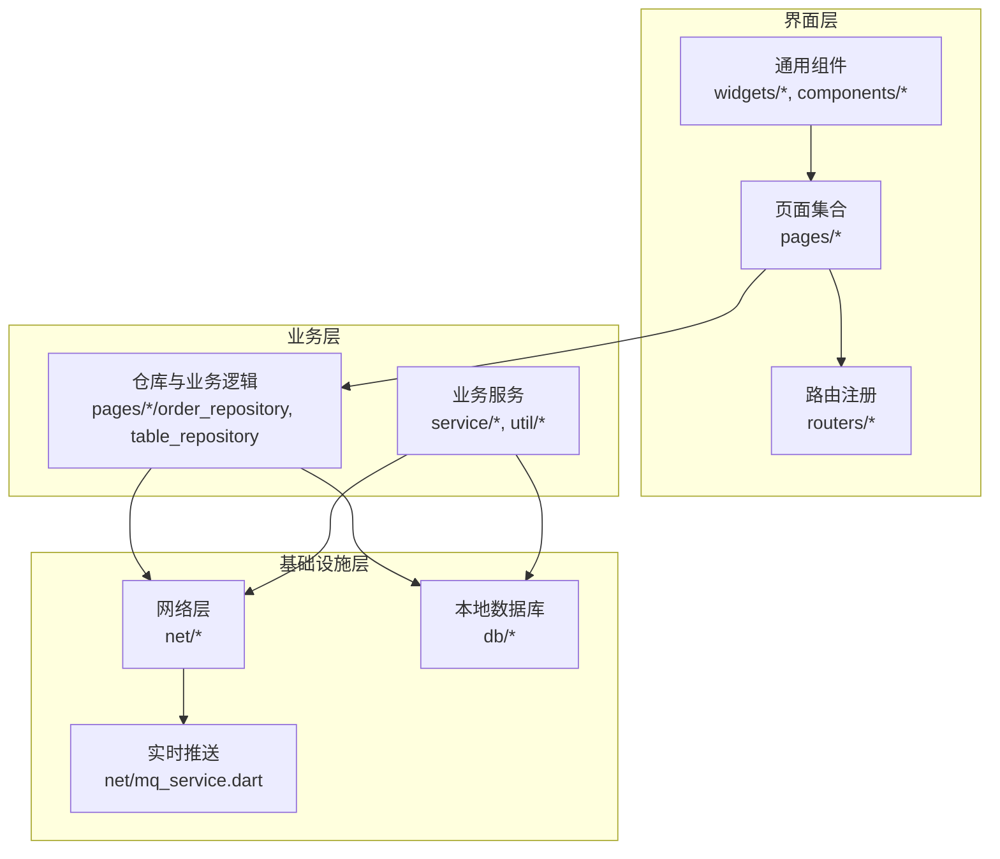

**图表来源**
- [lib/main.dart:1-159](file://lib/main.dart#L1-L159)
- [lib/routers/routers.dart:1-71](file://lib/routers/routers.dart#L1-L71)
- [lib/net/dio_utils.dart:1-200](file://lib/net/dio_utils.dart#L1-L200)
- [lib/net/mq_service.dart:1-112](file://lib/net/mq_service.dart#L1-L112)
- [lib/db/app_database.dart:1-200](file://lib/db/app_database.dart#L1-L200)

## 关键组件分析

### 应用入口与初始化
应用入口负责：
- 全局异常捕获与错误处理。
- 去除 URL hash（仅 Web）。
- 初始化 sp_util 本地存储。
- 初始化文件日志与订单日志。
- 初始化设备信息。
- 初始化 Dio 与拦截器，包括身份验证、Token 刷新、日志打印、数据适配。
- 注册路由。
- 根据 token 决定初始页面。
- 配置 MaterialApp 主题、语言、路由、未知路由处理和文字缩放策略。

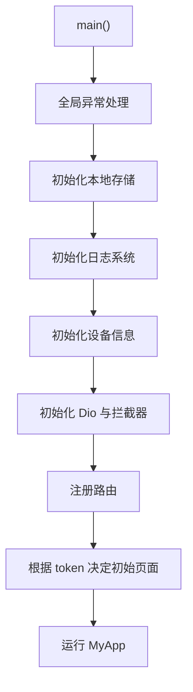

**图表来源**
- [lib/main.dart:1-159](file://lib/main.dart#L1-L159)

**章节来源**
- [lib/main.dart:1-159](file://lib/main.dart#L1-L159)

### 路由系统
路由系统以 Fluro 为核心，提供统一的 router 实例和各模块路由提供者。模块新增时只需实现 IRouterProvider 并注册到 routers.dart。项目已内置登录、设置、点餐模块的路由。

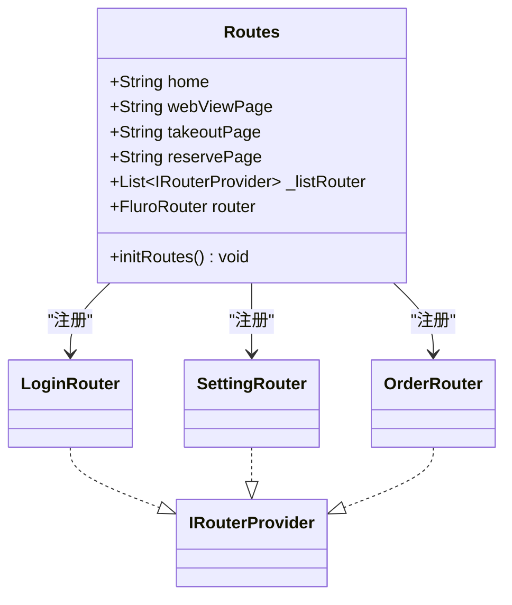

**图表来源**
- [lib/routers/routers.dart:1-71](file://lib/routers/routers.dart#L1-L71)

**章节来源**
- [lib/routers/routers.dart:1-71](file://lib/routers/routers.dart#L1-L71)

### 网络层与拦截器
网络层基于 Dio，封装了统一请求方法、超时配置、代理调试、JSON 解析、异常处理和回调分发。主要职责包括：
- 统一 BaseOptions 配置，如连接超时、接收超时、发送超时、baseUrl。
- 非 Web 平台下可按 debug 模式与特定 spid 启用抓包代理。
- 将 HTTP 响应转为 BaseEntity，统一 code/msg/data 结构。
- 大体积 JSON 使用 compute 在 isolate 中解析，降低主线程压力。
- 统一错误码与消息处理，便于上层 Toast 与业务提示。

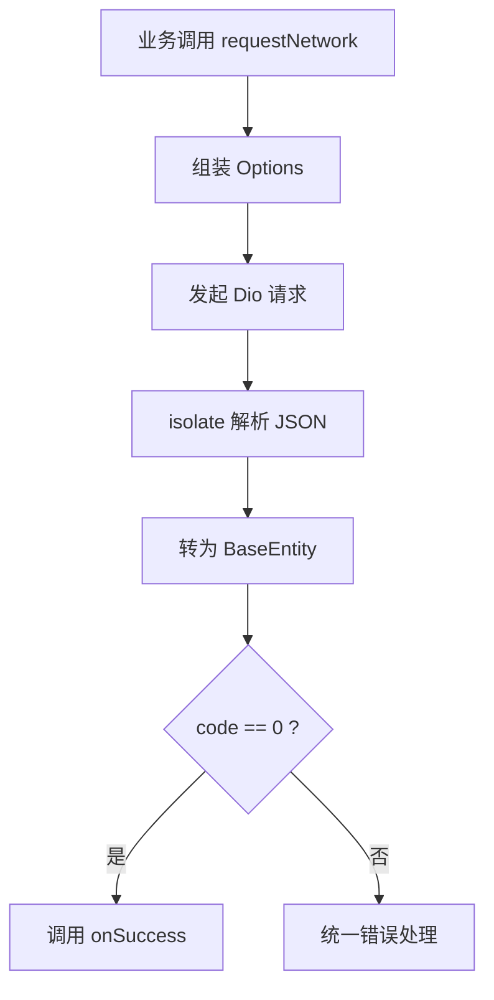

**图表来源**
- [lib/net/dio_utils.dart:1-200](file://lib/net/dio_utils.dart#L1-L200)

**章节来源**
- [lib/net/dio_utils.dart:1-200](file://lib/net/dio_utils.dart#L1-L200)

### 实时推送服务
MqService 是对 RabbitMQ 的封装，负责：
- 登录成功后连接 RabbitMQ，监听桌台变更、锁台、扫码接单、强制下线、打印通知、叫号刷新等事件流。
- 从 SpUtil 读取 host、port、account、storeCode、machNo 等参数。
- 若商户号为空则跳过连接。
- Web 平台自动跳过 dart_amqp 连接，依靠定时轮询兜底。

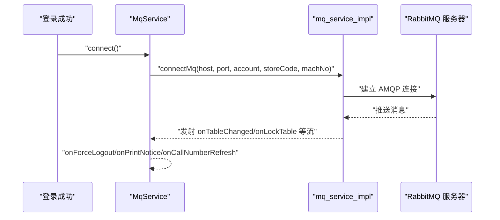

**图表来源**
- [lib/net/mq_service.dart:1-112](file://lib/net/mq_service.dart#L1-L112)

**章节来源**
- [lib/net/mq_service.dart:1-112](file://lib/net/mq_service.dart#L1-L112)

### 本地数据库
AppDatabase 是基于 sqflite 的本地数据库封装，仅在 iOS/Android 生效，Web 平台会抛出 UnsupportedError。其特点包括：
- 数据库文件名为 catering.db，版本为 3。
- 维护后端下载表与本地业务表两类表。
- 提供 queryList、queryOne、insert、batchInsert、clearAll、clearTable、checkpoint 等方法。
- 使用 PRAGMA table_info 动态获取列名，按数值类型规范空值。
- 退出登录时清空全部业务表，WAL 检查点保证日志上传前数据落盘。

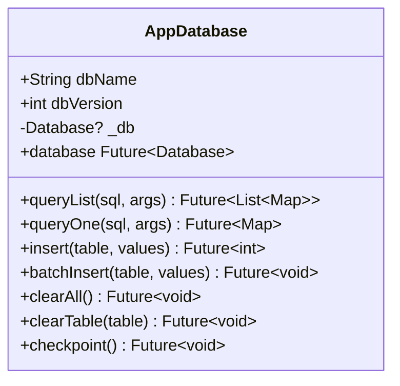

**图表来源**
- [lib/db/app_database.dart:1-200](file://lib/db/app_database.dart#L1-L200)

**章节来源**
- [lib/db/app_database.dart:1-200](file://lib/db/app_database.dart#L1-L200)

## 依赖关系分析
从 pubspec.yaml 可见，项目核心依赖包括：
- flutter、dart sdk：跨平台 UI 框架与运行时。
- dio：网络请求。
- provider：状态管理。
- fluro：路由。
- sqflite：本地数据库。
- dart_amqp：RabbitMQ 客户端。
- sp_util：轻量本地存储。
- oktoast：Toast 提示。
- device_info_plus、package_info_plus：设备与版本信息。
- mobile_scanner：条码/二维码扫描。
- cached_network_image、flutter_svg：图片与 SVG 渲染。
- archive、flutter_tts：日志压缩打包与语音播报。

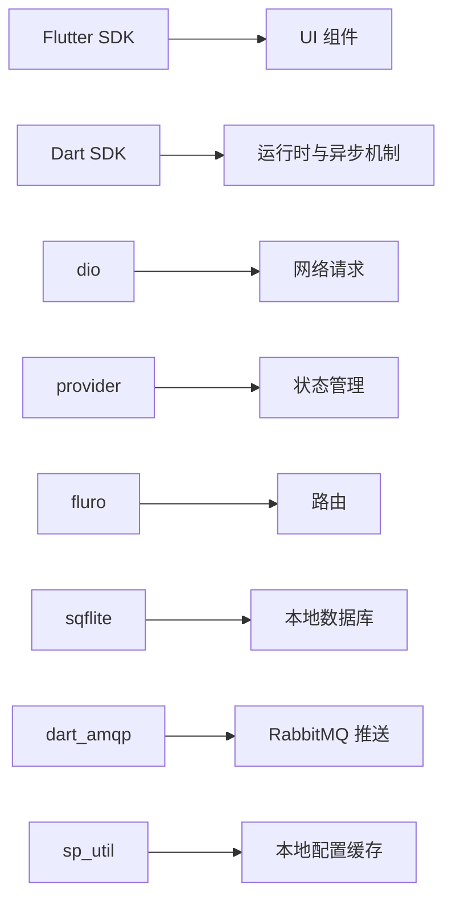

**图表来源**
- [pubspec.yaml:1-111](file://pubspec.yaml#L1-L111)

**章节来源**
- [pubspec.yaml:1-111](file://pubspec.yaml#L1-L111)

## 性能与可靠性特征
- 网络层对大数据量 JSON 使用 isolate 解析，减少主线程阻塞。
- 点菜页使用 Map 缓存商品数量与分类映射，提升加购与角标计算效率。
- 桌台页使用定时器轮询与 MQ 推送双重机制，兼顾稳定性与实时性。
- 本地数据库使用 batchInsert 批量写入，并使用 WAL 检查点确保数据一致性。
- 应用入口统一异常处理，避免崩溃后无法回收资源。
- 路由与页面生命周期管理结合 CancelToken，避免内存泄漏与无效请求。

[本节为通用性能讨论，不直接分析具体代码行]

## 快速开始指南

### 环境要求
- Flutter 版本：>= 3.19.0
- Dart SDK 版本：>= 3.4.0 < 4.0.0
- 支持 Android 与 iOS 双端部署，同时保留 Web 入口用于联调。

### 依赖安装
在项目根目录执行依赖安装命令：
- 使用 Flutter CLI 获取依赖。
- 如需清理或重新生成平台工程，可参考 Flutter 官方文档。

### 首次运行步骤
- 安装依赖后直接运行应用。
- 首次启动会根据 token 决定进入登录页或首页。
- 若需要切换主题，可在设置中心切换亮色/暗色模式。
- 若需要调整网络地址，请检查 Dio 初始化配置与拦截器 baseUrl。

### 基本配置
- 本地存储：sp_util 用于保存 token、store、spid、主题偏好等。
- 日志系统：文件日志与订单日志用于线上问题定位。
- 设备信息：设备初始化用于公共参数如 machserial。
- 路由：新增模块需实现 IRouterProvider 并在 routers.dart 中注册。
- 主题：ThemeProvider 管理主题模式，MaterialApp 使用 MultiProvider 注入。

**章节来源**
- [pubspec.yaml:1-30](file://pubspec.yaml#L1-L30)
- [README.md:11-20](file://README.md#L11-L20)
- [lib/main.dart:1-159](file://lib/main.dart#L1-L159)
- [lib/routers/routers.dart:1-71](file://lib/routers/routers.dart#L1-L71)

## 故障排查
常见问题与建议：
- 登录失败：检查网络连通性、商户号/员工工号/手机号与密码是否正确、vcode 与版本号是否匹配。
- 桌台不刷新：检查 RabbitMQ 连接参数、商户号是否为空、MQ 推送是否正常、轮询是否被禁用。
- 结账报错：检查桌台是否被锁、支付方式是否可用、促销活动是否冲突、会员余额是否足够。
- 交班失败：检查登录时间是否为空、sumdata 是否为空、支付方式过滤条件是否符合预期。
- Web 平台 MQ 不可用：Web 不支持 dart_amqp，应依赖轮询兜底或改用 Web 专用接口。
- 本地数据库异常：检查 kIsWeb 分支是否误调用 sqflite，确认表结构升级逻辑是否完整。

**章节来源**
- [lib/net/mq_service.dart:1-112](file://lib/net/mq_service.dart#L1-L112)
- [lib/pages/order/settle_page.dart:1-200](file://lib/pages/order/settle_page.dart#L1-L200)
- [lib/setting/page/handover_page.dart:1-200](file://lib/setting/page/handover_page.dart#L1-L200)
- [lib/db/app_database.dart:1-200](file://lib/db/app_database.dart#L1-L200)

## 结论
聚客美滋滋（ytt-smdc-flutter）是一个围绕餐饮 POS 点餐场景构建的 Flutter 应用，具备桌台管理、点菜下单、结账收银、交班对账和用户认证五大核心功能。项目通过 Provider 管理状态、Dio 封装网络、sqflite 提供本地数据、RabbitMQ 提供实时推送，形成稳定且可扩展的技术栈。对于新开发者，建议从 main.dart 与 routers.dart 入手，理解应用启动与路由注册；对于有经验的开发者，可重点关注 table_page、order_page、settle_page、handover_page 与 mq_service、dio_utils、app_database 的实现细节，以便在此基础上扩展新功能或优化性能。

[本节为总结性内容，不直接分析具体文件]